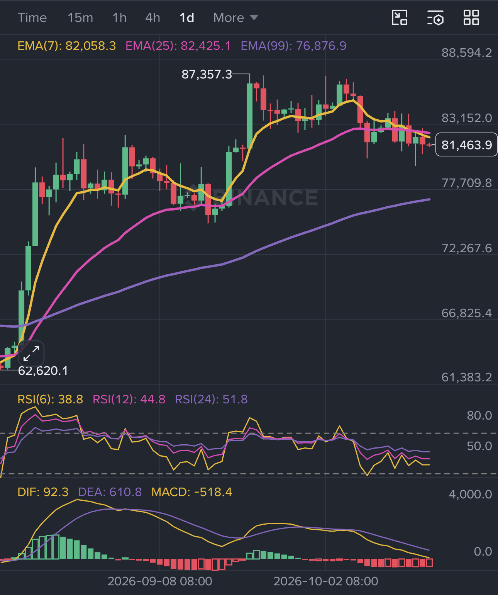
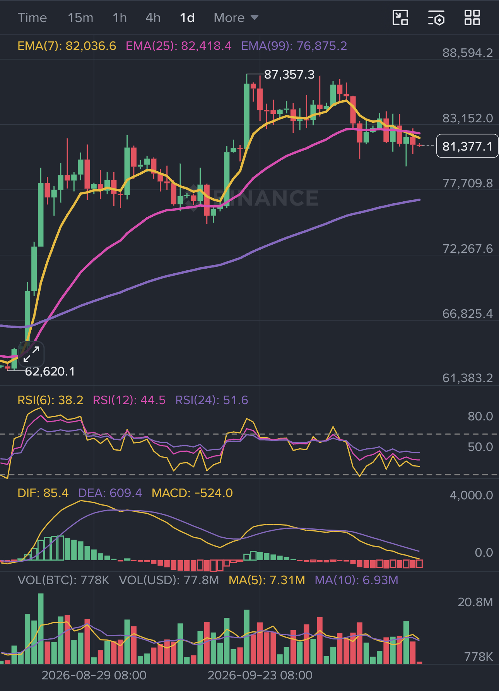
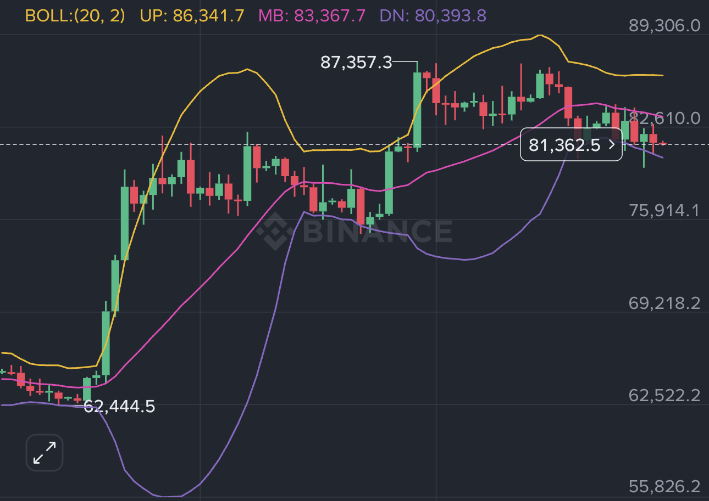
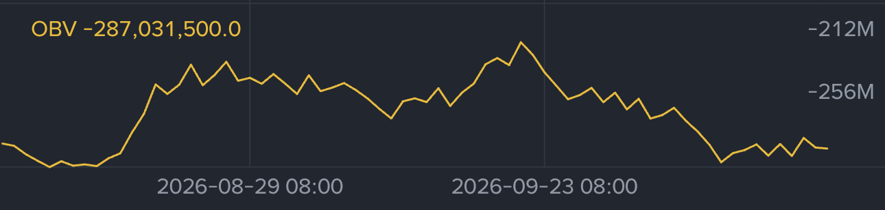
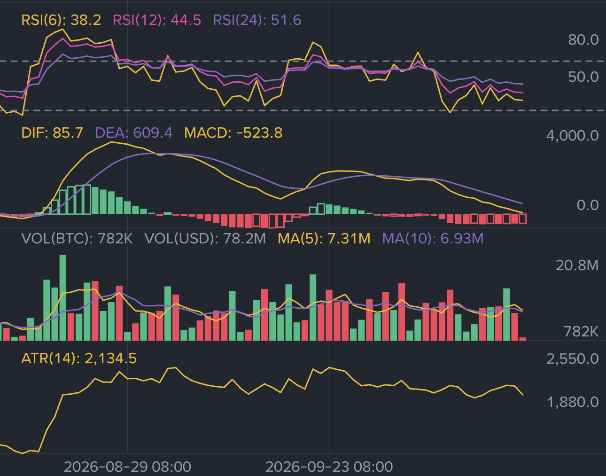

# Advanced — Combining price, volume, and indicators

Chapter 2 introduced each indicator separately. This article explains how to read them together without counting the same price movement several times. The goal is not to find a chart where every line points in the same direction. The goal is to form a conditional hypothesis, identify what would confirm it, and define what would invalidate it.

## Indicator priority

The menu contains more tools than a beginner needs. Use this order when deciding what deserves attention:

| Priority | Tools | Why |
| --- | --- | --- |
| Start here | Price structure, MA/EMA, volume, ATR | They answer direction, participation, and risk questions with relatively clear interpretations. |
| Add for momentum | MACD or RSI | They describe acceleration or weakening; choose one first because they overlap. |
| Add for a specific use | Bollinger Bands, VWAP, OBV, open interest, funding, basis | Useful when volatility, execution, volume flow, or futures positioning is the question. |
| Usually optional | SAR, KDJ, Williams %R, StochRSI | They can help a tested method, but they largely repeat trend or momentum information. |
| Check the formula first | AVL, SUPER, L.S Account, L.S Position, L.S Ratio, B.S Vol | Names and calculations vary by platform, market, and data sample. |

The short list is not a ranking of profitable signals. It is a learning order that reduces duplicated information and makes it easier to understand why a decision was made.

## Do traders really need many indicators?

Usually, no. A trader does not become more accurate by filling the chart with more panels. Most indicators are different calculations of the same price and volume data, so adding five momentum indicators can create the appearance of agreement without adding five independent reasons. A practical beginner setup can be enough: **price structure for direction, one moving-average tool for trend, volume for participation, and either RSI or MACD for momentum**. ATR can then help adjust the stop distance and position size.

Add another indicator only when it answers a question that the current tools cannot answer. For example, use Bollinger Bands when volatility compression or expansion matters, or open interest and funding when you are studying crowded perpetual-futures positions. Before adding it, state the question in one sentence and decide what observation would change your view. If a new indicator only repeats “momentum is strong,” it probably adds visual clutter rather than useful evidence. A simple chart that you understand and can test is more valuable than a crowded chart that appears precise.

## Full indicator reference

The table below explains the indicators shown in the Binance-style menu. Use it as a reference after you understand the smaller beginner set in Chapter 2.

**Naming note:** *Parabolic SAR* is the full indicator name. **SAR** means **Stop and Reverse**; “Parabolic” describes the way the stop reference follows price and is not part of the acronym.

| Indicator (full name) | What question does it answer? | Simple example | Priority and main limit |
| --- | --- | --- | --- |
| **MA — Moving Average / EMA — Exponential Moving Average** | Is the market generally rising, falling, or sideways? | Price holds above a rising average during pullbacks. | **Core.** It lags and crosses falsely in ranges. |
| **MACD — Moving Average Convergence/Divergence** | Is momentum accelerating, weakening, or crossing between bullish and bearish conditions? | A rising histogram supports strengthening momentum; a crossover in a range may fail. | **Core momentum tool.** It is derived from price and lags. |
| **RSI — Relative Strength Index** | Are recent gains or losses stronger, and is momentum becoming extreme? | RSI falls while price makes a higher high: momentum may be weakening. | **Core momentum tool.** High RSI can persist in a strong trend. |
| **VOL — Volume** | How much was traded during each candle? | A breakout with clearly higher volume has stronger participation evidence. | **Core confirmation tool.** It does not reveal intent by itself. |
| **ATR — Average True Range** | How large are recent moves, whether up or down? | Use a larger normal-movement estimate to avoid placing a stop inside ordinary noise. | **Core risk tool.** It measures movement, not direction. |
| **BOLL — Bollinger Bands** | Is volatility expanding or contracting around an average? | Bands narrow during a quiet range and widen when movement expands. | **Useful.** A band touch is not automatically a reversal. |
| **OBV — On-Balance Volume** | Is cumulative volume flowing more on rising or falling candles? | Price makes a new high while OBV does not: participation may be lagging. | **Useful supplement.** It depends on close direction and venue data. |
| **VWAP — Volume-Weighted Average Price / Volume Profile** | What price was most important based on traded volume? | Price holding above VWAP can show buyers accepting prices above the period average. | **Useful for context.** Settings and session boundaries matter. |
| **SAR — Parabolic SAR (Stop and Reverse)** | Where might a trend-following stop move as the trend develops? | Dots stay below price in an uptrend and may flip above it after a decline. | **Optional.** It flips repeatedly in sideways markets. |
| **KDJ — stochastic K, D, and J lines** | Where is the close within its recent high-low range, and is short-term momentum turning? | K crossing below D in a range can warn of a short-term pullback. | **Optional.** It overlaps with RSI. |
| **WR — Williams %R** | Is the latest close near the top or bottom of its recent range? | A reading near the top of a range shows strong recent closes, not a guaranteed reversal. | **Optional.** It is closely related to stochastic oscillators. |
| **StochRSI — Stochastic RSI** | Is RSI itself near the top or bottom of its recent range? | A fast turn can flag a short-term momentum change, but may reverse again. | **Optional and noisy.** It can over-signal. |
| **AVL — Average Volume Line** | Is current volume above or below its recent average? | A volume bar well above the AVL line suggests unusually active trading; it does not reveal whether buyers or sellers will win. | **Optional supplement.** The label and calculation can vary by platform or setting. |
| **SUPER — Supertrend** | Is price currently on the bullish or bearish side of a volatility-based trend reference? | A line flipping below price can support a bullish trend-following view; a flip can also happen repeatedly in a range. | **Optional.** It is a lagging trend tool, not a prediction. |
| **O.I. — Open Interest** | Are outstanding futures contracts growing or shrinking? | Price rises while open interest rises: new leveraged positions may be entering. | **Advanced futures data.** It does not show long or short direction alone. |
| **L.S Ratio — Long/Short Ratio** | How large is the platform's measured long-versus-short imbalance? | An extreme ratio can show crowding, but does not say when price will reverse. | **Advanced.** Formula and sample can differ. |
| **L.S Account / L.S Position — Long/Short accounts or positions** | Is the imbalance coming from many accounts or from larger position sizes? | A small number of large positions can produce a different risk picture from many small accounts. | **Advanced.** Labels vary across platforms. |
| **B.S Vol. — Buy/Sell Volume** | Which side appears to be trading more aggressively? | A buy-volume surge during a breakout can support participation, but classification may be estimated. | **Advanced.** It is venue-specific. |
| **Basis — futures minus spot price** | Is the futures market trading above or below the spot market? | A widening positive basis can show a futures premium, often alongside stronger leverage demand. | **Advanced futures data.** It changes with expiry, funding, and liquidity. |

## 1. Start with price structure

Begin with the candles before opening the indicator panels. Mark the meaningful swing highs and lows, support and resistance zones, and the current regime: trend, range, or transition. A long setup has a different meaning in an established HH/HL uptrend than it does in the middle of a range.

Price structure is the anchor because every indicator is derived from market data. If an indicator suggests strength while price keeps making lower highs and lower lows, the conflict deserves attention rather than an automatic trade.

## 2. Use moving averages for direction

Use a small number of averages to describe the trend. A rising MA(25) with price holding above it can support a bullish context; a falling MA(25) with price below it can support a bearish context. A slower MA(99) can provide the broader reference. Alignment such as `EMA(7) > EMA(25) > EMA(99)` is more meaningful when the lines slope and price structure agrees.

Moving averages are delayed. They are useful as trend filters and dynamic reference zones, but they are weak evidence when the lines are flat and tangled. A crossover is a change in the recent average, not proof that a new trend must continue.

## 3. Use MACD and RSI for momentum

The detailed MA and MACD foundations are already covered in [Advanced — Moving-average and momentum tools](moving-average-and-momentum.md). The screenshot below is the latest RSI view used in this article. We begin with RSI, then combine its evidence with MACD and price structure. MACD compares moving averages and shows whether recent momentum is strengthening or weakening. RSI shows the balance of recent upward and downward movement on a 0–100 scale. Neither indicator predicts the market by itself.

### 3.1 RSI lookback periods: RSI(6), RSI(12), and RSI(24)

The number in an RSI label is the number of completed candles used in its lookback window. On a daily chart, RSI(6) uses roughly six days of gains and losses, RSI(12) uses roughly twelve days, and RSI(24) uses roughly twenty-four days. They are three speeds of the same gauge, not three separate markets:

| Line | What it reacts to | Useful question | Main limitation |
| --- | --- | --- | --- |
| **RSI(6)** | The most recent price changes | Has short-term momentum just weakened or turned? | It moves quickly and can produce noise. |
| **RSI(12)** | The recent swing | Is the current move becoming stronger or weaker over several weeks? | It reacts later than RSI(6). |
| **RSI(24)** | The broader recent trend | Is the larger daily momentum still healthy? | It can hide a fast reversal. |

When the short line is above the longer lines, recent gains are stronger than the older part of the window. When it falls below them, recent losses are becoming more influential. If all three rise together, momentum is broadening across several windows. If RSI(6) falls first while RSI(24) stays high, the chart may be showing a short-term pullback rather than a complete trend change. If all three fall and remain below 50, the weakness is broader.

The familiar 70 and 30 levels are reference zones, not automatic sell and buy buttons. In a strong trend, RSI can remain above 70 or below 30 for a long time. The 50 level is also useful: sustained readings above 50 often fit a bullish regime, while sustained readings below 50 fit a bearish one. Always compare RSI with price structure, support and resistance, volume, and the timeframe. Binance’s [RSI reference](https://www.binance.com/en/square/post/43083) describes the 0–100 calculation, the standard 14-period setting, and why extreme readings are not standalone reversal signals.

#### Reading the supplied BTC daily snapshot

The latest screenshot shows BTC at **81,463.9**. The daily panel reports **EMA(7) = 82,058.3**, **EMA(25) = 82,425.1**, and **EMA(99) = 76,876.9**. RSI reads **RSI(6) = 38.8**, **RSI(12) = 44.8**, and **RSI(24) = 51.8**. The ordering `RSI(6) < RSI(12) < RSI(24)` means that the newest daily price action is weaker than the older part of each lookback. RSI(6) and RSI(12) are below 50, while RSI(24) is only slightly above it: short-term momentum is weak, but the longer daily reading has not entered a clearly bearish zone.

The MACD panel adds a bearish momentum signal: **DIF = 92.3**, **DEA = 610.8**, and **MACD = -518.4**. DIF is below DEA and the histogram is negative, so recent momentum is still losing strength. The price is also below EMA(7) and EMA(25), and EMA(7) is below EMA(25). These observations show that the pullback is real rather than just a one-candle dip. At the same time, price remains well above the rising EMA(99), so the broader daily structure has not yet confirmed a full bearish trend.

The most balanced conclusion is **a pullback within a previously bullish daily trend, with an early warning that the trend may be weakening**. It is too early to call this a confirmed downtrend. A recovery above the short averages, RSI(6) and RSI(12) reclaiming 50, and DIF turning back above DEA would support a resumption of the bullish trend. A sustained close below the recent higher low, continued negative MACD, and RSI(24) falling below 50 would make a deeper trend transition more likely. This is a chart reading, not a guaranteed forecast.

This screenshot is a fixed daily-chart snapshot, not a live trading signal. The values can change as the current candle develops, and the quote may differ from the screenshot after the capture time.

MACD and RSI are related evidence because both use price history. If both turn bullish, describe it as stronger momentum evidence, not two independent votes. Divergence can warn that momentum is no longer keeping pace with price, but it can persist during a strong trend.

## 4. Use volume to test participation

Volume asks whether the move attracted activity. A resistance breakout with a close above the level and a clear volume increase is more credible than a thin wick above resistance. A price rally on falling volume may still continue, but it deserves more caution. A volume spike after a liquidation or headline can represent forced trading rather than healthy trend participation.

Volume must be interpreted with the candle and location. High volume at resistance can mean acceptance above the level or aggressive selling into the breakout. The next candle and pullback help distinguish those possibilities.

#### Reading the updated BTC volume snapshot

The newer screenshot shows BTC near **81,377.1**. The volume panel displays **VOL(BTC) = 778K**, **VOL(USD) = 77.8M**, **MA(5) = 7.31M**, and **MA(10) = 6.93M**. The bars alternate between green and red and the recent bars do not make a new high comparable with the large participation seen during the earlier breakout. That pattern describes two-sided trading without a clear expansion of fresh participation. The latest bar is also from an unfinished daily candle, so its final volume can still change.

The updated momentum readings are **RSI(6) = 38.2**, **RSI(12) = 44.5**, **RSI(24) = 51.6**, **DIF = 85.4**, **DEA = 609.4**, and **MACD = -524.0**. Compared with the previous snapshot, the short RSI readings have weakened slightly and MACD remains negative with DIF below DEA. These readings confirm the earlier warning rather than provide a new bullish signal. A stronger bearish conclusion would need sustained selling volume, a break of the recent higher low, RSI(24) below 50, and continued negative MACD.

#### Bollinger Bands in the same BTC snapshot

The Bollinger panel shows **BOLL(20, 2)**: an upper band at **86,341.7**, a middle band at **83,367.7**, and a lower band at **80,393.8**. BTC near **81,362.5** is below the middle band but still above the lower band. In everyday language, price has moved into the lower half of its recent 20-day range, but it has not yet broken the lower volatility boundary. The bands are no longer expanding sharply at the right edge, so this looks more like a pullback and cooling volatility than a confirmed downside breakout. Bollinger Bands do not say “buy at the lower band”; price can ride a band during a strong trend.

#### OBV and participation

The OBV reading is **-287,031,500**, and the line has generally declined from its late-September high while price has also moved lower and failed to make a fresh high. OBV adds participation evidence: more recent down closes have outweighed up closes in the cumulative series. That supports the idea that the pullback has not attracted strong new buying. OBV is not a direct count of all buying and selling, however; it assigns the whole period's volume according to whether the close rose or fell, so it should be read with the actual volume bars and price structure.

Taken together, Bollinger Bands and OBV support, but do not prove, the earlier conclusion: **BTC is in a weakening pullback within a broader bullish daily structure, with no clear volume-backed recovery yet**. The view would improve if price reclaimed the Bollinger middle band, RSI recovered above 50, MACD turned upward, and OBV stopped falling. A decisive close below the lower band with expanding volume would be stronger evidence of a deeper bearish transition.

## 5. Add volatility and derivatives context

ATR estimates the size of recent price movement and helps decide whether a stop is inside ordinary noise. It does **not** tell you whether the next move will be up or down. On a daily chart, `ATR(14)` uses the true ranges of the latest 14 daily candles. A true range is the largest of the current high-to-low move and the distance from the previous close to the current high or low. The platform then smooths those values into one average.

#### Reading the ATR value in the supplied BTC snapshot

The screenshot shows **ATR(14) = 2,134.5** on a daily BTC chart. In this context, the value is approximately **2,134.5 USDT of typical daily movement**, not a target price and not a prediction. With BTC near 81,000 USDT, that is roughly **2.6% of the price**. It gives a scale for ordinary movement: a stop only a few hundred dollars away could be inside normal daily noise, while a stop several ATRs away would allow much more room but would require a smaller position to keep the same risk.

The ATR line is not making a strong new high or low in this screenshot. That means recent daily volatility is broadly stable, with a slight easing at the right edge; it does **not** mean that price is stable or that the market has chosen a direction. A flat ATR can occur while BTC trends, ranges, or changes direction. Use price structure, volume, MACD, and RSI to judge direction; use ATR to adjust stop distance and position size. Binance’s [Average True Range explanation](https://academy.binance.com/en/articles/what-is-average-true-range) describes ATR as a volatility measure that does not indicate direction. TradingView’s [ATR reference](https://www.tradingview.com/support/solutions/43000501823-average-true-range-atr/) explains true range, the common 14-period setting, and why a rising or falling ATR should not be read as bullish or bearish by itself.

For perpetual futures, open interest shows whether outstanding positions are growing or shrinking, while funding indicates which side is paying the other. These measures can reveal crowded leverage, but they are venue-specific and do not identify the next price move by themselves.

## 6. A complete BTC example

Suppose BTC is testing resistance after a daily HH/HL sequence. On the 4-hour chart, price closes above resistance, EMA(7) is above EMA(25), MACD crosses above its signal line, the histogram expands, and volume is clearly above its recent average. ATR is elevated, so the position must be smaller and the stop wider than usual. This is a coherent bullish hypothesis because structure, trend, momentum, participation, and volatility tell a consistent story.

Now change one fact: price closes above resistance, but volume is weak, MACD histogram is shrinking, and the next candle closes back inside the range. The same breakout should now be treated as a possible false break. The indicators did not fail; the evidence never confirmed acceptance above resistance.

## 7. When indicators disagree

Conflicting evidence is normal. Price may be above a rising MA while MACD weakens and volume falls. That can mean a healthy pause, a trend losing energy, or a transition that has not resolved. Do not force agreement by changing settings until the chart looks clear.

Record the conflict explicitly:

- **Structure:** what are the latest swing points?
- **Trend:** what are the relevant averages doing?
- **Momentum:** is MACD or RSI strengthening or fading?
- **Participation:** is volume confirming the move?
- **Risk:** where is the idea invalidated, and how large is normal movement?

If the answers do not produce a clear, testable condition, waiting is a valid decision.

## 8. A MACD signal that fails

In a sideways BTC range, DIF can cross above DEA and the histogram can turn green while price remains below resistance. If volume does not expand and the next candles fail to hold above the moving average, the bullish signal can disappear quickly. DIF then crosses back below DEA and the histogram returns toward zero or turns negative.

This is not a contradiction. MACD measured a short-lived change in momentum; it did not promise a trend. The failure teaches three things: crossovers work poorly in ranges, volume and structure provide necessary context, and a signal should have an invalidation rule before it is traded.

## 9. What a combined analysis can and cannot do

A combined reading can improve the quality of a hypothesis and help with timing, risk distance, and position size. It cannot reveal private information, prevent sudden news, or guarantee execution. Indicators are compressed descriptions of past trades. The durable skill is learning when the evidence is aligned, when it conflicts, and when the safest conclusion is that no trade is justified.

For the individual calculations and naming differences, see [Advanced — Moving-average and momentum tools](moving-average-and-momentum.md), [Binance’s MACD explanation](https://www.binance.com/en/academy/articles/macd-indicator), and [TradingView’s MACD reference](https://www.tradingview.com/support/solutions/43000502344-macd-moving-average-convergence-divergence/).
