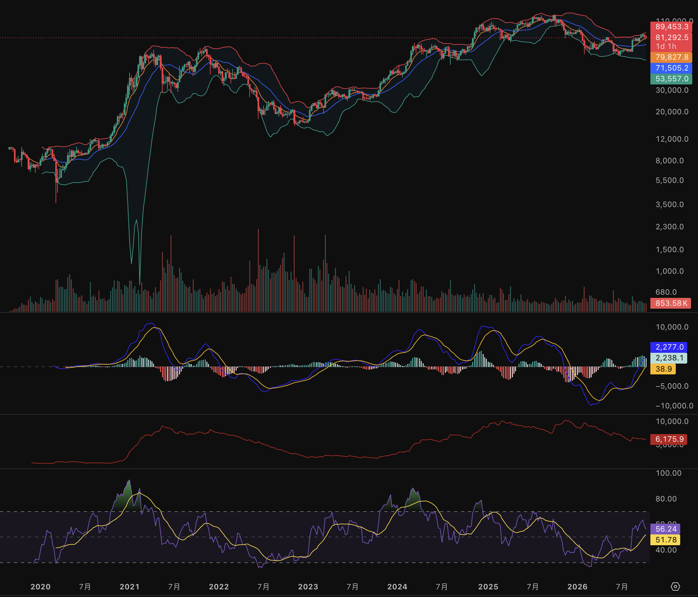
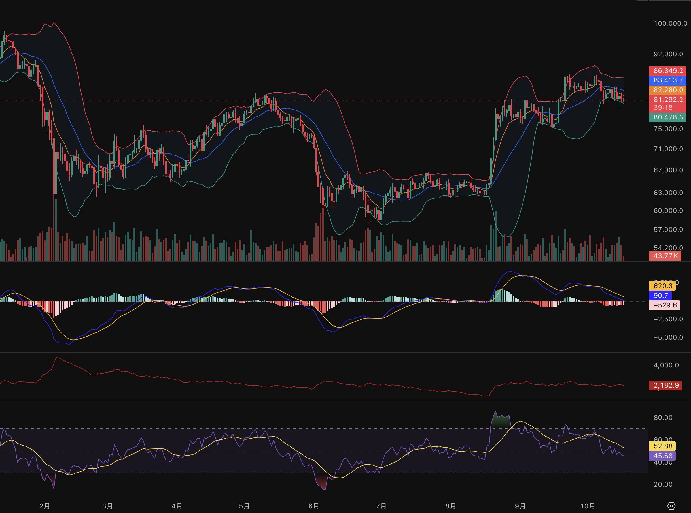

# Advanced — How to Identify a Market Trend

Before following a trend, define what “trend” means. A trend is not a feeling that the chart looks strong. It is a sequence of price movements that continues to support one direction on a chosen timeframe.

## 1. Start with the timeframe

There is no single trend that applies to every chart. BTC can be rising on the weekly chart, moving sideways on the daily chart, and falling on the 15-minute chart at the same time.

Use a top-down order:

1. **Weekly:** the broad environment and major cycle direction.
2. **Daily:** the main trend used for a swing or position decision.
3. **4-hour:** the working trend and possible entry structure.
4. **15-minute or lower:** execution detail, not the main market direction.

For a beginner, the daily chart should usually decide whether a BTC spot position is allowed. The 4-hour chart can improve the entry. A 5-minute chart can show a temporary move against the daily trend, but it should not overrule the daily structure by itself.

## 1.1 How much history should you inspect?

The right amount depends on how long you expect to hold the position. A useful beginner default is:

| Chart interval | History to inspect | Main job |
| --- | --- | --- |
| **1w** | At least 1–2 years; use more when studying a full market cycle | Identify the broad cycle, major support and resistance, and whether the market is broadly rising, falling, or ranging |
| **1d** | About 3–6 months for a swing decision; check 1 year when major levels are unclear | Decide the working trend and the important HH/HL or LH/LL structure |
| **4h** | About 2–8 weeks; extend to 3 months when the structure is crowded or unclear | Plan a pullback, breakout, or invalidation level inside the daily context |
| **15m** | About 1–3 trading days | Refine execution and observe a local entry pattern; do not use it to define the main trend |

These are starting ranges, not laws. Make sure the chart contains enough candles for the tools you use. For example, EMA(99) needs at least 99 completed candles before its reference is meaningful: that is roughly 99 days on a daily chart, about 16.5 days on a 4-hour chart, and about 24.75 hours on a 15-minute chart. A longer history is still useful because it shows the level and the trend in context.

If the holding plan is several weeks, the daily chart should carry more weight than the 15-minute chart. If the plan is a short intraday trade, the 15-minute chart can guide the entry, but the trader should still check the 4-hour or daily context before assuming the move has room to continue. More candles do not automatically mean more accuracy; the timeframe must match the decision being made.

## 1.2 Match the timeframe to the trading pace

Do not choose a chart interval by asking how many trades you should force into a day. Choose the interval that matches the time you can watch the market and the length of the move you want to capture.

| Style | Main charts | Typical pace | Main cost |
| --- | --- | --- | --- |
| **Intraday trading** | 15m and 1h | Several decisions in a day | More noise, fees, screen time, and emotional pressure |
| **Swing trading** | 4h and 1d | Often zero to a few trades in a week | You may miss some short moves and must hold through overnight volatility |
| **Position trading** | 1d and 1w | A few decisions per month | Stops are wider and a thesis can take weeks or months to play out |

For a beginner trading BTC spot, a 4-hour and daily combination is usually the most practical starting point: the daily chart defines the environment, and the 4-hour chart provides an entry without demanding constant monitoring. A 15-minute chart can refine that entry, but it should not create a reason to trade more often. If no valid setup appears, zero trades is a correct result.

## 1.3 A top-down process: environment, opportunity, entry

The three charts answer different questions. Do not use the 15-minute chart to decide whether the daily market is bullish.

### Daily: decide the environment

Start with the last several months of daily candles. Mark the important swing highs and lows, then classify the chart:

- **Bullish environment:** price is making HH and HL, the latest important HL is holding, and price is not immediately rejecting a major resistance level.
- **Bearish environment:** price is making LH and LL, rallies fail below important prior highs, and the latest important low is under pressure.
- **Range or unclear:** price is between clear boundaries or the recent break has no follow-through.

Use EMA, MACD, RSI, VOL, BOLL, and ATR to describe the context. For example, a rising EMA(25), positive MACD momentum, and expanding volume can support a bullish daily hypothesis. They cannot overrule a daily close that breaks the structure the hypothesis depends on.

The daily chart should answer: **Am I mainly looking for long setups, protecting capital, or waiting?** It should not answer the exact entry price.

### 4-hour: find a tradeable opportunity

Only after the daily environment is clear, inspect the 4-hour chart. Look for a setup that fits the daily direction:

1. **Pullback:** price returns to a prior breakout level, support zone, or rising EMA and begins to hold.
2. **Breakout:** price closes above a meaningful 4-hour resistance level, preferably with stronger-than-usual volume.
3. **Structure confirmation:** after the pullback, price forms a 4-hour HL and then breaks the nearby swing high.

Define the level that must hold before thinking about entry. If BTC breaks daily resistance but the 4-hour candles close back inside the old range, the opportunity is invalid or needs more evidence. The 4-hour chart should answer: **Is there a defined setup with a clear invalidation point and acceptable risk?**

### 15-minute: refine the entry

Use the 15-minute chart only after the 4-hour setup exists. It can help reduce entry distance or avoid buying during a fast spike:

- wait for a small 15-minute range or pullback to hold the 4-hour level;
- look for a close back in the planned direction, rather than entering on a wick;
- place the stop where the 4-hour or daily idea is invalidated, not at an arbitrary 15-minute noise point;
- skip the trade if the 15-minute signal requires a much wider stop or contradicts the higher-timeframe setup.

The 15-minute chart should answer: **Has the planned level produced a usable trigger now?** It cannot turn a bearish daily environment into a bullish one. A 15-minute bullish pattern inside a daily downtrend is usually a short-lived countertrend move unless the higher timeframe also changes.

### Example

Suppose BTC is making daily HH and HL, and the daily EMA(25) is rising. On the 4-hour chart, BTC breaks 70,000, pulls back to 70,000, and holds above it while volume remains healthy. On the 15-minute chart, price forms a small HL and closes above the local swing high. The daily chart supplied the environment, the 4-hour chart supplied the opportunity, and the 15-minute chart supplied the trigger. If the 4-hour candle later closes back below 70,000, the original trade idea is weakened even if the 15-minute chart briefly turns upward again.

## 2. Define the trend from price structure

An upward trend normally creates **higher highs (HH)** and **higher lows (HL)**. A downward trend normally creates **lower highs (LH)** and **lower lows (LL)**. A range has no reliable sequence because price keeps returning between boundaries.

Use meaningful swings rather than every tiny wick. A swing high or low should be visible on the selected timeframe and followed by a real reaction. A wick shows where price briefly traded; a candle close shows where that timeframe finished. For a breakout, give more weight to a close beyond the level and to whether the next pullback holds.

Example: BTC makes a daily high at 70,000, pulls back to 66,000, then closes above 70,000 and later holds 70,000 as support. That is stronger evidence of an upward structure than a single wick at 70,500 that closes back inside the range.

## 3. Classify the market before choosing a strategy

| State | What to look for | Practical response |
| --- | --- | --- |
| **Uptrend** | Repeated HH and HL; pullbacks hold above important prior lows | Look for planned pullbacks or confirmed breakouts |
| **Downtrend** | Repeated LH and LL; rallies fail below important prior highs | Avoid aggressive spot buying; preserve capital |
| **Range** | Price moves between clear boundaries without a lasting HH/HL or LH/LL sequence | Wait for a confirmed break or use a separately tested range rule |
| **Unclear** | Conflicting timeframes or a recent break without follow-through | Reduce size or wait |

One higher high does not automatically create a bull trend, and one lower low does not automatically create a bear trend. Ask whether the next pullback or rally confirms the new structure.

## 4. Use seven tools to ask different questions

The price chart should lead. The indicators in [Advanced — Moving-average and momentum tools](moving-average-and-momentum.md) and [Advanced — Combining price, volume, and indicators](combining-indicators.md) help test the idea formed from price structure:

| Tool | Question it helps answer | Starting weight in a trend reading |
| --- | --- | ---: |
| **K-lines and structure** | Are buyers and sellers making HH/HL, LH/LL, or a range? | **35%** |
| **EMA** | Is price direction supported by a smooth short, medium, and long trend reference? | **15%** |
| **VOL (volume)** | Did enough participation appear to support the move? | **15%** |
| **MACD** | Is directional momentum strengthening or weakening? | **10%** |
| **RSI** | Is recent upward or downward pressure strong, neutral, or diverging? | **10%** |
| **BOLL (Bollinger Bands)** | Is volatility expanding, contracting, or pressing against a band? | **8%** |
| **ATR (Average True Range)** | How large are recent moves, and can the planned stop survive normal noise? | **7%** |

These percentages are a thinking aid, not a score that can prove a trade. K-lines and structure receive the largest share because every other tool is calculated from market data and reacts after price has moved. EMA and MACD overlap because both use moving averages; RSI also uses price history. Agreement among them is useful, but it is not three independent votes.

### What weight should analyst price targets receive?

Long-term targets such as “BTC could reach 250,000” are scenario opinions, not chart evidence. They can help a reader think about possible upside, but they do not tell us when to enter, where to place a stop, or whether the current trend is intact. A major bank changing a target from 300,000 to 150,000 after market conditions change is a useful reminder that the number is conditional, not a fact; [Bloomberg reported such a revision in 2025](https://www.bloomberg.com/news/articles/2025-12-09/bitcoin-bulls-standard-chartered-bernstein-pare-back-most-ambitious-forecasts).

For a short-term or swing trade, give an analyst target **0% weight** in the entry decision. For a multi-month allocation plan, it may provide a **small background weight, roughly 0–5%**, only after you record the forecast date, time horizon, assumptions, base case, and downside case. Do not treat the absence of a 40,000 forecast as evidence that 40,000 is impossible. Analysts who publish upside targets are a selected group, and bullish targets receive more attention than quiet or wrong forecasts. Use the target to define scenarios; use price structure, participation, volatility, and a risk limit to make the decision.

Change the emphasis with the situation:

- **Breakout:** give more attention to the closing candle, follow-through, and VOL; reduce the importance of RSI because RSI can remain high during a strong rise.
- **Established trend:** give more attention to EMA slope, pullback behavior, and MACD; use RSI mainly to detect a loss of momentum rather than to sell automatically.
- **Range:** give more attention to BOLL and RSI near the range boundaries; reduce the weight of EMA crossovers and MACD because they can flip repeatedly.
- **Risk planning:** give ATR more attention when setting the stop and position size. ATR describes movement size, not direction.
- **Unusual news or liquidation:** reduce confidence in every indicator. A chart calculation cannot know an event before it reaches the market.

A practical reading separates three steps:

1. **Observation:** BTC has made two daily HHs and the latest pullback held above the prior HL; EMA(25) is rising; breakout volume is above its recent average.
2. **Interpretation:** the daily structure is bullish and the breakout has reasonable participation, while the indicators support rather than create that conclusion.
3. **Decision:** wait for a defined entry, stop, and position size. If the next daily candle closes back inside the range, the bullish hypothesis is weakened or invalidated.

## 5. Example: weekly environment and daily condition

The weekly chart shows the full BTC history in the screenshot. It is useful for locating the current move inside the larger cycle, but it should not be used to postpone every decision until a new all-time high appears. We need a defined horizon: for a position held for weeks or months, the recent one-to-two-year weekly structure matters more than the entire history.

On this chart, BTC remains far above the major 2022 low and has recovered from the recent low near the 60,000 area. Weekly RSI is around **56.34**, above its smoother line near **51.79** and above the neutral 50 area. The weekly MACD lines have turned upward and the histogram is positive near the right edge. Those observations support a **weekly recovery or bullish environment**.

They do not prove that a new long-term bull cycle is already established. Price is still below the later peak near 120,000, and the chart has not yet shown a new weekly HH above that peak. Weekly volume at the right edge is also much lower than the largest historical expansion. A precise conclusion is therefore: **the long-term structure is recovering and currently constructive, but continuation still needs confirmation**.

The lower recent bars need careful interpretation. This panel is the volume for the selected symbol and data source, not a complete measure of every BTC trade worldwide. The 2021–2023 period included exceptional retail speculation, altcoin activity, leverage, and liquidation waves, which created unusually large bursts. Later activity can also be distributed across spot ETFs, regulated futures, OTC transactions, and other exchanges rather than appearing in one crypto venue's weekly bars. The launch of US spot Bitcoin ETFs changed how institutions could obtain exposure; the [Banque de France's review](https://www.banque-france.fr/en/publications-and-statistics/publications/institutional-investments-crypto-exchange-traded-funds-rise) documents that institutional ETF holdings grew during 2024. Treat the visible volume as evidence about participation in this chart, not as proof that total Bitcoin participation has fallen.

The daily screenshot gives the shorter-term condition inside that weekly environment. BTC rose from roughly 63,000 to the 85,000–87,000 area, then stopped making new highs and pulled back toward **81,280**. Daily MACD is negative, with DIF below DEA and a histogram near **−530.4**. RSI is around **45.64**, below its smoother line near **52.88**, while volume has not returned to the breakout peak.

The combined reading is not “everything is bullish” or “the bull market is over.” It is: **weekly recovery, daily pullback**. A spot trader can keep a bullish bias on the larger timeframe while waiting for the daily chart to stabilize. A daily close below the relevant higher low, followed by a lower high and lower low, would weaken that interpretation. A daily recovery above the recent high with stronger participation would strengthen it.

This is how we avoid both extremes: we do not call every short pullback a bear market, and we do not keep expanding the historical window until every decision becomes impossible. The timeframe must match the holding period, and every bullish hypothesis needs a nearby failure condition.

## 6. Decide when the trend has failed

Define the failure condition before entering. In an upward BTC setup, a practical warning might be a close below the most recent important HL, followed by a failed recovery. A single intraday wick below support may be noise; a daily close below it and a new LH provide stronger evidence that the structure changed.

Trend failure does not prove that the opposite trend has begun. It may become a range first. Move from “bullish” to “unclear” before moving to “bearish” unless the chart actually forms LH and LL.

## 7. Trend following in the spot strategy

The spot strategy uses this process:

1. Use the weekly and daily charts to classify the environment.
2. Allow a BTC position mainly when the daily structure is bullish or recovering with clear confirmation.
3. Use the 4-hour chart to plan a pullback or breakout entry.
4. Put the stop below the structure that must hold for the idea to remain valid.
5. Reduce or exit when that structure fails; do not wait for a perfect reversal signal.

This process is slower than reacting to every short-term candle, but it gives the word “trend” a testable meaning. Exposure changes when the market evidence changes, rather than because a fixed schedule says that another trade must be made.

