# Advanced — K-line structures and chart patterns

This is a reference for the main price structures and chart patterns a crypto trader may encounter. It is deliberately broad, but it is not a promise that every named shape deserves a trade. A pattern is a description of how price moved. It becomes useful only when its location, timeframe, volume, confirmation, invalidation, and risk are clear.

## 1. How to read a pattern before naming it

Start with the raw chart. Mark the open, high, low, and close; identify the meaningful swing highs and lows; and note the timeframe. Then ask five questions:

1. Is the market trending up, trending down, or moving in a range?
2. Is the pattern forming at support, resistance, or in the middle of nowhere?
3. What did the candle close do, not only its wick?
4. Did volume and volatility expand, contract, or remain ordinary?
5. What price would prove the pattern wrong?

The same shape can mean different things in different locations. A hammer at a tested support zone is a different observation from a hammer in the middle of a range. A triangle after a strong trend is a different question from a triangle after a long decline. Pattern names come after context.

Use **wick extremes** to record where price actually traded, and use **candle closes** to confirm a break. State this rule before reviewing a chart. A wick through resistance that closes back below it is a test or possible liquidity sweep; it is not the same as a confirmed breakout.

## 2. Single-candle formations

These formations describe one interval. They are fast to recognize and weak when used alone.

| Formation | What the candle shows | What to check next |
| --- | --- | --- |
| **Doji** | Open and close are close together; the interval ended with little net progress. | Is it at a major level after an extended move, or just ordinary noise? |
| **Long lower wick** | Sellers pushed price down, but buyers recovered much of the move before the close. | Does the next candle hold the low and break a nearby swing high? |
| **Long upper wick** | Buyers reached higher prices, but sellers forced the close back down. | Does price reject resistance or continue above it on a later close? |
| **Hammer** | A small body near the top with a long lower wick, usually after a decline. | Support, volume, and a bullish follow-through close matter more than the name. |
| **Inverted hammer** | A small body near the bottom with a long upper wick after a decline. | It is a reversal attempt; wait for buyers to prove they can hold higher prices. |
| **Shooting star** | A small body near the bottom with a long upper wick after a rise. | A close below the candle low or a break of the nearby higher low gives more evidence. |
| **Hanging man** | A hammer-like shape after a rise. | It warns of rejection but needs bearish follow-through; the shape alone is not a short signal. |
| **Marubozu / wide body** | A large body with little wick; one side controlled most of the interval. | Was the move at a level, and did later candles accept or reject the new price? |

The body and wicks are evidence about one interval, not a complete story. A long wick may reflect rejection, stop hunting, a news spike, or thin liquidity. The next close and the surrounding structure decide how much weight it deserves.

## 3. Multi-candle formations

These patterns compare two or more adjacent candles. Their meaning is still conditional on location and trend.

### Reversal attempts

- **Bullish engulfing:** a bearish body is followed by a larger bullish body that covers it. Near support after a decline, it shows a strong change in short-term control. Below resistance or inside a range, it may only be a bounce.
- **Bearish engulfing:** a bullish body is followed by a larger bearish body that covers it. Near resistance after a rise, it warns that sellers have taken control for the interval.
- **Morning star:** a long bearish candle, a small indecision candle, and a strong bullish candle. It is a reversal attempt after a decline; the third candle and its location matter.
- **Evening star:** the bearish counterpart after a rise.
- **Bullish harami:** a small body contained inside a previous large bearish body. Selling may be slowing, but buyers still need to break a nearby level.
- **Bearish harami:** the opposite arrangement after a rise.
- **Piercing pattern / dark cloud cover:** the second candle moves deeply into the previous candle's body. These are context-dependent attempts to reverse a recent move.
- **Three white soldiers / three black crows:** three consecutive strong candles in one direction. They can show persistent control, but after an already extended move they can also mark exhaustion.

### Continuation and pause formations

- **Inside bar:** the current candle stays within the prior candle's high and low. It shows temporary compression; the eventual break can occur in either direction.
- **Rising three methods:** a strong bullish candle, a short pause of smaller bearish candles, and a bullish continuation candle.
- **Falling three methods:** the bearish counterpart.
- **Flag and pennant:** these are multi-candle pause structures, covered with the other swing and trend patterns below.

TradingView's candlestick reference lists many additional names—abandoned baby, kicking, tasuki gaps, tweezer tops and bottoms, spinning tops, and others. Learning every label can be useful for vocabulary, but the core information remains body, wick, location, close, volume, and follow-through.

## 4. Swing structure and trend patterns

### Higher highs and higher lows

An uptrend is usually described by **HH** followed by **HL**. A downtrend is usually described by **LH** followed by **LL**. A small opposite sequence can be a pullback inside the larger trend. The important question is whether price breaks the protected swing that supported the original structure.

### BOS and CHoCH

**Break of Structure (BOS)** describes a confirmed close beyond a meaningful prior swing in the direction of the existing trend. **Change of Character (CHoCH)** describes a possible first break against the existing trend, such as a close below a protected higher low during an uptrend. Neither label is confirmed by a single wick. Follow-through and a successful or failed retest provide additional evidence.

### Range and rectangle

Price repeatedly reacts between a range high and range low. A range is useful because it defines where buying and selling have been accepted, but it gives no directional answer until a boundary breaks and holds. Buying the lower boundary and selling the upper boundary is a separate strategy with its own failure rule; do not assume a range will continue after a breakout.

### Double and triple top or bottom

A **double top** has two attempts near resistance with a pullback between them. It is only a possible reversal; confirmation comes if price closes below the support between the two peaks (the neckline). If BTC rises to a similar resistance area twice but keeps holding the pullback low, the pattern is still incomplete.

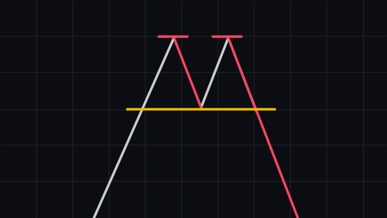

A **double bottom** is the reverse: price tests support twice, with a rebound high between the lows. A close above that rebound high is the usual confirmation. Two similar lows alone do not prove that buyers have taken control.

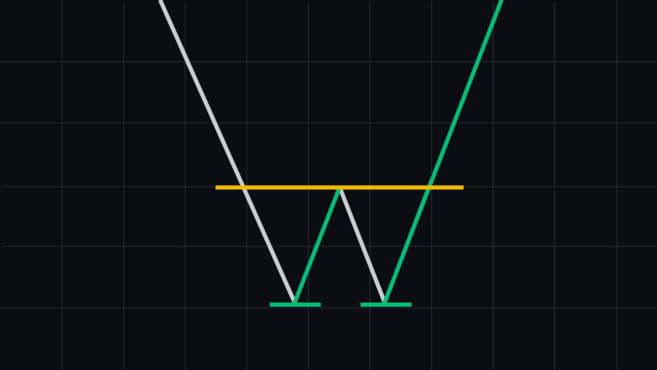

Triple versions make three attempts, but extra touches do not guarantee a reversal; repeated tests can also weaken a level before it breaks.

### Head and shoulders

A **head and shoulders** structure has a left shoulder, a higher head, a right shoulder, and a neckline. After an uptrend, a close below the neckline can support a bearish reversal hypothesis. The right shoulder need not be perfectly symmetrical; the neckline break is the key test.

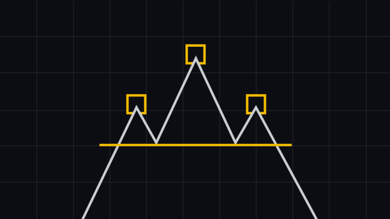

An **inverse head and shoulders** has the same outline upside down: a lower head between two higher troughs. After a decline, a close above its neckline can support a bullish reversal hypothesis. In either version, a failed break or a move back through the shoulder structure weakens the idea.

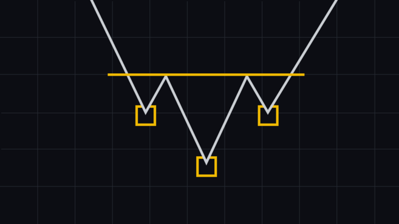

### Triangles

- **Ascending triangle:** a relatively flat resistance area and rising lows. Buyers appear willing to step in at progressively higher prices, but the pattern can still break down.

  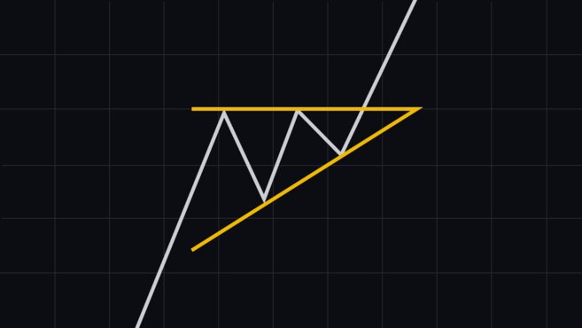

- **Descending triangle:** a relatively flat support area and falling highs. Sellers appear willing to sell at progressively lower prices, but the pattern can still break up.

  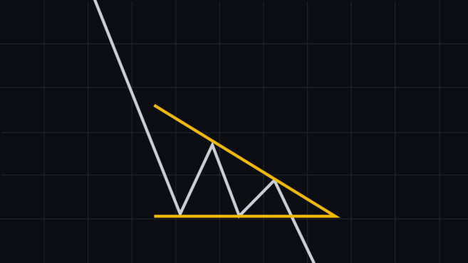

- **Symmetrical triangle:** converging lower highs and higher lows. It is a compression pattern without a reliable direction until the boundary breaks.

### Wedges

- **Rising wedge:** both boundaries rise, but the range narrows. It can warn that an advance is losing force, especially after a long rise, but it is not bearish until price confirms a downside break.

  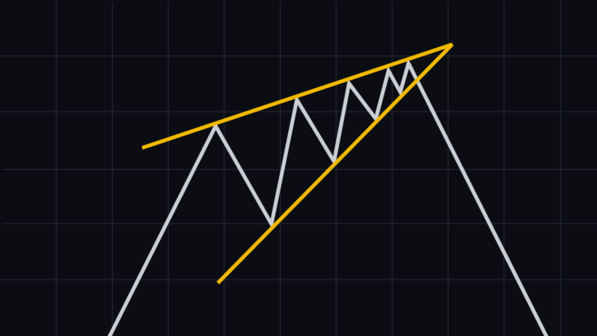

- **Falling wedge:** both boundaries fall, but the range narrows. It can warn that selling pressure is easing, especially after a long decline, but it is not bullish until price confirms an upside break.

  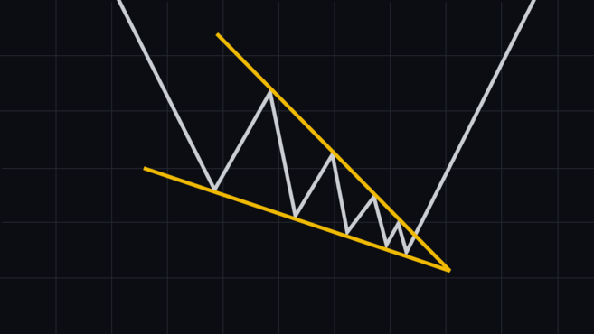

### Flags and pennants

A **bull flag** is a brief, often downward-sloping pause after a sharp rise. It may continue upward if price closes above the flag and holds; if the pause breaks down, the continuation idea is weakened.

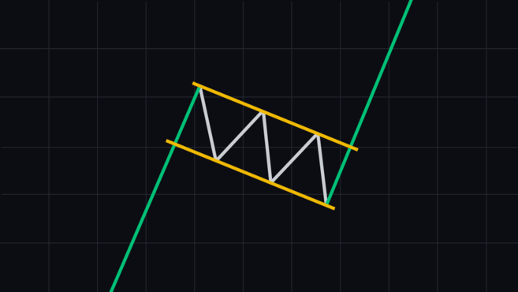

A **bear flag** is a brief, often upward-sloping pause after a sharp decline. A close below the flag may support continuation down, while a break upward weakens that idea.

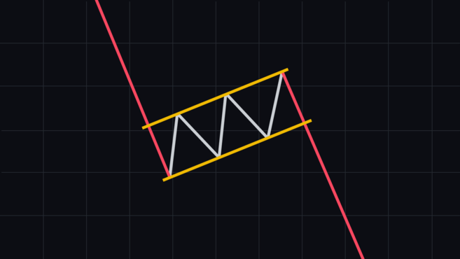

A **pennant** is a small converging pause after a strong move. Its shape alone does not tell the direction; wait for a confirmed break and define what would invalidate the setup.

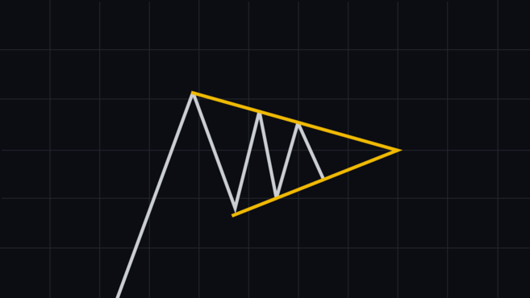

### Channels

A **rising channel** connects higher highs and higher lows with two roughly parallel boundaries. A **falling channel** connects lower highs and lower lows. A **horizontal channel** is a range. A channel break is more useful when the close holds outside it and the next retest does not return inside.

### Cup and handle

A **cup and handle** resembles a rounded recovery followed by a smaller pullback below resistance. The pattern is only a hypothesis until price closes above the rim and shows acceptance. A deep or volatile handle, weak volume, or a failure at the rim weakens the idea.

## 5. Breakout, pullback, and false-break logic

When a pattern reaches a boundary, separate three events:

1. **Test:** a wick or brief move reaches the level.
2. **Break:** a candle closes beyond the level.
3. **Acceptance:** later candles hold beyond it, often through a pullback and retest.

A breakout with expanding volume and a controlled retest is usually more informative than a single wick. A close back inside the old range is a failed breakout or liquidity sweep. In a fast market, the retest may never arrive; chasing the first large candle means accepting a worse price and a wider invalidation.

For every pattern, write the bullish case, the bearish case, and the no-trade case. For example, after BTC closes above resistance:

- **Bullish case:** the old resistance holds as support and price forms a higher low.
- **Bearish case:** price closes back inside the range and breaks the retest low.
- **No-trade case:** the close is weak, volume is ordinary, and the distance to the next resistance is too small for the planned risk.

## 6. Volume, volatility, and momentum around patterns

Price shape is stronger when other evidence answers a different question:

- **Volume:** did participation expand during the break, or did price drift on thin activity?
- **ATR or range:** is the move large enough that a normal stop would be unrealistic?
- **MA or EMA:** is the pattern aligned with the broader direction or fighting it?
- **RSI or MACD:** is momentum confirming the move, weakening, or diverging?
- **Liquidity and news:** could a fast move be caused by liquidation, an event, or a thin order book?

Do not count five price-derived indicators as five independent confirmations. Structure supplies the main hypothesis; volume, volatility, momentum, and execution conditions test different parts of it.

## 7. What a complete pattern record looks like

Before treating a pattern as a trade idea, record:

- the market and timeframe;
- the pattern name and the exact swings used;
- the level that must break or hold;
- the confirmation condition;
- the invalidation condition;
- the entry, stop, target, and position size;
- the result after fees and slippage.

Review the pattern only after the future candles are hidden again. A pattern that looks perfect after the outcome is known may have been ambiguous at the decision point. Keep failed examples; they teach where the pattern does not work.

## 8. Limits and reference library

Patterns are not laws of nature. Different traders can draw different swing points, trendlines, necklines, and pattern boundaries. Short timeframes add noise, crypto trades continuously without a daily exchange close, and news or liquidation can invalidate a clean formation. Automatic pattern tools can also label an incomplete pattern or use rules that differ from yours.

### Frequently asked questions

**Are chart patterns reliable?**

No pattern is reliable on its own. A pattern summarizes a repeated historical shape and gives a probability-based hypothesis. Its usefulness changes with the market regime, timeframe, volume, and liquidity. Use it with structure, execution checks, and risk controls.

**What are the three main types of chart patterns?**

They are usually grouped as **reversal** patterns, which may mark a change in direction; **continuation** patterns, which may mark a pause before the existing trend resumes; and **bilateral** patterns, which can break either up or down.

**Which timeframe is best?**

There is no universal best timeframe. Four-hour and daily patterns generally contain less short-term noise than 15-minute patterns, but they form more slowly and need wider risk levels. A practical workflow is to set the directional context on a higher timeframe and use a lower timeframe only to plan a better entry.

**How do traders confirm a pattern?**

They normally wait for a decisive break of the relevant neckline, trendline, or range boundary. A candle close beyond the level, supporting volume, and a retest that holds can make the hypothesis stronger. None of these steps guarantees follow-through.

**Do patterns work differently in crypto?**

The names are the same, but crypto trades continuously and can move sharply through thin liquidity or liquidations. False breakouts and long wicks are therefore common. Waiting for the candle to close and checking participation are especially useful in crypto.

Chart patterns are useful because they organize evidence, not because they remove uncertainty. They should be one part of a wider process that includes market structure, volume, momentum, volatility, execution, and a survivable risk plan.

The following references are useful for definitions and platform conventions:

- [Binance Academy — A Beginner's Guide to Classical Chart Patterns](https://academy.binance.com/en/articles/a-beginners-guide-to-classical-chart-patterns): reversal, continuation, and bilateral patterns, with a reminder that confirmation matters more than the label.
- [Binance Academy — How to Read the Most Popular Candlestick Patterns](https://academy.binance.com/en/articles/how-to-read-the-most-popular-crypto-candlestick-patterns): common reversal and continuation candle formations.
- [Binance Academy — A Beginner's Guide to Candlestick Charts](https://academy.binance.com/en/articles/a-beginners-guide-to-candlestick-charts): OHLC construction, candle bodies, wicks, and the limits of candlesticks.
- [TradingView — How to read chart patterns](https://www.tradingview.com/support/solutions/43000759289-how-to-read-chart-patterns/): context, reversal, continuation, neutral patterns, and confirmation.
- [TradingView — All Chart Patterns](https://www.tradingview.com/support/solutions/43000706927-all-chart-patterns/): the platform's current list of flags, pennants, double and triple tops or bottoms, head and shoulders, wedges, triangles, rectangles, and cup-and-handle patterns.
- [TradingView — Introduction to candlestick charts and patterns](https://www.tradingview.com/support/solutions/43000745269-introduction-to-candlestick-charts-and-patterns/): candle construction and the distinction between chart patterns and candlestick patterns.
- [TradingView — Automatic candlestick pattern detection](https://www.tradingview.com/support/solutions/43000584462-candlestick-patterns/): how TradingView labels candlestick formations and alerts.
- [TradingView — Triangle pattern drawing tool](https://www.tradingview.com/support/solutions/43000570208-triangle-pattern-drawing-tool/) and [Head and shoulders drawing tool](https://www.tradingview.com/support/solutions/43000570149-head-and-shoulders-drawing-tool/): platform drawing conventions for two common structures.

Use these references to compare definitions, then use your own written rules and historical review to decide whether a pattern deserves a place in your trading process. No reference can turn a visual pattern into a guaranteed forecast.

The pattern illustrations in this article were downloaded from the Binance Academy guide linked above and retained with source attribution for educational reference: [A Beginner's Guide to Classical Chart Patterns](https://www.binance.com/en/academy/articles/a-beginners-guide-to-classical-chart-patterns).
