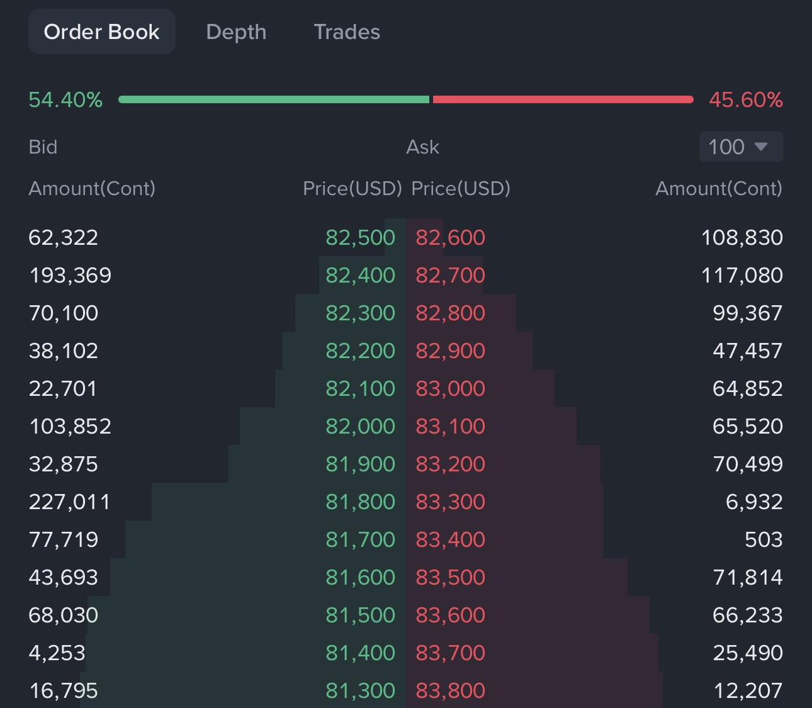
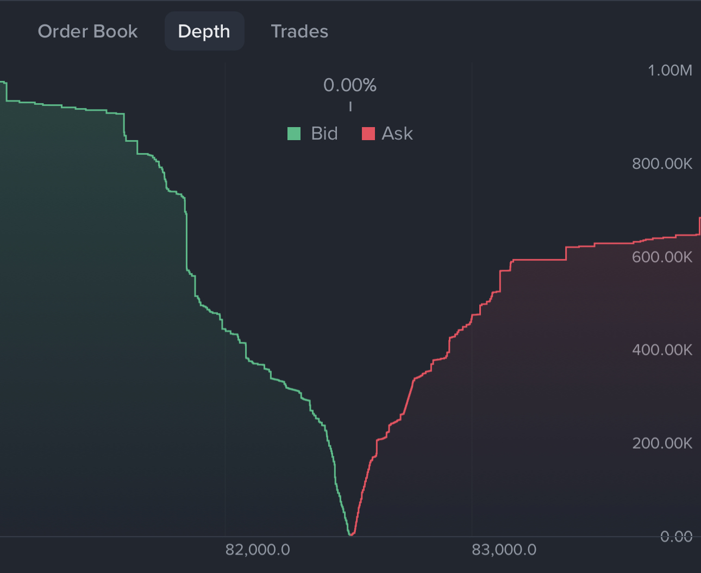
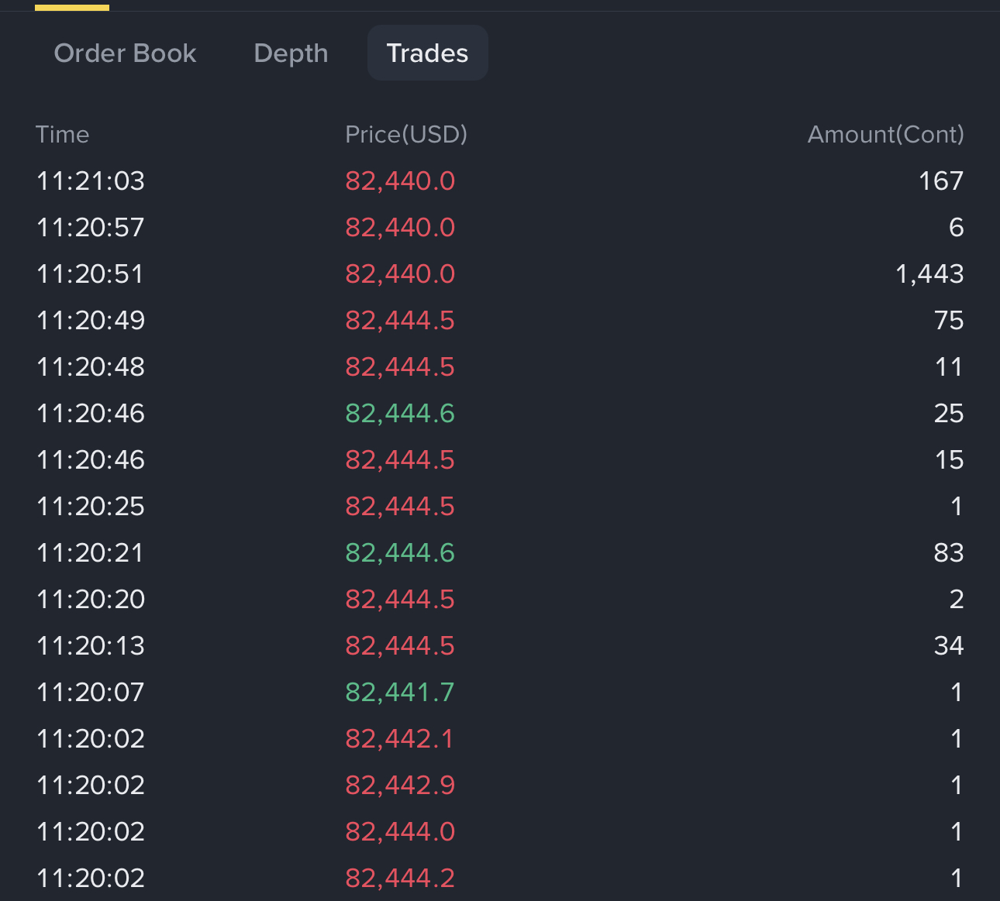
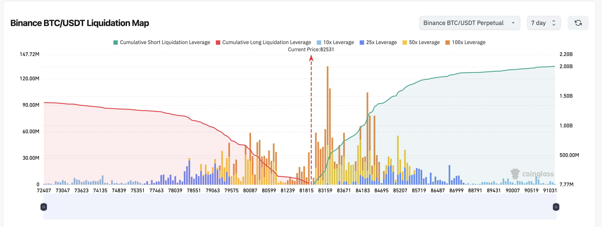
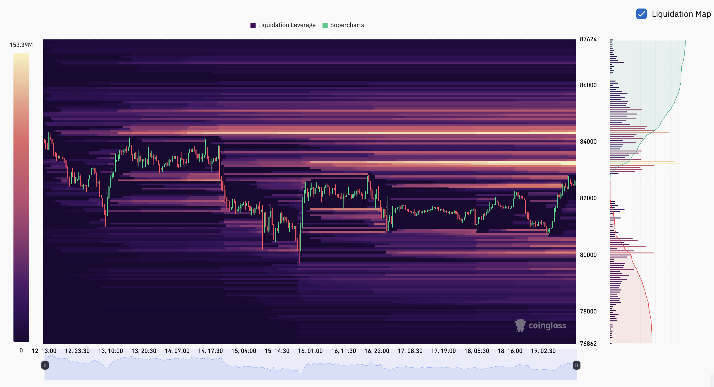

# Advanced — Liquidity, slippage, and market impact

Liquidity is not a direction signal. It tells you how easily a trade can enter or exit without moving the market against you. A liquid market has many willing buyers and sellers close to the current price. A thin market has fewer nearby orders, so a modest order or a sudden event can move price sharply.

For a retail trader, liquidity matters because the chart shows a reference price, while your order is filled against actual available orders. The difference becomes especially important when using market orders, large position sizes, stops, leverage, or small tokens.

## 1. The core ideas to understand

### 1.1 Bid, ask, and spread

The **bid** is the highest price currently offered by a buyer. The **ask** is the lowest price currently offered by a seller. The **bid-ask spread** is the gap between them.

Suppose the BTC/USDT order book shows:

- Highest bid: 80,000 USDT
- Lowest ask: 80,002 USDT

A market buyer normally pays the ask, while a market seller normally receives the bid. The 2 USDT gap is an immediate execution cost before the trading fee. A narrow spread usually suggests active liquidity; a wide spread usually means execution is more expensive or uncertain.

### 1.2 Order-book depth

The order book contains resting bids below the market and asks above it. **Depth** means how much quantity is available across nearby price levels.

If 1 BTC is offered at 80,002, another 2 BTC at 80,010, and another 5 BTC at 80,025, a 1 BTC market buy may fill near 80,002. A 6 BTC order must consume several ask levels, producing a higher average price. The displayed last price did not promise that the whole order could fill there.

Visible depth is only a snapshot. Orders can be cancelled, moved, hidden, or replaced before your order arrives. A large wall is evidence about the current book, not guaranteed support or resistance.

*Figure 1 — Binance order book: asks are shown above the current price and bids below it. Read the best ask and best bid first, then look at how much quantity sits across the nearby levels. The visible wall can disappear, so it is not a guaranteed barrier.*

*Figure 2 — Binance depth view: the bid and ask curves show how much visible order quantity is stacked at different prices. A steep curve means more displayed quantity in that area; it does not prove that every order will remain or that price must reverse there.*

### 1.3 Recent trades: what has actually filled

*Figure 3 — Binance Recent Trades: each row records a completed match, with a price, quantity, and timestamp. The colors usually distinguish trades executed at the ask from trades executed at the bid, but check the app legend because display conventions can differ.*

Recent Trades is different from the volume panel. **Recent Trades** shows individual or grouped executions arriving now; **VOL** adds all reported trading quantity inside each candle. A large number in one row means that a relatively large amount traded in that match. It does not tell you whether one person, several accounts, a market maker, or an automated strategy created it.

Read the numbers in context:

- Several large prints close together can show that significant size is being executed quickly, especially if price moves through nearby levels.
- Many small prints with steady price movement can reflect ordinary fragmented activity, algorithmic execution, or a large order being split into smaller child orders.
- A large print that is immediately absorbed with little price movement suggests that opposing liquidity was available; a large print followed by a fast move suggests thinner nearby liquidity or an imbalance.
- Compare the trade size with the pair's normal recent sizes and with the order-book depth. A number that looks large in isolation may be small for BTC but enormous for a thin token.

A whale does not need to place one obvious order. A large participant may split an order over time, use several accounts, or execute passively so that the flow looks like many ordinary trades. That is **order splitting**, not proof of deception. **Spoofing**—placing orders with the intention of cancelling them rather than trading—can occur, but a screenshot cannot establish it and it is prohibited or restricted under many market rules. Do not label every small trade as a hidden whale.

A retail trader can form only a cautious inference. Repeated unusually large executions, a sudden change in volume, price moving despite visible opposing orders, and depth disappearing together may suggest larger or urgent participation. They cannot prove that a whale is buying or selling, predict direction, or identify the trader. Treat Recent Trades as execution evidence: ask who appears to be taking liquidity, whether price is accepting the new level, and whether the move survives after the burst ends.

### 1.4 Does this matter if we cannot identify the whale?

Yes, but use the information to read the trading conditions, not to play detective:

#### Execution

- **Explanation:** The spread, depth, and recent fills help you judge whether your own order can fill near the displayed price.
- **Example:** You press Buy when BTC shows 80,000 USDT, but only a small amount is offered there. Your order fills at 80,020, 80,050, and 80,080 because the nearby sell orders run out. The chart price was only a reference; the order book determines your actual fill.

#### Participation

- **Explanation:** Sustained trades and rising volume show that more participants are accepting the move.
- **Example:** BTC breaks resistance and several candles print with high volume. That is stronger evidence than one quick jump on almost no trading. It still does not guarantee continuation.

#### Absorption

- **Explanation:** A large amount of buying or selling can be absorbed by the other side without much price movement.
- **Example:** Someone sells 100,000 USDT of BTC, but price barely falls because buyers take the other side. Do not immediately go long: if that buy wall disappears, price can fall quickly. A displayed wall is not guaranteed support.

#### Urgency

- **Explanation:** Fast prints, thin depth, and a widening spread suggest that normal execution conditions are becoming unstable.
- **Example:** Recent Trades start flashing rapidly while the order book empties. News, liquidations, or traders rushing for the exit may be involved. Reduce size, use a controlled order, or wait instead of guessing the cause.

#### Risk

- **Explanation:** A stop can fill worse than its chart level when there are few orders between entry and stop.
- **Example:** Your stop is 1% below entry, but the bids below it are sparse. During a fast fall, the sell order may search for lower buyers and the real loss can exceed 1%.

#### Limits

- **Explanation:** Trades, depth, and volume show activity and execution conditions, not the identity of traders or a guaranteed direction.
- **Example:** A large print may come from one trader, several accounts, or an algorithm. Use this information to decide whether the trade is executable and affordable; use structure and invalidation to decide direction.

For most beginners, this is enough. Use Recent Trades and depth as an **execution and risk check**, not as a secret whale detector. Price structure, timeframe context, and a defined invalidation remain more important for deciding direction.

### 1.5 Slippage

**Slippage** is the difference between the price you expected and the average price you actually received.

For example, you submit a market order when BTC is displayed at 80,000 USDT. The sell orders at 80,000 have already been filled, so your order consumes asks at 80,020, 80,050, and 80,080 and fills at an average of 80,080. The 80 USDT difference is negative slippage for the buyer. Slippage can also occur when a stop order becomes a market order during a fast move.

With a **limit buy**, you set the highest price you will accept. If you place a buy limit at 80,000, it cannot fill at 80,080; it either fills at 80,000 or lower, or remains unfilled. The protection is price control, but the trade may never happen. A sell limit works in the opposite direction: it sets the lowest price you will accept.

With a **post-only order**, the exchange is instructed to let the order rest on the book as a maker order. If a post-only buy at 80,000 would immediately match an ask already at 80,000, the exchange cancels or rejects it instead of filling it as a taker. Post-only can help avoid crossing the spread and may qualify for maker fees, but it gives up execution certainty.

Market orders prioritize execution, limit orders prioritize price control, and post-only orders prioritize resting on the maker side. None of them guarantees that the market will move in your favor.

### 1.6 Market impact

**Market impact** is the price movement caused by your own order as it consumes available liquidity. It is different from a general market move that would have happened anyway.

A 100 USDT BTC order is usually small compared with the BTC/USDT book. The same dollar amount in a thin altcoin market may consume many price levels and move the quote sharply. The order may appear profitable on the chart while the actual entry and exit costs remove the edge.

## 2. How to assess liquidity before trading

No single number describes liquidity. Check several observations:

| Observation | What it tells you | Practical question |
| --- | --- | --- |
| **Bid-ask spread** | Immediate cost of crossing the book | Is the spread small enough for this trade and timeframe? |
| **Nearby order-book depth** | Quantity available around your planned price | Would my order consume several levels? |
| **Recent volume** | How actively the market has traded | Is this normal activity or a temporary spike? |
| **Expected slippage** | Difference between quote and realistic fill | Would the stop and target still make sense after costs? |
| **Market conditions** | Whether liquidity may disappear | Is there major news, a liquidation cascade, maintenance, or an inactive session? |

Volume is useful but incomplete. High volume can come from forced liquidations or a short-lived news event. A thick-looking book can change quickly. Compare the expected order size with the depth you can actually see, and recheck it when the market becomes fast.

## 3. A BTC example and a thin-market example

Imagine two planned long trades with the same chart entry and stop.

**BTC/USDT:** the spread is narrow, the nearby book is deep, and a 500 USDT order fills close to the displayed price. The main uncertainty comes from BTC's movement after entry.

**A thin altcoin pair:** the spread is wide, only small quantities sit near the quote, and the same 500 USDT order fills across several levels. The average entry is worse, the stop may trigger through a gap, and exiting can move the price again. The chart pattern may look identical, but the trade is economically different.

This is why a clean technical setup on a thin market is not automatically better than a less dramatic setup on BTC. Execution quality is part of the strategy.

## 4. Liquidity and order types

- **Market order:** takes available liquidity immediately. It is useful when leaving a dangerous position matters more than an exact price, but it can suffer slippage.
- **Limit order:** adds liquidity if it rests on the book, or takes liquidity if it crosses the spread and fills immediately. It controls price but does not guarantee execution.
- **Post-only order:** is designed to rest as a maker order; the exchange cancels it if it would execute immediately.
- **Stop or conditional order:** may become a market or limit order after its trigger. Read the product rules so you know what happens during a gap or fast move.
- **Scaled order:** splits one intended trade across multiple prices. This can reduce the impact of one large order, but some child orders may never fill.

A stop does not guarantee the exact stop price. In a fast or thin market, the next available price may be materially worse. Position size should account for that possibility.

## 5. Liquidity, leverage, and liquidation

Liquidity risk becomes more severe with leverage. A small move against a highly leveraged position can trigger liquidation, and many liquidations arriving together can consume nearby bids or asks. This can create a cascade: forced orders move price, the move triggers more stops or liquidations, and execution becomes worse.

The order book is therefore not a promise that a liquidation price will be filled exactly. Mark price, liquidation rules, insurance mechanisms, and contract specifications differ across products. Check the current Binance contract details before trading futures.

## 6. CoinGlass liquidation maps: useful context, not a price target

CoinGlass liquidation maps estimate where leveraged positions may be forced to close if price moves through their liquidation ranges. They are useful for seeing where a fast move could encounter forced buying or selling. They are not a list of guaranteed orders waiting at exact prices. The [CoinGlass Liquidation Map](https://www.coinglass.com/pro/futures/LiquidationMap) and [BTC Liquidation Heatmap](https://www.coinglass.com/pro/futures/LiquidationHeatMap?coin=BTC) are the live versions of the views shown below; the data and layout can change.

*Figure 4 — Binance BTC/USDT Perpetual, seven-day liquidation map. The screenshot marks the current price near **82,531**. Because price runs from left to right, the red cumulative long-liquidation curve is to the left of the current-price marker and represents lower price levels; the green cumulative short-liquidation curve is to the right and represents higher price levels. The colored bars estimate liquidation leverage by price area: orange represents the displayed 100x category, yellow 50x, darker blue 25x, and lighter blue 10x.*

What can be read from this screenshot:

- To the left of the current-price marker, the red cumulative line represents lower price levels. A sharp fall through a concentrated lower cluster could force some long positions to close and add selling pressure.
- To the right of the current-price marker, the green cumulative line rises sharply through the **83,000–85,000** area. A fast rise through a concentrated short-liquidation area could force short positions to close by buying, creating a short squeeze.
- The largest visible bars show areas where the estimate is concentrated, but they do not tell us which side will win or whether price will visit that area.
- The chart uses a seven-day window and a specific Binance perpetual contract. Changing the exchange, contract, leverage filter, or time window changes the map.

*Figure 5 — CoinGlass BTC liquidation heatmap. Brighter horizontal bands represent higher estimated liquidation leverage in the selected view. The screenshot shows bright areas around the low-to-mid **84,000s** and several bands near **80,000–81,000**; the current price is near the right edge around the low **82,000s**.*

The heatmap is easier to use as a map of **possible forced-flow zones** than as a prediction. For example, if price moves toward a bright band above and short liquidations begin, the move may accelerate upward. If it reaches a bright band below and long liquidations begin, the move may accelerate downward. The acceleration can stop once the forced orders are cleared, and the market can reverse or continue for unrelated reasons.

Do not read a bright band as “price must go there.” CoinGlass combines exchange data and model assumptions, and the displayed estimates can change as positions open, close, or are liquidated. Confirm the actual contract, timeframe, funding, open interest, price structure, and current exchange conditions before treating a liquidation map as relevant.

## 7. What a beginner should do

A beginner does not need to model the entire order book. Use a short checklist:

1. Start with a liquid BTC pair such as BTC/USDT when learning execution.
2. Look at the spread and nearby depth before using a market order.
3. Compare your order size with the visible quantity near the price.
4. Include fees and plausible slippage in the stop and target calculation.
5. Avoid opening a large position immediately before a known high-impact event.
6. If the book is thin or the spread suddenly widens, reduce size or wait.
7. Record the expected price and the actual average fill in your journal.

Liquidity is a condition of execution, not proof that a trade will win. It can make a good idea cheaper and a bad idea more expensive, but it cannot turn an uncertain signal into a reliable prediction.

## 8. References and limits

For a beginner explanation, see Binance Academy's [Liquidity](https://www.binance.com/en/academy/glossary/liquidity), [Bid-Ask Spread](https://www.binance.com/en/academy/glossary/bid-ask-spread), [Slippage](https://www.binance.com/en/academy/glossary/slippage), and [Market Order](https://www.binance.com/en/academy/glossary/market-order) pages. TradingView's [What is liquidity](https://www.tradingview.com/support/solutions/43000784778-what-is-liquidity/) and [What is a market order](https://www.tradingview.com/support/solutions/43000754940-what-is-a-market-order/) explain liquidity, spreads, depth of market, and execution in accessible terms.

These references describe visible market mechanics. They cannot show every hidden order, future cancellation, private flow, or cross-exchange change. Treat the order book as changing evidence, not as a guaranteed map of future support or resistance.
