# Advanced — Moving averages and momentum tools

Chapter 2 introduced moving averages, MACD, and other indicators as ways to organize market information. This article goes one step further. It explains how moving averages are built, what traders mean by alignment, golden crosses, death crosses, and MACD signals, and why every one of these tools can mislead.

The central idea is simple: an indicator describes past price behavior. It can help us build a rule, but it cannot remove uncertainty or predict the next candle with certainty.

## 1. Moving averages: a smoother view of price

A moving average takes the closing prices from a chosen number of candles and turns them into one line. On a 15-minute chart, MA(7) uses seven 15-minute closes; on a daily chart, MA(7) uses seven daily closes. The same number therefore represents different lengths of real time on different charts.

### 1.1 SMA and EMA

**SMA** means **Simple Moving Average**. Every candle in the selected period has equal weight. If the last three closes are 82,000, 83,000, and 84,000 USDT, the 3-period SMA is 83,000 USDT.

**EMA** means **Exponential Moving Average**. It gives more weight to recent candles, so it turns faster when price changes direction. That speed can be useful for short-term analysis, but it also makes the line more sensitive to noise. Neither method is automatically better: SMA is smoother, while EMA is more responsive.

The chart calculates both for us. Before comparing two charts, check whether each one uses SMA or EMA; a line with the same period can behave differently under the two methods.

For further reading, see Binance Academy’s [Moving Averages Explained](https://www.binance.com/en/academy/articles/moving-averages-explained/) and this [SMA versus EMA reference](https://altfins.com/knowledge-base/sma-vs-ema/). Treat outside examples as explanations of a tool, not as trading signals.

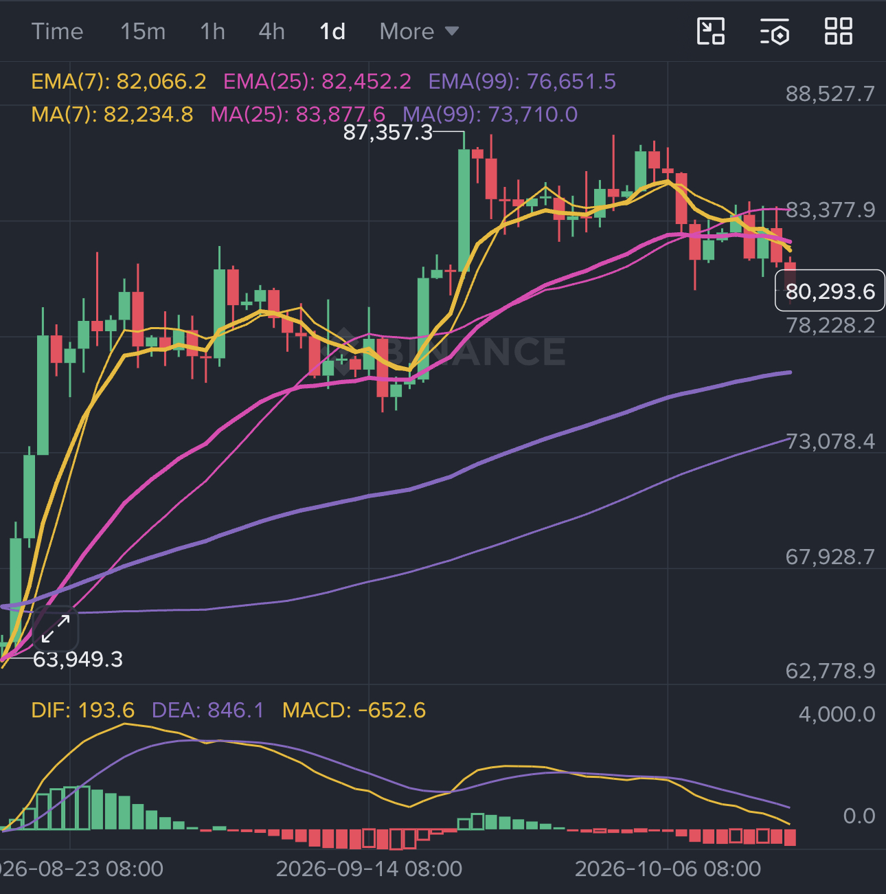

In this comparison, EMA reacts sooner to the sharp move because it gives recent candles more weight; SMA stays smoother and turns later. The faster response can help with an early trend signal, but it can also create earlier false signals. Confirm the method and period before comparing lines across charts.

### 1.2 What MA(7), MA(25), and MA(99) mean

The number in an MA is a **lookback length**, not a rating or a confidence score. In the Binance 15-minute example:

- **MA(7)** covers about 105 minutes and follows short-term movement closely.
- **MA(25)** covers about 6 hours 15 minutes and gives a medium-term view.
- **MA(99)** covers about 24 hours 45 minutes and changes more slowly, showing a broader intraday context.

A shorter MA reacts first but gives more false turns. A longer MA filters more noise but reacts later. Traders often use three different lengths to compare short-term behavior with the larger trend. These numbers are conventions, not laws; the useful period depends on the asset, timeframe, and strategy.

### 1.3 The same MA numbers mean different things on different timeframes

An MA(7) is based on seven candles, so its real-time window changes when the chart interval changes. On a daily chart, MA(7) summarizes about seven days. On a weekly chart, it summarizes about seven weeks. The calculation is the same, but the question is different: the daily chart describes a shorter swing, while the weekly chart describes a much broader market phase.

The weekly chart can therefore show a different MA arrangement from the daily chart without either chart being wrong. A recent weekly recovery can lift the seven-week EMA above the slower average even while the daily chart shows another short-term arrangement, or the daily chart can improve before the weekly chart has enough candles to turn.

This difference gives us useful information about scale:

- The **weekly chart** helps answer whether the larger market structure is recovering, weakening, or still in a broad range.
- The **daily chart** helps answer how the current swing is developing inside that larger context.
- A disagreement tells us that the timeframes are describing different layers of the market. It is a reason to reduce confidence and check support, resistance, volume, and closed candles—not a reason to choose whichever chart supports a preferred trade.

For example, a weekly bullish alignment with a daily pullback can describe a possible pullback inside a larger uptrend. A daily bullish crossover while the weekly averages remain bearish can describe an early recovery that has not yet changed the broader trend. Neither arrangement predicts what must happen next.

### 1.4 Shorter timeframes usually fail more easily

Your timeframe changes how durable an MA observation is. A 4-hour MA arrangement can be overturned by one news headline, a liquidation cascade, or a temporary liquidity imbalance because it is built from a small number of recent candles. A daily arrangement usually changes more slowly and filters out more intraday noise. A weekly arrangement changes more slowly still.

This does **not** mean that a daily or weekly signal is safe. A major macro announcement, a market-wide liquidity crisis, an exchange failure, or a severe protocol event can invalidate a higher-timeframe structure as well. The more accurate rule is: **shorter timeframes usually produce more signals and more false breaks; longer timeframes produce fewer signals and slower but often more durable observations.** Use the higher timeframe for context and the lower timeframe for timing, while defining what would prove the idea wrong on each timeframe.

## 2. What moving averages can tell us

A rising MA says that recent closes are generally higher than earlier closes in its window. A falling MA says the opposite. Price holding above a rising MA can support a bullish context; price remaining below a falling MA can support a bearish context. The MA may also act as a **dynamic support or resistance zone** when many traders are watching the same line.

These are observations, not instructions. Price can cross an MA and immediately cross back. A strong trend can run far away from its averages, while a range can cut through them repeatedly. Always read the line together with HH/HL or LH/LL structure, key levels, volume, and the higher timeframe.

## 3. Alignment and crossovers

When a fast MA is above a medium MA and the medium MA is above a slow MA, traders call this **bullish alignment**. For example, `EMA(7) > EMA(25) > EMA(99)` with all three lines rising suggests that recent price strength is stronger than the older trend. The reverse arrangement, with all three falling, is **bearish alignment**.

A **golden cross** occurs when a shorter MA crosses above a longer MA. A **death cross** occurs when it crosses below. On a daily chart, traders often discuss MA(50) and MA(200); on an intraday chart, they may use MA(7) and MA(25). The names describe a relationship between two averages, not a guaranteed market event.

Crossovers are delayed because the averages need enough new candles to change direction. In a sideways market, the same two lines can cross several times and produce a series of small losses. A crossover is more useful when the averages are sloping, price has broken a meaningful level, and the next pullback holds. It is weaker when the lines are flat and tangled.

### 3.1 Is a moving average only hindsight?

Partly, yes. A moving average is calculated from completed and current candles, so it cannot turn before price begins to move. A crossover often appears after the first part of a trend has already happened. If we draw an MA on a historical chart, it can look obvious because we already know what happened next. That is hindsight bias.

This does not make the MA useless. Its limited predictive value comes from organizing current information, not from seeing the future. A rising average can show that recent prices have been stronger than older prices. A pullback that holds near a rising average can provide a repeatable reference for a trend-following rule. A flat, tangled group of averages can warn that trend signals are unreliable. These are conditions and probabilities, not predictions.

For example, an upward crossover may help a trader stay with a trend after it has become visible, but it cannot reliably identify the exact bottom. A downward crossover may confirm that weakness has lasted, but it can arrive after much of the decline and can reverse during a range. Use the MA to filter context, plan a response, and define invalidation; do not treat it as a standalone forecast.

### 3.2 Common MA arrangements and what they may mean

The position of the lines gives more context than the word “cross” alone. Keep two ideas separate:

- **Position** asks which average is above or below another average.
- **Slope** asks whether each average is rising, falling, or flat.

For example, MA(7) can cross above MA(25) while all three averages are still falling. That is a short-term improvement inside a declining market, not a confirmed bullish trend. The following examples use **MA(7)** as the fast average, **MA(25)** as the medium average, and **MA(99)** as the slow average. They are observations to investigate, not automatic trade instructions.

Cases **1–4 describe crossing events or transition points**. Cases **5–7 describe the broader arrangement after we observe the lines and their slopes**. One chart can therefore move through several cases in sequence.

1. **MA(7) crosses above MA(25), while MA(99) is below both.** At the crossing, this is a short-term improvement and a bullish line order. It does **not** say that all three lines are rising. If the lines later rise together and price holds above them, the chart may develop into case 5. If MA(7) and MA(25) rise while MA(99) is flat or falling, it may only be an early recovery.

   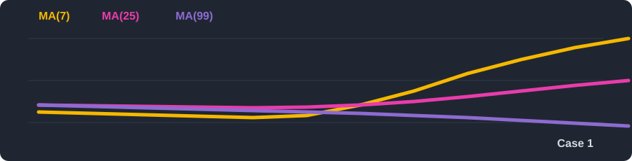
2. **MA(7) crosses above MA(99), while MA(25) is below both.** At the crossing, this is a fast rebound above the long-term average while the medium-term average remains weaker. If MA(7) is rising but MA(25) and MA(99) are still falling, the move may be counter-trend. Check whether MA(25) turns upward and whether price holds the reclaimed level.

   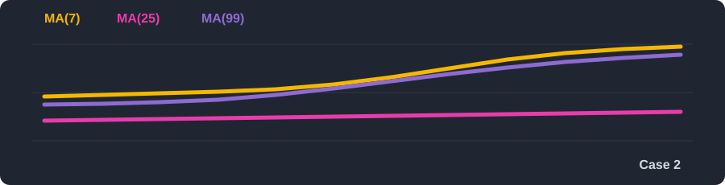
3. **MA(7) crosses below MA(25), while MA(99) remains below both.** This describes short-term weakness inside a still higher average order. If MA(99) is rising and MA(25) remains above it, the move may be a pullback in a larger uptrend. If all three slopes turn down, the bearish interpretation becomes stronger.

   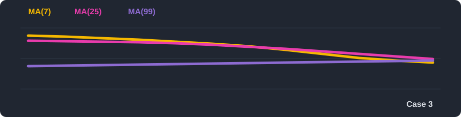
4. **MA(7) crosses below MA(99), while MA(25) remains above both.** This is a mixed transition: the fast average is weak, but the medium average still has the stronger position. If MA(25) is rising, it may be a pullback before continuation. If MA(25) and MA(99) are both falling, it may be the first stage of a deeper reversal.

   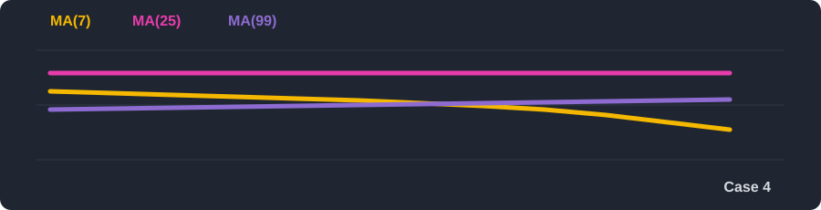
5. **MA(7) > MA(25) > MA(99), with all three rising.** This is a bullish alignment: recent prices are stronger across all three windows, and the slopes agree with the order. It is more credible when price makes HH/HL and a pullback holds. Because averages lag, it may appear after a large part of the move.

   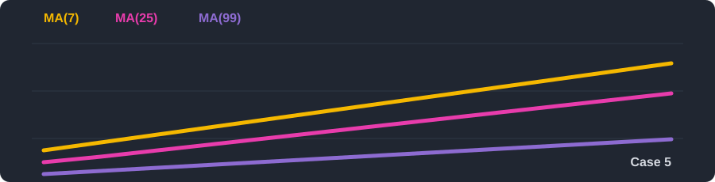
6. **MA(7) < MA(25) < MA(99), with all three falling.** This is a bearish alignment: recent prices are weaker across all three windows, and the slopes agree with the order. It is more credible when price makes LH/LL and failed rallies remain below the averages. It can still reverse quickly after a large selloff.

   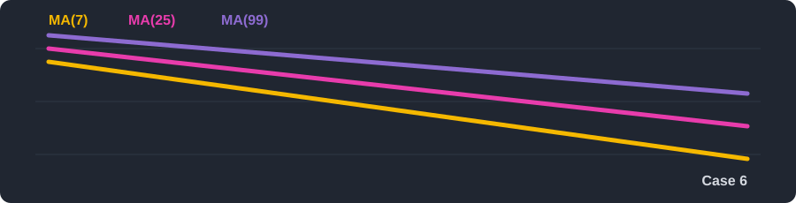
7. **The three averages are flat, tangled, or crossing repeatedly.** The market is probably ranging or changing regime. Cross-based signals are less reliable here, so support, resistance, volume, and a confirmed close matter more than the latest crossing line.

Before acting on any arrangement, record the timeframe, whether each line is rising or falling, where price sits relative to the lines, and the price level that would invalidate the idea. The same arrangement on a 5-minute chart and a weekly chart does not carry the same meaning.

## 4. Momentum: what the word means on a chart

In physics, momentum describes motion. In trading, **momentum** is a practical description of how strongly and consistently price has been moving in one direction recently. It is not the market's physical speed and it is not a guarantee that the move will continue.

We observe momentum through clues such as the size and sequence of candles, the slope and separation of moving averages, the distance between MACD lines, RSI behavior, and participation from volume. A series of large green candles with rising volume suggests stronger upward momentum. Smaller candles near the same high, a flattening fast EMA, or a shrinking MACD histogram suggests that the upward move is losing force. Price can still rise while momentum weakens; this is why divergence is a warning rather than an automatic reversal signal.

Momentum answers a narrower question than trend. **Trend** asks, “Which direction has the market generally taken?” **Momentum** asks, “How much force is behind the latest part of that move, and is that force increasing or fading?” A market can remain in an uptrend while its short-term momentum slows during a pullback.

### 4.1 MACD: moving-average momentum

MACD stands for **Moving Average Convergence Divergence**. It compares a faster EMA with a slower EMA to show whether recent momentum is becoming stronger or weaker relative to that baseline.

Most charting tools show three parts:

- **MACD line:** the difference between a fast EMA and a slow EMA. The common setting is EMA(12) minus EMA(26).
- **Signal line:** a slower EMA of the MACD line, commonly calculated over 9 periods.
- **Histogram:** the distance between the MACD line and signal line, shown as bars.

If the MACD line is above the signal line, recent momentum is stronger than its recent average. If it is below, momentum is weaker. A move above or below the zero line compares the fast EMA with the slow EMA. Taller histogram bars show increasing separation; shrinking bars show that separation is fading.

The following Binance-style MACD panel uses the names **DIF**, **DEA**, and **MACD** that appear in some charting apps. DIF is the MACD line, DEA is the signal line, and the green or red bars are the histogram. The labels are different, but the ideas are the same as MACD line, signal line, and histogram described above.

### 4.2 Why MACD looks different in different regions

The word **MACD** is used differently by different charting platforms. Some regional apps present the panel as **DIF** (the fast line), **DEA** (the signal line), and **Histogram** (the red/green bars). In many international platforms, **MACD** usually means the fast-minus-slow line, while **Signal** means its smoothed line and **Histogram** means the gap between them.

This is the Binance-style display used in the supplied screenshot. Binance’s [MACD indicator explanation](https://www.binance.com/en/academy/articles/macd-indicator) is a useful reference for the exchange’s terminology; always compare the chart’s settings with the documentation for the platform you are using.

| Label often seen in Chinese apps | Label often seen in international apps | Meaning |
| --- | --- | --- |
| DIF | MACD line | Fast EMA minus slow EMA, often EMA(12) − EMA(26) |
| DEA | Signal line | A smoothing EMA of the DIF/MACD line, often 9 periods |
| Histogram bars | Histogram | The distance between DIF and DEA |

There is one more source of confusion: some Chinese chart packages display the histogram as `DIF − DEA`, while others display `2 × (DIF − DEA)`. Colors can also be assigned differently, and some platforms calculate from a different price source or use non-standard periods. Therefore, do not identify a line by color or by the word “MACD” alone. Open the indicator settings, check the formula and periods, and compare the displayed values. In the supplied image, `DIF: 248.7`, `DEA: 857.1`, and `MACD: −608.5` are consistent with a histogram close to `DIF − DEA`; the exact display convention belongs to that app.

For standard terminology, compare the platform’s documentation with TradingView’s [MACD explanation](https://www.tradingview.com/support/solutions/43000502344-macd-moving-average-convergence-divergence/) and Binance Academy’s [MACD guide](https://www.binance.com/en/academy/articles/macd-indicator). The calculation matters more than the translation.

### 4.3 How traders read MACD

A MACD line crossing above the signal line can support a bullish momentum hypothesis. A cross below can support a bearish hypothesis. A histogram that keeps growing can support continuation; a histogram that shrinks while price keeps rising can warn that momentum is slowing.

MACD divergence compares price swings with MACD swings. If price makes a higher high but MACD makes a lower high, bullish momentum may be weakening. If price makes a lower low but MACD makes a higher low, selling momentum may be weakening. Divergence is a warning to investigate, not a command to reverse. Strong trends can produce several divergences before price turns.

## 5. Reading the BTC technical story

The chart examples show a useful sequence: a quiet range, a strong breakout, a weakening advance, and a possible reversal. The indicators do not tell us the future in advance. They help us describe how the move developed and what evidence changed at each stage.

### Stage 1: sideways consolidation

At the beginning of the chart, price moves roughly between the 61,000 and 68,000 area. EMA(7), EMA(25), and EMA(99) are close together and repeatedly cross. None has a clear slope. In the MACD panel, DIF and DEA remain near the zero line, crossing back and forth, while the histogram alternates between small green and red bars.

This is a range, not a clean trend. A crossover system can lose repeatedly here because every apparent direction is quickly reversed. The correct conclusion is limited: the market has not shown sustained directional commitment. It is not evidence that a breakout must happen next.

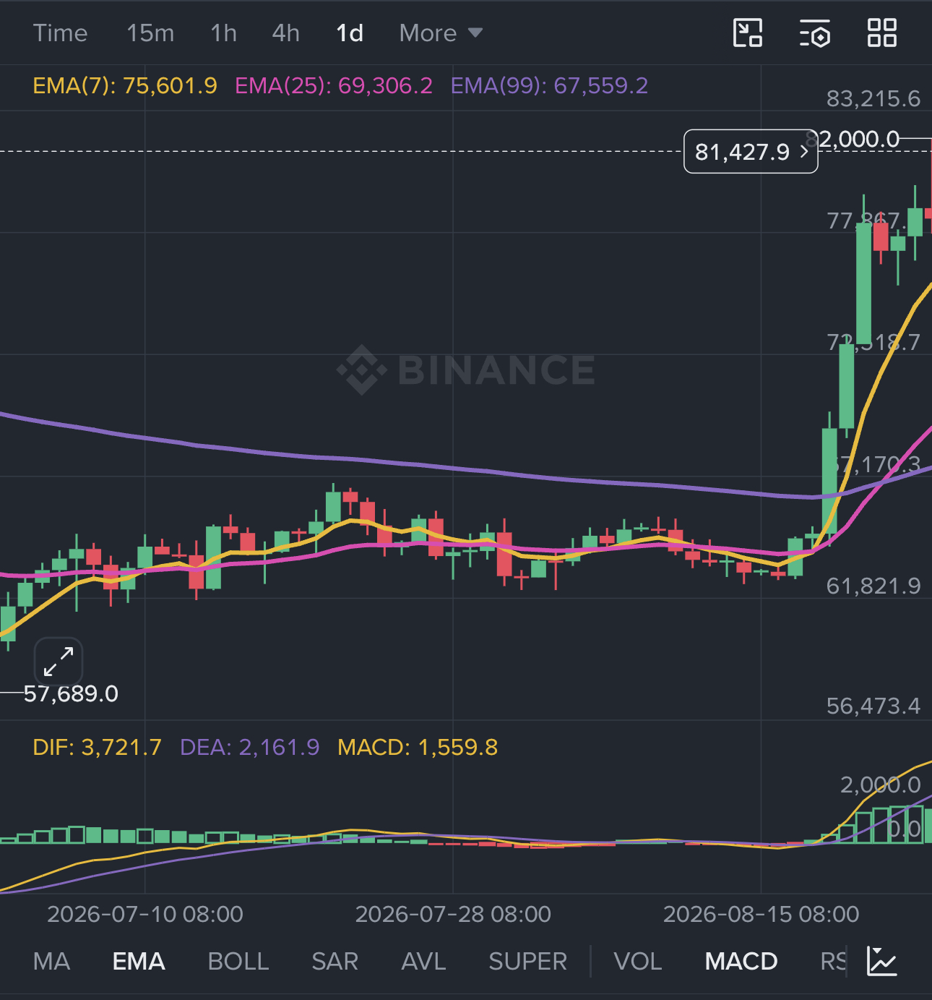

This image shows a transition from **case 7**—MA(7) and MA(25) tangled while MA(99) falls—through **case 1**, as MA(7) rises above MA(25), and toward **case 5** at the right side, where `EMA(7) > EMA(25) > EMA(99)`. It shows improving momentum, not a confirmed long-term trend change.

### Stage 2: breakout and acceleration

Around 20 August, price breaks above the upper part of the range near 68,000 with strong bullish candles and reaches a high near 82,265.9. That is roughly a 21% rise from 68,000. The price move is the primary evidence; the indicators then help us describe its strength.

- EMA(7), the yellow line, turns upward first because it reacts fastest.
- EMA(25), the pink line, bends upward after it and begins to separate from the slow average.
- EMA(99), the purple line, turns more slowly but also begins rising.
- The averages form **bullish alignment**: `EMA(7) > EMA(25) > EMA(99)`, with all three generally rising.
- DIF crosses above DEA, the two lines move above zero, and the histogram expands with tall green bars.

The three MACD observations describe the same acceleration from different angles: a line crossover, a move above the zero line, and increasing distance between DIF and DEA. Together with the price breakout and participation, they make a stronger continuation hypothesis than any one signal alone. They still arrive after the move has started, so they are confirmation rather than a guaranteed early entry.

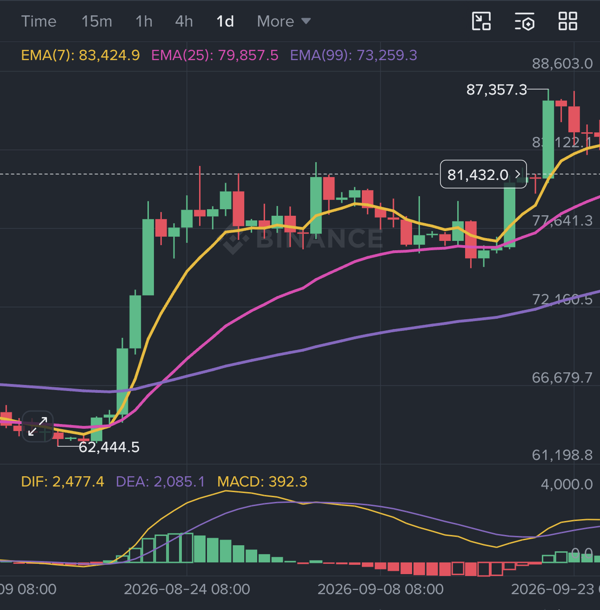

This image corresponds to **case 5**: `EMA(7) > EMA(25) > EMA(99)` with the averages rising during the breakout, a bullish alignment rather than a guarantee of continuation.

### Stage 3: a top and a divergence warning

Near the 82,000 area, price makes another high, but the force of the advance becomes less convincing. The key observation is a **bearish divergence**: price reaches a higher high while the MACD/DIF line fails to reach a higher high. At the same time, the histogram bars begin to shrink and DIF moves closer to DEA.

This says that price is still rising while measured momentum is weakening. It does not say that the top is already confirmed. A strong trend can continue after divergence. The useful response is to stop treating every new high as proof of stronger demand, then watch structure, support, and the next pullback.

### Stage 4: weakening and possible reversal

In the later screenshot, price has pulled back from the high. The fast EMA(7) has turned down and price has moved below it, while EMA(25) is nearby and EMA(99) is still rising. This is a weakening short-term picture, but the longer trend is not automatically broken. A decisive close below EMA(25), loss of a meaningful higher low, and failure to reclaim the level would provide stronger evidence of a structural change.

The MACD numbers make the direction clear. The panel shows `DIF: 1,021.4` and `DEA: 1,807.0`. Because **1,021.4 is below 1,807.0**, DIF is below DEA: the MACD line has made a bearish crossover or remains in a bearish crossover state. The histogram is approximately:

`DIF − DEA = 1,021.4 − 1,807.0 = −785.6`

That negative value matches the displayed `MACD: −785.6` under this app’s convention. The negative histogram supports weakening or bearish momentum; it does not by itself prove that price must continue down. The current price shown in the screenshot is about 80,536, so descriptions such as 78,776 should not be substituted for the value actually displayed in the image.

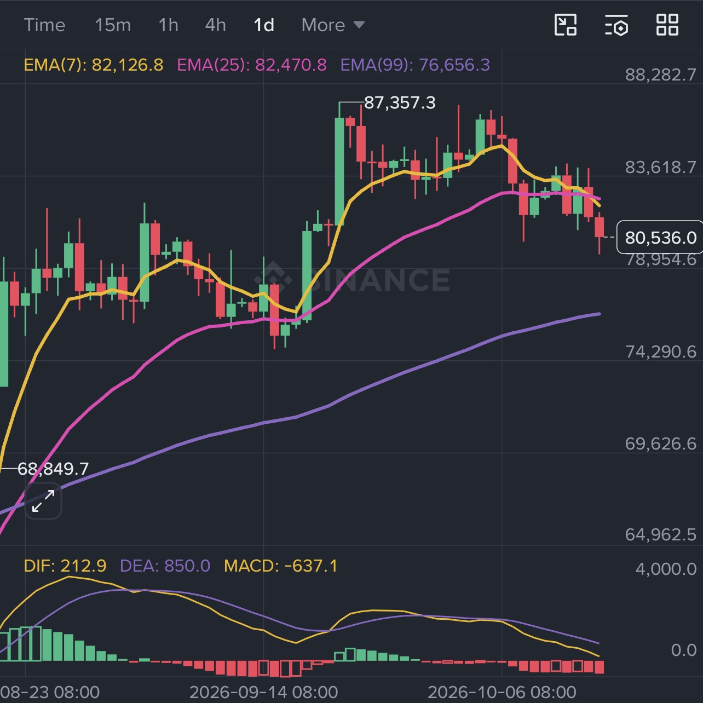

At the right side, this corresponds to **case 3**: `EMA(7) < EMA(25)` while `EMA(99)` remains below both, showing short-term weakness inside a still higher average order.

The weekly chart below adds a higher-timeframe view to this four-stage story:

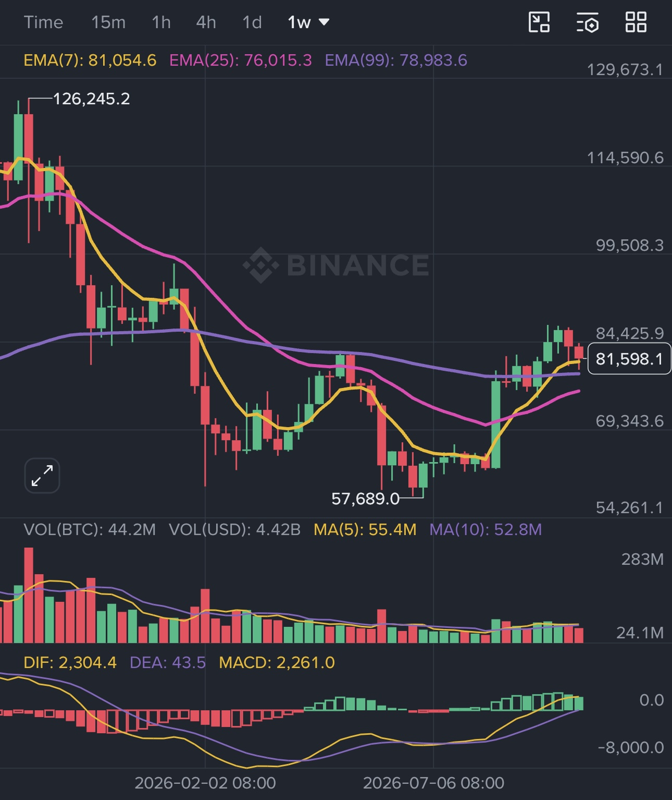

At the right side of the weekly image, **EMA(7)** is above **EMA(99)** , while **EMA(25)** remains below EMA(99). This shows a recent weekly recovery that has improved short-term strength without fully restoring the medium-term order. The daily chart may therefore look different: it is measuring a shorter swing with a different set of candles. The weekly chart says that the larger recovery is still incomplete; the daily chart helps us see the current pullback and nearby decision levels.

This corresponds to **case 2**: `EMA(7) > EMA(99)` while `EMA(25)` remains below both, an early or mixed recovery rather than a complete bullish alignment.

### Stage summary: reading the daily and weekly pictures together

The **daily chart** is useful for the current swing. In this four-stage example, it shows the breakout from the range, the loss of short-term momentum, the pullback below EMA(7), and the nearby question of whether EMA(25) and the last higher low will hold. It helps describe the setup, invalidation level, and possible execution area.

The **weekly chart** is useful for the larger market phase. In the supplied image, the weekly arrangement is an early or mixed recovery rather than a complete bullish alignment. It helps put the daily pullback into a broader context.

Together, the charts tell a conditional story: the daily structure is weakening inside a weekly recovery that is not yet complete. A stronger bearish interpretation would require continued daily deterioration plus a weekly loss of its improving structure. A stronger bullish interpretation would require the daily pullback to hold and the weekly medium-term averages to turn upward. Until one of those conditions develops, the most accurate conclusion is mixed evidence rather than a forced prediction.

### What this story teaches

1. **A range creates noisy signals.** Crosses near zero and tangled averages are common when there is no sustained trend.
2. **A breakout is stronger when price, participation, MA alignment, and MACD momentum agree.** Agreement improves a hypothesis; it does not remove risk.
3. **Divergence is a warning.** It tells us that momentum is no longer keeping pace with price, not that a reversal must begin immediately.
4. **A reversal needs structure.** Price below EMA(7) is an early warning; losing EMA(25), a higher low, or a reclaimed support zone gives more information.
5. **MACD arithmetic matters.** Always check whether DIF is above or below DEA and calculate the displayed histogram using the platform’s convention before describing it as bullish or bearish.

The images are historical chart examples, not a live recommendation. Their value is that they show how a trader can update a hypothesis as the evidence changes.

## 6. Combining the evidence

A sensible reading might look like this: the daily chart has HH/HL structure, the 4-hour chart holds above a rising MA(25), volume expands at a breakout, and MACD turns upward after a pullback. Together these observations form a bullish hypothesis. They still do not specify an entry, stop, size, or exit; those must be defined separately.

Do not count EMA, SMA, a moving-average crossover, and MACD as four independent confirmations. They are all heavily derived from the same price data. More lines can make a chart look certain without adding new information. Price structure, volume, volatility, and higher-timeframe context provide different kinds of evidence.

## 7. Common misunderstandings

- **“A golden cross means BTC must rise.”** It means the recent average has moved above the longer average, usually after a move has already started.
- **“A death cross means shorting is safe.”** It can arrive late and fail during a range or a sudden recovery.
- **“An overbought or high MACD reading means sell now.”** Strong trends can remain extended for a long time.
- **“The perfect MA period exists.”** Periods are choices that must fit the timeframe and purpose.
- **“A line touching an MA is guaranteed support.”** A moving average is a reference zone; it can fail with news, liquidation, or thin liquidity.
- **“More indicators mean more certainty.”** Several indicators may simply repeat the same price information.

## 8. A disciplined way to use these tools

Before trusting an MA or MACD signal, state the market regime, the timeframe, the price structure, and the condition that would invalidate the idea. Decide whether the tool is being used as a trend filter, a pullback reference, a momentum warning, or an exit rule. Keep the position small enough that a late or false signal does not force an emotional decision.

The advanced skill is not memorizing a special crossover or finding a perfect setting. It is knowing what the calculation measures, what information it repeats, when it tends to fail, and how to combine it with a clear risk plan.

## References and further reading

- [Moving Averages Explained — Binance Academy](https://www.binance.com/en/academy/articles/moving-averages-explained/)
- [MACD Indicator — Binance Academy](https://www.binance.com/en/academy/articles/macd-indicator)
- [MACD: Moving Average Convergence Divergence — TradingView](https://www.tradingview.com/support/solutions/43000502344-macd-moving-average-convergence-divergence/)
- [SMA versus EMA — Altfins](https://altfins.com/knowledge-base/sma-vs-ema/)
