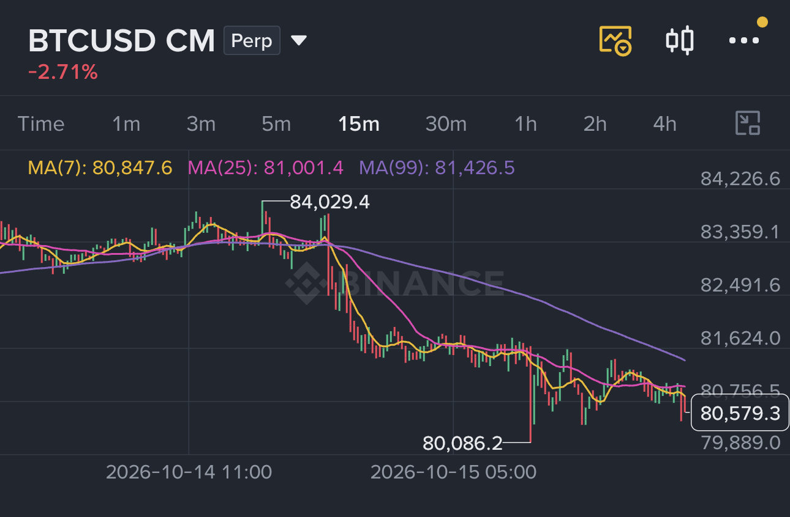
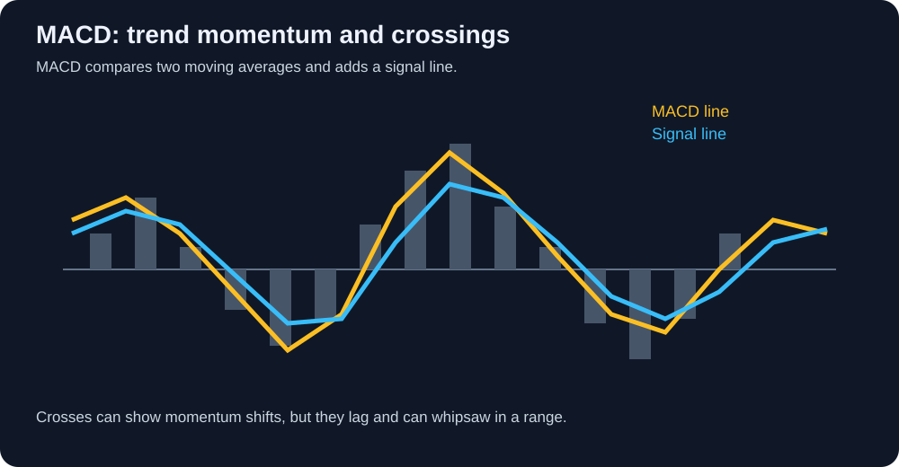
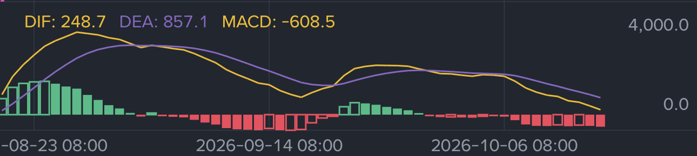

# Advanced — Moving averages and momentum tools

Chapter 2 introduced moving averages, MACD, and other indicators as ways to organize market information. This article goes one step further. It explains how moving averages are built, what traders mean by alignment, golden crosses, death crosses, and MACD signals, and why every one of these tools can mislead.

The central idea is simple: an indicator describes past price behavior. It can help us build a rule, but it cannot remove uncertainty or predict the next candle with certainty.

## 1. Moving averages: a smoother view of price

A moving average takes the closing prices from a chosen number of candles and turns them into one line. On a 15-minute chart, MA(7) uses seven 15-minute closes; on a daily chart, MA(7) uses seven daily closes. The same number therefore represents different lengths of real time on different charts.

### 1.1 SMA and EMA

**SMA** means **Simple Moving Average**. Every candle in the selected period has equal weight. If the last three closes are 82,000, 83,000, and 84,000 USDT, the 3-period SMA is 83,000 USDT.

**EMA** means **Exponential Moving Average**. It gives more weight to recent candles, so it turns faster when price changes direction. That speed can be useful for short-term analysis, but it also makes the line more sensitive to noise. Neither method is automatically better: SMA is smoother, while EMA is more responsive.

The chart calculates both for us. Before comparing two charts, check whether each one uses SMA or EMA; a line with the same period can behave differently under the two methods.

For further reading, see Binance Academy’s [Moving Averages Explained](https://www.binance.com/en/academy/articles/moving-averages-explained/) and this [SMA versus EMA reference](https://altfins.com/knowledge-base/sma-vs-ema/). Treat outside examples as explanations of a tool, not as trading signals.

### 1.2 What MA(7), MA(25), and MA(99) mean

The number in an MA is a **lookback length**, not a rating or a confidence score. In the Binance 15-minute example:

- **MA(7)** covers about 105 minutes and follows short-term movement closely.
- **MA(25)** covers about 6 hours 15 minutes and gives a medium-term view.
- **MA(99)** covers about 24 hours 45 minutes and changes more slowly, showing a broader intraday context.

A shorter MA reacts first but gives more false turns. A longer MA filters more noise but reacts later. Traders often use three different lengths to compare short-term behavior with the larger trend. These numbers are conventions, not laws; the useful period depends on the asset, timeframe, and strategy.

## 2. What moving averages can tell us

A rising MA says that recent closes are generally higher than earlier closes in its window. A falling MA says the opposite. Price holding above a rising MA can support a bullish context; price remaining below a falling MA can support a bearish context. The MA may also act as a **dynamic support or resistance zone** when many traders are watching the same line.

These are observations, not instructions. Price can cross an MA and immediately cross back. A strong trend can run far away from its averages, while a range can cut through them repeatedly. Always read the line together with HH/HL or LH/LL structure, key levels, volume, and the higher timeframe.

## 3. Alignment and crossovers

When a fast MA is above a medium MA and the medium MA is above a slow MA, traders call this **bullish alignment**. For example, `EMA(7) > EMA(25) > EMA(99)` with all three lines rising suggests that recent price strength is stronger than the older trend. The reverse arrangement, with all three falling, is **bearish alignment**.

A **golden cross** occurs when a shorter MA crosses above a longer MA. A **death cross** occurs when it crosses below. On a daily chart, traders often discuss MA(50) and MA(200); on an intraday chart, they may use MA(7) and MA(25). The names describe a relationship between two averages, not a guaranteed market event.

Crossovers are delayed because the averages need enough new candles to change direction. In a sideways market, the same two lines can cross several times and produce a series of small losses. A crossover is more useful when the averages are sloping, price has broken a meaningful level, and the next pullback holds. It is weaker when the lines are flat and tangled.

## 4. MACD: moving-average momentum

MACD stands for **Moving Average Convergence Divergence**. It compares a faster EMA with a slower EMA to show whether recent momentum is becoming stronger or weaker relative to that baseline.

Most charting tools show three parts:

- **MACD line:** the difference between a fast EMA and a slow EMA. The common setting is EMA(12) minus EMA(26).
- **Signal line:** a slower EMA of the MACD line, commonly calculated over 9 periods.
- **Histogram:** the distance between the MACD line and signal line, shown as bars.

If the MACD line is above the signal line, recent momentum is stronger than its recent average. If it is below, momentum is weaker. A move above or below the zero line compares the fast EMA with the slow EMA. Taller histogram bars show increasing separation; shrinking bars show that separation is fading.

The following Binance-style MACD panel uses the names **DIF**, **DEA**, and **MACD** that appear in some charting apps. DIF is the MACD line, DEA is the signal line, and the green or red bars are the histogram. The labels are different, but the ideas are the same as MACD line, signal line, and histogram described above.

### 4.1 Why MACD looks different in different regions

The word **MACD** is used differently by different charting platforms. In many Chinese-language apps, the panel is presented as **DIF** (the fast line), **DEA** (the signal line), and **MACD柱** (the red/green histogram). In many international platforms, **MACD** usually means the fast-minus-slow line, while **Signal** means its smoothed line and **Histogram** means the gap between them.

| Label often seen in Chinese apps | Label often seen in international apps | Meaning |
| --- | --- | --- |
| DIF | MACD line | Fast EMA minus slow EMA, often EMA(12) − EMA(26) |
| DEA | Signal line | A smoothing EMA of the DIF/MACD line, often 9 periods |
| MACD柱 | Histogram | The distance between DIF and DEA |

There is one more source of confusion: some Chinese chart packages display the histogram as `DIF − DEA`, while others display `2 × (DIF − DEA)`. Colors can also be assigned differently, and some platforms calculate from a different price source or use non-standard periods. Therefore, do not identify a line by color or by the word “MACD” alone. Open the indicator settings, check the formula and periods, and compare the displayed values. In the supplied image, `DIF: 248.7`, `DEA: 857.1`, and `MACD: −608.5` are consistent with a histogram close to `DIF − DEA`; the exact display convention belongs to that app.

For standard terminology, compare the platform’s documentation with TradingView’s [MACD explanation](https://www.tradingview.com/support/solutions/43000502344-macd-moving-average-convergence-divergence/) and Binance Academy’s [MACD guide](https://www.binance.com/en/academy/articles/macd-indicator). The calculation matters more than the translation.

### 4.1 How traders read MACD

A MACD line crossing above the signal line can support a bullish momentum hypothesis. A cross below can support a bearish hypothesis. A histogram that keeps growing can support continuation; a histogram that shrinks while price keeps rising can warn that momentum is slowing.

MACD divergence compares price swings with MACD swings. If price makes a higher high but MACD makes a lower high, bullish momentum may be weakening. If price makes a lower low but MACD makes a higher low, selling momentum may be weakening. Divergence is a warning to investigate, not a command to reverse. Strong trends can produce several divergences before price turns.

## 5. Reading the supplied BTC examples

The MA example shows three lines on a 15-minute BTCUSD CM chart. The yellow MA(7) follows candles most closely, the pink MA(25) moves more slowly, and the purple MA(99) gives the broadest view in that screenshot. Price spends much of the right side below the longer purple line, while the shorter lines flatten and move close together. That combination describes weakening short-term momentum and a lack of clean trend continuation; it does not prove that the next candle must fall.

The MACD example shows DIF and DEA moving down toward and below the zero line. Red histogram bars appear when the MACD line is below the signal line, while green bars appear when it is above. Notice that the lines and bars change after price has already moved: MACD is useful for describing momentum confirmation and weakening, but it is delayed. The chart should be read with the price structure and timeframe beside it.

These examples support a careful reading: first identify the trend or range from price, then use the MA and MACD panels to ask whether momentum agrees, weakens, or conflicts. Do not treat a colored line or histogram bar as an independent prediction.

## 6. Combining the evidence

A sensible reading might look like this: the daily chart has HH/HL structure, the 4-hour chart holds above a rising MA(25), volume expands at a breakout, and MACD turns upward after a pullback. Together these observations form a bullish hypothesis. They still do not specify an entry, stop, size, or exit; those must be defined separately.

Do not count EMA, SMA, a moving-average crossover, and MACD as four independent confirmations. They are all heavily derived from the same price data. More lines can make a chart look certain without adding new information. Price structure, volume, volatility, and higher-timeframe context provide different kinds of evidence.

## 7. Common misunderstandings

- **“A golden cross means BTC must rise.”** It means the recent average has moved above the longer average, usually after a move has already started.
- **“A death cross means shorting is safe.”** It can arrive late and fail during a range or a sudden recovery.
- **“An overbought or high MACD reading means sell now.”** Strong trends can remain extended for a long time.
- **“The perfect MA period exists.”** Periods are choices that must fit the timeframe and purpose.
- **“A line touching an MA is guaranteed support.”** A moving average is a reference zone; it can fail with news, liquidation, or thin liquidity.
- **“More indicators mean more certainty.”** Several indicators may simply repeat the same price information.

## 8. A disciplined way to use these tools

Before trusting an MA or MACD signal, state the market regime, the timeframe, the price structure, and the condition that would invalidate the idea. Decide whether the tool is being used as a trend filter, a pullback reference, a momentum warning, or an exit rule. Keep the position small enough that a late or false signal does not force an emotional decision.

The advanced skill is not memorizing a special crossover or finding a perfect setting. It is knowing what the calculation measures, what information it repeats, when it tends to fail, and how to combine it with a clear risk plan.

## References and further reading

- [Moving Averages Explained — Binance Academy](https://www.binance.com/en/academy/articles/moving-averages-explained/)
- [MACD Indicator — Binance Academy](https://www.binance.com/en/academy/articles/macd-indicator)
- [MACD: Moving Average Convergence Divergence — TradingView](https://www.tradingview.com/support/solutions/43000502344-macd-moving-average-convergence-divergence/)
- [SMA versus EMA — Altfins](https://altfins.com/knowledge-base/sma-vs-ema/)
