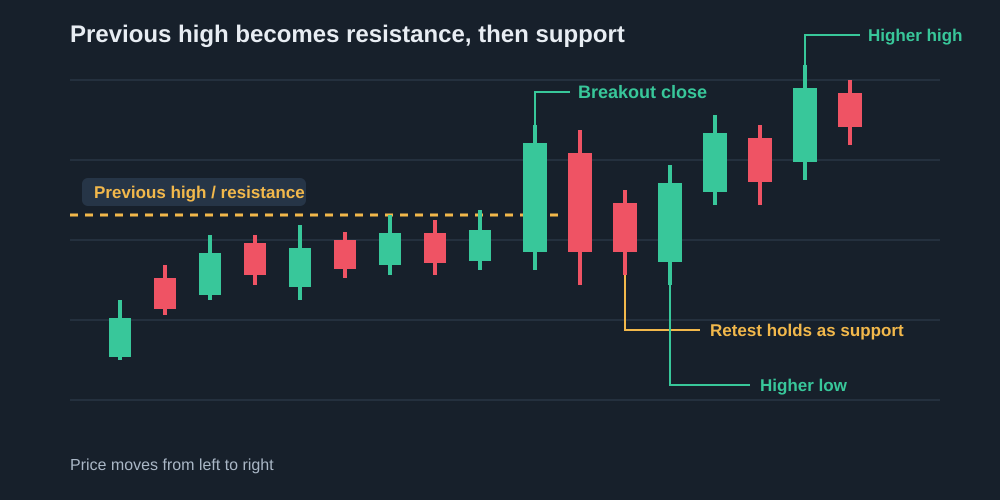

# Advanced — A Spot Trading Strategy

This article develops a spot trading strategy from market context to entry, position size, stop, exit, and review. It starts with BTC because a beginner should reduce unknowns before adding more assets.

## 1. Trading strategy analysis

A trading strategy is a set of rules for deciding when to buy, when to wait, how much to hold, and when to sell. No strategy guarantees profit. A historical result can disappear after fees, slippage, taxes, survivorship bias, or a change in market regime.

The strategies below have produced profitable results in some markets or historical samples. That makes them useful research starting points, not promises that a beginner can copy for guaranteed returns.

### 1.1 Dollar-cost averaging

**Dollar-cost averaging (DCA)** invests a fixed amount on a schedule instead of trying to choose one perfect entry. For example, a person might buy the same amount of BTC every week and keep a separate rule for when to stop, reduce, or sell.

DCA can reduce the emotional pressure of choosing one entry and spreads purchases across different prices. Binance's [DCA guide](https://www.binance.com/en/academy/glossary/dollar-cost-averaging) explains this use, and Binance's [Recurring feature](https://www.binance.com/en/support/faq/detail/5026705ac87942069b1bdcf5a99ffc48) can automate fixed purchases where it is available. Binance also warns that DCA does not remove loss risk. It can underperform a lump-sum purchase in a steadily rising market, and it cannot protect against a long decline. Frequent small orders can also add fees.

DCA is closer to a long-term accumulation plan than to active trading. It is useful for someone with regular income, a long holding horizon, and no need to predict the next few candles. It still needs an allocation limit, a review date, and an exit or rebalancing rule. “I will keep buying until it recovers” is not a complete strategy.

### 1.2 Trend following and time-series momentum

**Trend following** means buying while an asset is clearly moving upward, then reducing or exiting when that upward trend breaks. **Time-series momentum** is the same idea stated as a rule: compare BTC with its own recent history, rather than comparing it with other coins. It is therefore an active, conditional plan; DCA buys on the calendar whether the chart is rising, falling, or unclear. For the detailed definition of an uptrend, downtrend, range, timeframe, and failure condition, read [Advanced — How to Identify a Market Trend](identifying-market-trends.md).

For example, one BTC trend-following rule could use the MA setup explained earlier: stay invested while the daily close remains above a rising long-term average, then move to USDT after a confirmed break below it. Another rule could use market structure: buy after a breakout and pullback, then exit when the higher-low structure fails. The indicator changes, but the strategy idea stays the same: follow strength and leave when the reason for holding disappears.

The advantage is that the rule does not require guessing the exact bottom. The cost is that it enters after a move has already started, gives back some profit during reversals, and can lose several small trades when BTC moves sideways. It is a method for participating in large moves, not a prediction machine.

### 1.3 Breakout and pullback

A **breakout and pullback strategy** does not mean “price is rising, so buy” or “price broke a level, so sell.” It is a conditional plan: first identify the larger environment, then wait for price to leave a meaningful level, and finally ask whether the old level holds when tested from the other side. The pullback is the part that tests the idea.



#### Start with the larger trend

Use the weekly chart for the broad regime and the daily chart for the trade environment. A breakout above resistance has more room to work when the daily chart is making higher highs and higher lows, the weekly structure is recovering or bullish, and price is not breaking directly into a larger weekly resistance zone. A 4-hour breakout that goes against a falling daily structure is only a countertrend rally until the daily structure changes.

The three common contexts lead to different decisions:

| Higher-timeframe context | Meaning of a breakout | Sensible response |
| --- | --- | --- |
| **Bullish**: daily or weekly HH/HL and rising long-term reference | A possible continuation or new leg | Look for a confirmed breakout and pullback; avoid chasing a stretched candle. |
| **Range**: repeated rejection between clear support and resistance | A possible escape from the range, or a liquidity sweep | Wait for a close outside the range and a hold; reduce size because false breaks are common. |
| **Bearish**: daily or weekly LH/LL and falling references | Often a countertrend bounce | Do not treat a 4-hour break as a new bull market; wait for a real change in daily structure or stay in cash. |

#### Define the level before the move

Mark a level from repeated prior highs, a range boundary, or a clearly defended swing. Treat it as a **zone**, because different traders may place orders at slightly different prices. A level is more useful when price has reacted there several times and when the next available space is large enough to justify the risk. If resistance is immediately above the entry, the trade may have no room even if the breakout is genuine.

#### What counts as confirmation?

Use a sequence rather than one exciting candle:

1. **Close:** the selected timeframe closes beyond the resistance zone. A wick above the zone that closes back inside is weaker evidence.
2. **Participation:** volume is meaningfully higher than recent candles, or the move otherwise shows clear acceptance. A volume spike can also be liquidation or news, so it needs price follow-through.
3. **Pullback:** price returns toward the broken zone instead of continuing straight up. The pullback may touch or briefly wick through the zone; what matters is whether it closes back above it.
4. **Structure:** the 4-hour chart forms a higher low and then breaks the nearby pullback high. This gives a more objective trigger than buying simply because the retest has started.
5. **Risk:** the distance from entry to invalidation is acceptable before the order is placed.

MA/EMA, MACD, RSI, volume, and ATR can support this sequence. For example, rising averages and improving MACD can support a bullish continuation, RSI recovering through 50 can show improving momentum, volume can show participation, and ATR can show whether the stop needs more room. They do not replace the close, pullback, and structure. Several of them are calculated from the same price candles, so they are not five independent confirmations.

#### Three ways to enter

There is no single correct entry. The choice changes the trade-off between price and confirmation:

- **Breakout-close entry:** buy after the daily or 4-hour candle closes above the zone. This gets earlier exposure, but the stop may be far away and the breakout can fail on the next candle.
- **Limit-on-retest entry:** place a limit order near the old resistance after the close. This can produce a better price, but the order may not fill, or price may pass through the level without holding.
- **Structure-confirmation entry:** wait for the retest to hold and for a 4-hour higher low to break its local high. This gives more confirmation, but the entry is later and the risk-to-reward may be smaller.

Choose one rule before the trade. Do not enter half a position by impulse and then invent a different rule because the candle moved quickly.

#### Stop, size, and target

The invalidation point belongs below the structure that should hold. For a long BTC trade, that may be below the retest low, the reclaimed resistance zone, or the 4-hour higher low. A stop placed exactly on an obvious level can be hit by ordinary noise, so compare the distance with ATR and leave only the room that the account can afford.

Position size should be calculated from the amount you are willing to lose, not from the amount you hope to make:

```text
position size = planned loss ÷ (entry price − stop price)
```

The target should be the next meaningful resistance or a predefined reward-to-risk level. If the next resistance offers less potential reward than the planned loss, skip the trade. A profitable breakout does not require holding forever: take partial profit only if that is part of the written plan, and move the stop only according to a rule.

#### A concrete BTC example

Assume BTC has a bullish daily HH/HL structure. The daily chart has repeatedly rejected **70,000 USDT**, then closes at **71,200** with stronger volume. Instead of buying the large candle immediately, the trader marks **70,000–70,500** as the old resistance zone and waits on the 4-hour chart.

If BTC pulls back to 70,300, closes above the zone, forms a 4-hour higher low at 69,800, and then breaks the pullback high, a planned long entry can be considered. The stop might sit below 69,800 after checking the current ATR; the target might be the next daily resistance near 74,000. If BTC closes back inside the old range and then breaks 69,800, the setup is invalid and the trader exits or never enters. The example describes a decision rule; it does not predict whether BTC will reach 74,000.

#### When not to use it

Do not force a breakout-and-pullback trade when the higher timeframe is unclear, the level is too close to the next resistance, the breakout candle is already extended, volume is thin, or a major event can change liquidity. A news-driven spike can leave no orderly pullback. In a broad range, the best trade may be to wait for a genuine close and retest—or to do nothing.

The strategy's edge, if it has one, comes from making the risk small when the market does not confirm the idea and allowing confirmed moves room to develop. It is not a way to buy every rally. It is a way to define what must happen before entry and what proves the idea wrong afterward.

### 1.4 Range mean reversion

A **range mean-reversion strategy** buys near established support and reduces or exits near resistance while the range remains intact. It assumes that price will return toward the middle of the range after moving too far in one direction.

Mean reversion can appear at some short horizons, but the result depends heavily on the timeframe, market regime, and trading costs. Treat an oversold reading as a setup to investigate, not as a promise that price will bounce.

The main failure is a genuine breakout. A trader who keeps buying because price “looks cheap” can accumulate a large losing position while the old range becomes resistance. This strategy is better studied after the trader can identify a valid range, define its failure level, and stop trading it when volatility expands.

### 1.5 Which strategy should we develop first?

For an ordinary person trading BTC spot, this book will develop a **regime-filtered trend and pullback strategy**. It combines the most teachable parts of the strategies above:

1. Use the weekly or daily chart to classify the environment.
2. In a clear bullish regime, look for a planned pullback or a confirmed breakout rather than chasing a rising candle.
3. Use the 4-hour chart to refine the entry and confirm that the relevant level holds.
4. Use MA, MACD, RSI, volume, and ATR as supporting evidence, not as independent promises.
5. Place the invalidation stop below the higher low or support that the hypothesis depends on.
6. Reduce exposure or stay in USDT when the higher-timeframe structure is bearish or unclear.

This approach is deliberately unexciting. It gives a spot trader a way to participate in a sustained bull trend, remain mostly in cash during a bear trend, and avoid treating every 5-minute movement as an opportunity. It will still lose during false breakouts and sideways markets. Its value must be measured by a journal and a realistic backtest, not by one successful BTC trade.

## 2. What “profitable” must mean

A strategy is not proven by a high win rate or by one large gain. Measure expectancy after fees and slippage:

```text
expectancy = (win rate × average win)
           − (loss rate × average loss)
           − average trading costs
```

Also record the longest losing streak, maximum drawdown, number of trades, and the market regimes in which the method worked or failed. A strategy that earns money only during a bull market is not automatically broken; it may need a rule that keeps it out of bear markets. A strategy that works only after repeated parameter changes may be curve-fitted.

The next sections will turn the BTC trend-and-pullback idea into precise rules, test examples on historical charts, and compare it with DCA and range trading without pretending that any strategy can predict every market move.
