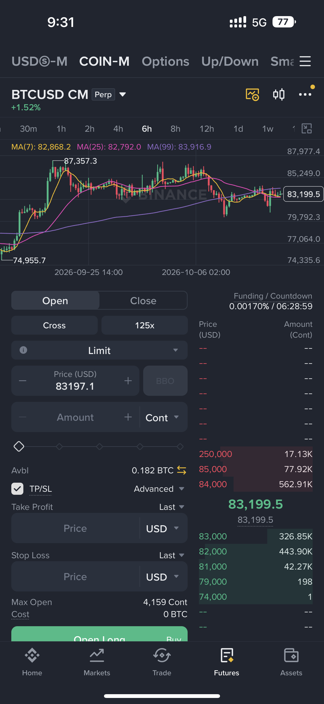
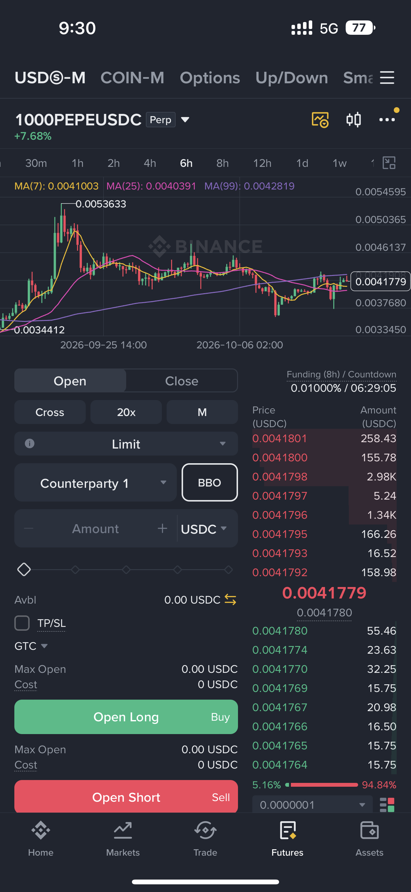
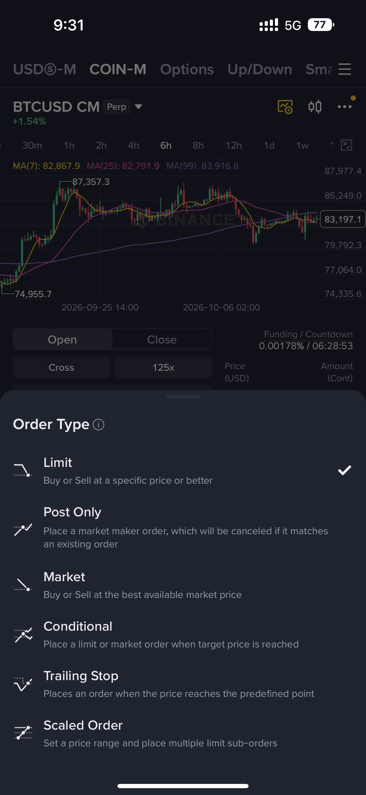

# Chapter 1 — Foundations: from crypto to a real trading decision

## Chapter map

1. [Before you dive into trading](#1-before-you-dive-into-trading)
2. [What a real CEX looks like](#2-what-a-real-cex-looks-like)
3. [The essence of making money](#3-the-essence-of-making-money)
5. [Binance app field guide](#5-binance-app-field-guide)

This chapter answers a simple question: what exactly are you looking at when you open Binance? A token, an account balance, an order book, a derivative, and a wallet transaction are different things. Confusing them is one of the fastest ways for a beginner to lose money.

---

## 1. Before you dive into trading

Crypto consists of digital assets such as Bitcoin; this book focuses on crypto rather than stocks because its markets trade around the clock and involve different custody and leverage risks—not because it is easier to make money.

### 1.1 Glossary: only the terms you need at first

- **Spot:** you buy or sell the asset itself. A spot BTC purchase can leave you with BTC in the exchange wallet; there is no automatic liquidation.
- **Margin:** borrowed or reserved collateral used to make a position larger than your cash balance. Losses can consume the collateral and trigger liquidation.
- **Perpetual (perp):** a futures contract with no ordinary expiry. It tracks a reference price through funding payments; it gives price exposure, not the underlying coin.
- **Option:** a contract giving the buyer the right, but not the obligation, to buy or sell at a specified price before or at an expiry. The buyer pays a premium; the seller takes a different, potentially much larger risk.
- **Leverage:** the size of the position compared with the margin supporting it. It magnifies gains, losses, fees, and liquidation risk.
- **Wallet/custody:** where the asset or claim is held and who controls the keys or account withdrawals.
- **K-line (candlestick):** a compact record of a market interval showing its open, high, low, and close price; the body shows open-to-close movement and the wicks show the extremes.
- **Liquidity:** how much can be bought or sold near the current price without moving the market sharply. A deep BTC market may absorb a large order across many nearby prices; a thin market may jump several levels when a modest order arrives. Low liquidity usually means wider spreads, more slippage, and a greater chance that a stop or indicator signal behaves differently from the chart expectation.

These definitions are enough to read a basic order screen. Learn more technical details when a strategy actually uses them; memorizing vocabulary is not the same as understanding risk.

### 1.2 Why does the market go up and down?

Knowing what the thing is tells you what can make or destroy its value:

- A **spot token** is exposed to price, liquidity, custody, contract, and network risks.
- A **stablecoin** seeks a stable reference value but has reserve, issuer, redemption, de-peg, regulatory, and liquidity risks.
- A **perpetual future** adds leverage, funding, mark-price, liquidation, counterparty, and basis risks.
- A **DeFi position** adds smart-contract, oracle, bridge, governance, and wallet-approval risks.
- An **exchange balance** adds platform solvency, account-security, withdrawal, and jurisdiction risks.

Markets are prices formed by participants trading these exposures. The chart is only the visible output. The cause may be new information, forced liquidation, funding pressure, a token unlock, a change in liquidity, a protocol failure, or a change in risk appetite. If you cannot name the exposure, you cannot interpret the chart responsibly.

At the simplest level, price moves because buyers are willing to pay more aggressively than sellers, or sellers are willing to accept less. Behind that interaction are several forces:

- new information about adoption, regulation, security, rates, liquidity, or a project;
- changing expectations about the future rather than only current facts;
- leverage, funding, liquidations, and stop orders forcing trades;
- large holders, market makers, ETFs, treasuries, and miners changing their flow;
- thin liquidity, where a modest order moves price a long way;
- fear, greed, and the need for participants to reduce risk quickly.

The chart is the final record of these competing decisions. One headline can push price briefly, while a liquidation cascade or a change in global liquidity can carry the move for weeks. You rarely know the full cause in real time, so separate what you observed from the story you are using to explain it.

### 1.3 Whose prediction should you trust?

You will find traders, influencers, analysts, and AI systems making opposite forecasts. That is normal: the future is uncertain, and a confident explanation is not evidence. Do not choose the loudest person or outsource your decision to a chatbot.

Use advice as a **hypothesis**, then check it yourself:

1. What product and timeframe is the person discussing?
2. What evidence would prove the idea wrong?
3. Is there a defined entry, invalidation, position size, and time horizon?
4. Does the claim survive fees, slippage, funding, and a losing streak?
5. Can you test it on past data or paper trades without changing the rules afterward?

Build your own mindset by keeping a trade journal. Record what you believed before the trade, what would change your mind, what actually happened, and whether you followed your rules. Your goal is not to predict every move; it is to make decisions you can repeat and review.

### 1.4 Protect yourself before trying to profit

Do not begin with dangerous leverage, all-in bets, borrowed money, revenge trades, or a product you cannot explain. Gambling feels like action but gives you no reliable feedback. Start with an amount whose loss will not damage your life, and use spot or a simulator while learning.

You will lose some trades even when your process is good. Loss is the price of uncertainty, not proof that you must immediately win it back. The dangerous response is increasing size, moving a stop, or abandoning a plan to relieve an emotion. Fear, greed, impatience, and the need to be right are often more damaging than a bad indicator.

“Knowing more is knowing less” is a useful warning: more information does not automatically produce better decisions. Learn enough to identify the risk, then act only when your rules and size are clear. This is a form of **training and personal discipline**—a practice of patience, self-observation, and repeated practice—rather than a race to find a secret signal.

### 1.5 A beginner’s identification checklist

Before researching a symbol, write:

- What is the exact product: spot, margin, perpetual, dated future, option, earn product, or on-chain token?
- What is the base asset and what is the quote/collateral asset?
- Who controls custody and who can stop withdrawals?
- What creates demand for the asset or contract?
- What creates new supply, dilution, funding payments, or forced selling?
- Which risks can make the position untradeable, not just cheaper?

This is not paperwork. It prevents the common error of using a spot intuition on a leveraged derivative or treating a marketing label as fundamental information.

---

## 2. What a real CEX looks like

A **centralized exchange (CEX)** is a company-operated venue that combines account management, custody, market data, order matching, settlement, and risk controls. Binance is a useful case study because one app contains Spot, USDⓈ-M Futures, COIN-M Futures, Options, trading bots, wallet transfers, and other products. Those tabs are not interchangeable: each one creates a different exposure, fee model, and failure mode.

The screenshots below are visual references from the Binance mobile app. Menu names, limits, eligibility, and exact behavior can change by region, account type, contract, and app version. Read the current order preview and product terms before submitting an order.

### 2.1 USDⓈ-M and COIN-M: two different futures families

**USDⓈ-M Futures** are margined and generally settled in a dollar-referenced asset such as USDT or USDC. For a BTC example, `BTCUSDC Perp` is a USDⓈ-M perpetual: the contract is quoted in USDC, and the futures account uses the eligible stablecoin collateral under the selected asset mode. USDⓈ-M makes the PNL unit easier to read in a stablecoin, but the stablecoin and exchange still carry risk.

*BTC example — a USDⓈ-M screen shows the perpetual contract, chart, funding countdown, cross margin, leverage, order type, order book, and long/short controls. The exact BTCUSDC screenshot should be read together with the current contract specification.*

**COIN-M Futures** use a cryptocurrency as margin and settlement collateral. In the screenshot, `BTCUSD CM Perp` is a BTC coin-margined perpetual. The contract is quoted in USD, but BTC is the collateral unit. This creates a double exposure: BTC collateral can lose dollar value while a position is losing. COIN-M contracts can be useful for a specific hedging or collateral objective, but they are harder to reason about than a stablecoin-margined position.

*Figure 2.2 — COIN-M screen: BTC collateral, contract quantity, funding, order book, mark/last-price choices, and TP/SL fields.*

Both families can include perpetuals and dated delivery contracts. A perpetual has no ordinary expiry, so a funding mechanism helps keep it near its reference market. A dated future settles at expiry. Before comparing a USDⓈ-M and COIN-M chart, check contract size, quote/collateral asset, tick size, funding, mark price, leverage limits, and liquidation rules.

### 2.2 One search term can return several different products

The supplied screenshots search for `btc`. This is a useful warning: **the search result is not a list of interchangeable ways to buy Bitcoin**. It is a filter across several product families. BTC appears in many of them because it is widely listed, but other assets can have a smaller or different set of markets.

*Figure 2.3 — Searching `btc` in Binance returns results grouped as Spot, Futures, Stocks, and Alpha.*

The screenshot shows why a search result needs interpretation: one search can lead to a normal coin purchase, a leveraged contract, a stock ticker, or an on-chain discovery page. Start with the product you actually intend to use, then open its details before placing an order.

#### Spot results: the usual way to buy Bitcoin

- **BTC/USDT** is the normal starting point for most learners. You spend USDT and receive BTC, or sell BTC and receive USDT. Choose it when you want to own Bitcoin, hold it, withdraw it, or use a simple recurring-buy plan. A filled 100 USDT market buy gives you roughly 100 USDT worth of BTC after fees; there is no liquidation price because you are not borrowing.
- **BTC/USDC** gives the same spot exposure, but your cash balance is USDC. Choose it when your funds are already in USDC or its spread and fees are better. If you have USDT and no special reason to use USDC, BTC/USDT is usually simpler.
- **ETH/BTC** is for trading Ethereum against Bitcoin. Buying it spends BTC to receive ETH; selling it turns ETH into BTC. Use it when you want to change your ETH-to-BTC mix, not when you simply want dollar-priced Bitcoin.

The `10x` badge is an app/product availability label, not automatic leverage on a normal Spot purchase. **Price Protection** and **Taker Fee Promo** are temporary execution or fee-program labels; read the order ticket and current terms.

#### Futures results: choose these for a defined reason

- **BTCUSDT Perp** is the common futures choice. It is a USDⓈ-M perpetual: you post eligible stablecoin margin and take a leveraged long or short position. Use it only for a controlled hedge or directional trade after understanding funding, liquidation, leverage, and position size. It does not give you BTC to withdraw.
- **BTCUSDC Perp** is the same broad idea with USDC as the margin/settlement currency where supported. It makes sense when your collateral is already USDC or its execution conditions suit your strategy.
- **BTCUSD CM Perp** is COIN-M. The contract is quoted in USD, but BTC is the margin and settlement asset. A BTC holder may choose it to keep collateral in BTC or hedge a BTC balance, but profits and losses are also affected by BTC's dollar value.
- **A suffix such as `1225` or `0326`** usually identifies a dated delivery contract. Use one only when you deliberately want an expiry and have checked the settlement date, multiplier, and delivery rules.
- **Unfamiliar symbols such as `BTCU`** should never be selected from the name alone. Open the contract details and confirm the margin asset, contract type, expiry, multiplier, funding, mark price, and leverage limits.

A practical rule: use **Spot BTC/USDT** to own Bitcoin; use **BTCUSDT Perp** only for a controlled leveraged or hedging plan; use **BTC/USDC** when your collateral or execution conditions make it worthwhile; and use **COIN-M or dated futures** only when you can explain the collateral and settlement choice in one sentence.

#### Stocks results

Rows such as **BTCS**, **BTCT**, and **BTCZ** are stock tickers containing the letters “BTC”; they are not Bitcoin and are not crypto pairs. A stock result represents a separate securities product, issuer, trading schedule, custody arrangement, and legal regime. Binance’s current stock and tokenized-securities products are jurisdiction-limited; a ticker match does not mean you own the underlying company or Bitcoin. Read the product disclosure before using a Stocks result. See Binance’s [stock trading guide](https://www.binance.com/en/support/faq/detail/a7469c7703524024b5bc2d492b03639d) and [bStocks explanation](https://academy.binance.com/en/articles/what-are-bstocks-a-guide-to-tokenized-stocks-on-binance).

#### Alpha results

**Alpha** is a discovery/listing category, not a special kind of BTC ownership. It may surface early or on-chain assets and related market information. Treat the label as a navigation filter. Check the token contract, network, liquidity, price impact, holder concentration, permissions, and whether the action is Spot or Wallet/on-chain before signing or trading anything.

#### A five-question check before opening any result

1. Is this **Spot**, **Futures**, **Options**, **Stocks**, or **Alpha/on-chain**?
2. What exactly is the base asset, quote asset, collateral, and settlement asset?
3. Do I own the underlying asset, or do I hold a contract/account claim that tracks its price?
4. Is there an expiry, funding payment, leverage, liquidation price, or smart-contract approval?
5. What are the fees, spread, liquidity, network, jurisdiction, and withdrawal rules?

If you cannot answer those questions, you have not yet selected a product—you have only selected a search result.

### 2.2 Read the futures screen from top to bottom

1. **Product tab:** USDⓈ-M, COIN-M, Options, or another derivative product.
2. **Symbol and contract:** the underlying, quote/settlement convention, and `Perp` or expiry.
3. **Chart:** selected timeframe, candles, indicators, and mark/last display.
4. **Funding:** current rate and countdown; funding is a transfer between eligible long and short positions, not a free yield.
5. **Open/Close:** whether the order increases exposure or reduces an existing position.
6. **Margin mode:** Cross or Isolated. Cross can use the eligible futures-wallet balance collectively; isolated assigns margin to a position under the product rules.
7. **Leverage:** exposure relative to margin. It magnifies PNL, fees, and liquidation sensitivity; it does not create an edge.
8. **Price and amount:** confirm whether amount means base asset, quote asset, or contract count. One `Cont` is not necessarily one coin.
9. **Trigger source:** Last Price or Mark Price. A stop based on one can trigger differently from a stop based on the other.
10. **TP/SL:** check whether it is reduce-only, which quantity it covers, and what order type is created after triggering.
11. **Order book:** red asks and green bids are currently displayed liquidity, not guaranteed support or resistance.

Binance’s own futures guide explains that USDⓈ-M can use USDT/USDC margin while COIN-M uses coin collateral, and that futures PNL and liquidation calculations depend on the contract specification and mark price. Read the [current Futures contract and clearing rules](https://www.binance.com/en/support/faq/detail/360033180732) before using derivatives.

### 2.3 Order types in the screenshot

The order-type sheet in Figure 2.3 lists **Limit, Post Only, Market, Conditional, Trailing Stop, and Scaled Order**. They answer different execution questions:

*Figure 2.3 — Binance order-type menu shown in the supplied screenshot.*

**Maker** means your order rests on the order book and adds liquidity; **taker** means your order matches an order that is already waiting and removes liquidity. A limit or post-only order can be a maker, while a market order is a taker; conditional, trailing, and scaled orders become maker or taker depending on how each child order executes.

The fee column below uses the published **regular-user starting rates** as a simple reference: Spot is **0.100% maker / 0.100% taker**, while USDⓈ-M and COIN-M Futures are typically **0.020% maker / 0.050% taker**. Your actual rate can change with VIP level, BNB or other promotions, product, region, and pair. Check Binance’s [current Spot fee table](https://www.binance.com/en/fee/trading) and [Futures fee table](https://www.binance.com/en/fee/futureFee) before trading; fees are charged on notional trade value, and a round trip normally pays a fee on both entry and exit.

| Order type | In everyday language | What happens in a BTC trade | What you give up | Typical Binance fee for a regular user* |
| --- | --- | --- | --- | --- |
| **Limit** | “Buy or sell only at my chosen price, or a better one.” | BTC is at 83,300 USDC. You place a BTCUSDC buy limit at 82,800. Nothing happens until sellers offer BTC at 82,800 or lower. | You control price, but you may miss the trade. If it crosses the book, it can fill immediately as a taker. | Spot: **0.100% maker / 0.100% taker**. Futures: **0.020% / 0.050%**, if it rests or crosses respectively. |
| **Post Only** | “Put my limit order on the book; cancel it if it would fill immediately.” | You place a post-only BTC buy at 83,250. It must wait as a maker; if it would match immediately, Binance cancels or rejects it. | You protect maker intent and may pay the lower fee, but you sacrifice certainty of execution. | Usually the **maker rate**: Spot 0.100%; Futures 0.020%. |
| **Market** | “Fill me now at the best prices available.” | A market BTC buy consumes the cheapest sell orders, perhaps filling at 83,300, 83,305, and 83,320. | You get speed, but the average price can be worse than the number on screen. | Usually the **taker rate**: Spot 0.100%; Futures 0.050%. |
| **Conditional** | “Wait for a condition, then place an order.” | A stop-market sell triggers when Mark Price reaches 82,800; Binance then submits a market sell. A stop-limit submits your chosen limit instead. | A triggered limit can remain unfilled during a fast fall. | Depends on the order created: maker if it rests, taker if it executes immediately; a stop-market is normally taker. |
| **Trailing Stop** | “Follow BTC while it moves in my favor; exit after a reversal.” | BTC rises from 83,300 to 84,000. With a 1% callback, the exit follows and triggers after the configured reversal. | Normal noise can trigger it, and execution is not guaranteed at the trigger price. | The resulting execution determines it: usually the **taker rate** for a market-style exit. |
| **Scaled Order** | “Break one large order into many smaller limit orders across a price range.” | You spread a BTC buy across 82,800, 82,600, 82,400, and 82,200. | Some orders may never fill, and each child order can have a different fee tier. | Each child order is charged according to its own execution: maker if it rests, taker if it crosses. |

### A single BTC example: choosing the order deliberately

Imagine BTCUSDC is trading at **83,300**, and you have decided—before opening the ticket—that you will risk only **10 USDC** on a small paper-trading experiment. Your market view is not enough by itself; you also need an entry, an invalidation, and an exit plan.

1. **You want a cheaper entry, and missing the trade is acceptable.** Place a limit buy at 82,800. If the market dips to 82,800, you may fill; if it jumps to 84,000, you remain out. The order expresses patience, not a prediction that 82,800 must hold.
2. **You want to join the book and avoid taking liquidity.** Place a post-only buy at 83,250. It will wait. If the current ask is already 83,250 or lower, the exchange cancels it instead of filling it immediately. You must decide whether to replace it later.
3. **You need exposure immediately.** Place a market buy. Check the order-book depth and estimated slippage first. “Market” means best available prices, not “the last price shown.”
4. **You want to enter only after a breakout.** Set a conditional buy: trigger when Mark Price reaches 84,000, then submit a market or limit order. A wick on Last Price alone may not trigger a Mark Price condition, and a limit order after the trigger may not fill.
5. **You already own a BTC long and want profits to run.** Use a trailing stop with a callback that fits BTC’s normal noise. It can protect part of a rise, but it is still an execution rule, not a guarantee.
6. **You want to build a position gradually.** Use a scaled order across 82,800–82,200. Before submitting, calculate the total BTC if every child order fills, the average price, fees, and the maximum loss if your invalidation is broken.

The correct choice depends on the job: **limit controls price, post-only controls maker behavior, market controls urgency, conditional controls timing, trailing stop controls a moving exit, and scaled orders control distribution**. None of them turns an uncertain market into a certain profit.

Binance documents conditional orders as a category containing stop-limit, stop-market, and stop-BBO orders; the availability of this category differs between USDⓈ-M and COIN-M. Its scaled-order tool lets the user choose lower/upper price, size, order count, and distribution. See the [order-type guide](https://www.binance.com/en/support/faq/detail/360033779452), [conditional-order guide](https://www.binance.com/en/support/faq/detail/998e63d2587d4e2fb894b1615de3b288), and [scaled-order guide](https://www.binance.com/en/support/faq/detail/109e5e36156d4c57a8ee29734f8bed3a).

A beginner should first understand **limit, market, and one explicit stop rule** in paper trading. Post Only, conditional, trailing, and scaled orders are execution tools—not independent strategies. If you cannot explain what happens when the trigger gaps through your price, do not rely on that order to protect you.

### 2.4 What a CEX cannot promise

A CEX cannot promise that a market order fills at the number on your chart, that a stop-limit exits during a gap, that a displayed order-book wall remains, that a grid bot profits outside its assumptions, or that an options premium will retain value. It also cannot remove phishing, API-key leakage, account takeover, or network mistakes. Convenience is not certainty.

## 3. The essence of making money

### 4.1 Can we really predict the market?

Usually we cannot predict the next price with certainty. A trading strategy can still make money if it has positive expectancy: across many trades, its average outcome after fees and slippage is positive. The useful question is not “Will this candle go up?” but “Under what conditions does this rule have a small, repeatable advantage, and how much can I lose while testing it?”

A strategy can win with a low win rate if winners are sufficiently larger than losers. It can also lose with a high win rate if one large loss erases many small wins. This is why expectancy, drawdown, risk of ruin, and execution costs matter more than a screenshot of a winning trade.

### 4.2 Analyst and K-line reading

Chart analysis is a way to form conditional hypotheses about trend, liquidity, momentum, and risk. It is useful when the rules are explicit and tested. It fails when a person retrofits a story to a completed chart, changes the pattern definition after each loss, or treats a familiar shape as a law of nature.

Write the setup before the outcome: instrument, timeframe, entry, invalidation, exit, size, and what would make you skip the trade. If two analysts cannot tell whether the rule triggered, it is not yet a strategy.

### 4.3 News and fundamentals

News can change the distribution of outcomes, but a headline alone does not tell you whether the market already priced it in, how crowded the trade is, or how liquidity will behave. Follow primary sources where possible: protocol releases, governance decisions, filings, official exchange notices, token-unlock schedules, and macroeconomic data. Record the timestamp and the market’s reaction rather than trading the headline’s emotional tone.

Fundamental research asks what supports value or demand: network usage, fees, security, supply schedule, treasury, competition, governance, regulation, and dependency on an issuer or venue. Fundamentals can be slow-moving while price is driven by leverage and positioning in the short term.

### 4.4 Quantitative research

Quant is not a magic prediction machine. It is a disciplined way to turn a hypothesis into data, rules, tests, and execution assumptions. A beginner can start with a simple moving-average trend rule or volatility filter. A professional workflow usually includes clean timestamped data, a benchmark, train/validation/test separation, realistic fees and slippage, walk-forward testing, paper trading, monitoring, and a kill switch.

Machine learning comes late. A model can memorize noise, leak future information, exploit bad data, or produce signals that cannot be executed. A simple strategy that survives unseen data and realistic costs is more valuable than a complex model with an impressive backtest.

### 4.5 Where returns actually come from

A sustainable edge must come from a reason participants pay you to take risk or provide a service. Examples include bearing inventory risk as a market maker, supplying liquidity, harvesting a documented risk premium, reacting faster to public information, or exploiting a temporary behavioral/structural inefficiency. Every edge competes with fees, slippage, adverse selection, other traders, changing regimes, and your own operational mistakes.

The complete money-making equation is:

`net result = signal edge − fees − spread − slippage − funding/borrow − errors − taxes (where applicable)`

Risk management does not create an edge, but it determines whether you remain alive long enough to learn whether an edge exists.

### 4.6 Four questions before every trade

1. What is the product and what exactly do I own or owe?
2. What is my testable reason for entering now?
3. Where am I wrong, how much will that cost, and how will execution behave?
4. What evidence will make me stop, reduce size, or retire the idea?

If the answer is “because it is going up,” you have described recent price action, not a complete strategy.

---

Crypto From Bottom is a structured, practice-first path for people who are new to crypto, have lost money, and want to build durable skills instead of chasing signals.

> **Scope:** education only. Crypto is volatile, leveraged products can lose more than the initial deposit, and no section of this project is a promise of returns. Start with paper trading and money you can afford to lose.
