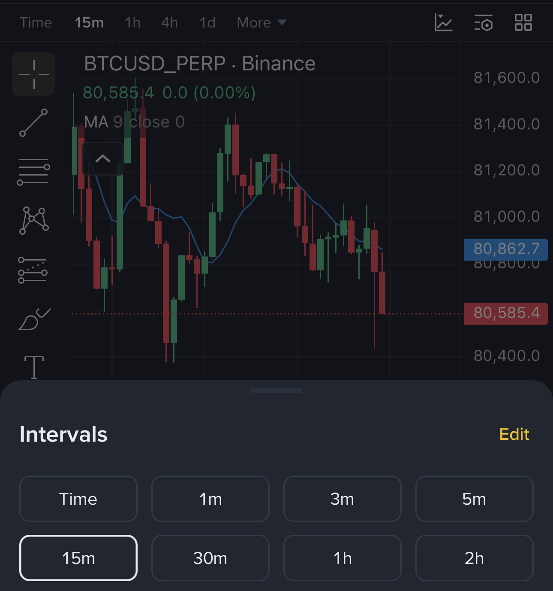
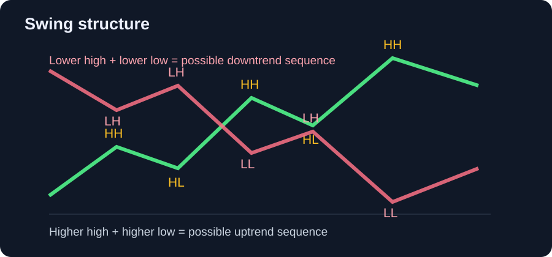
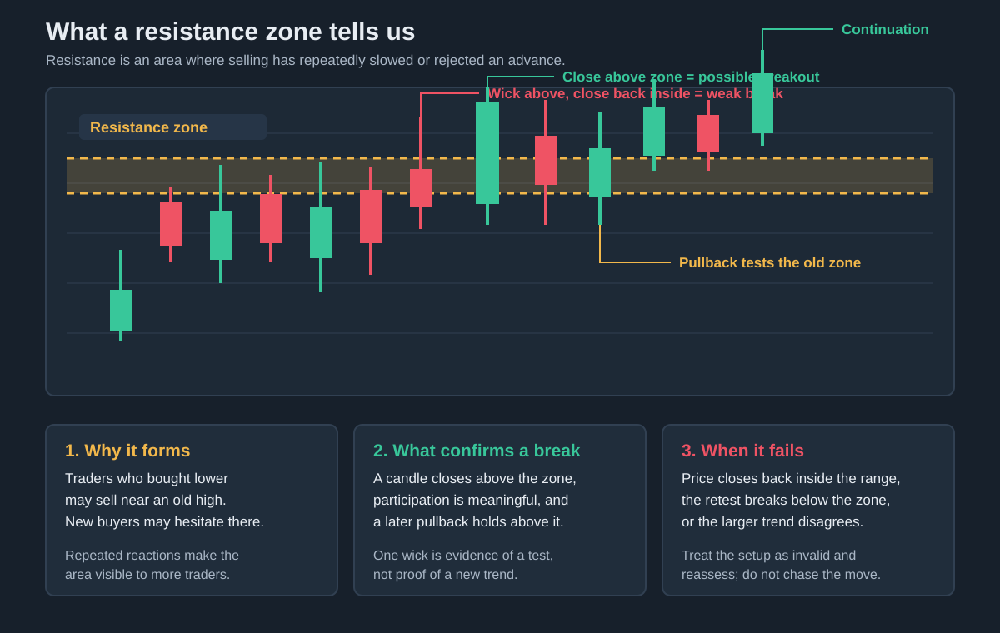
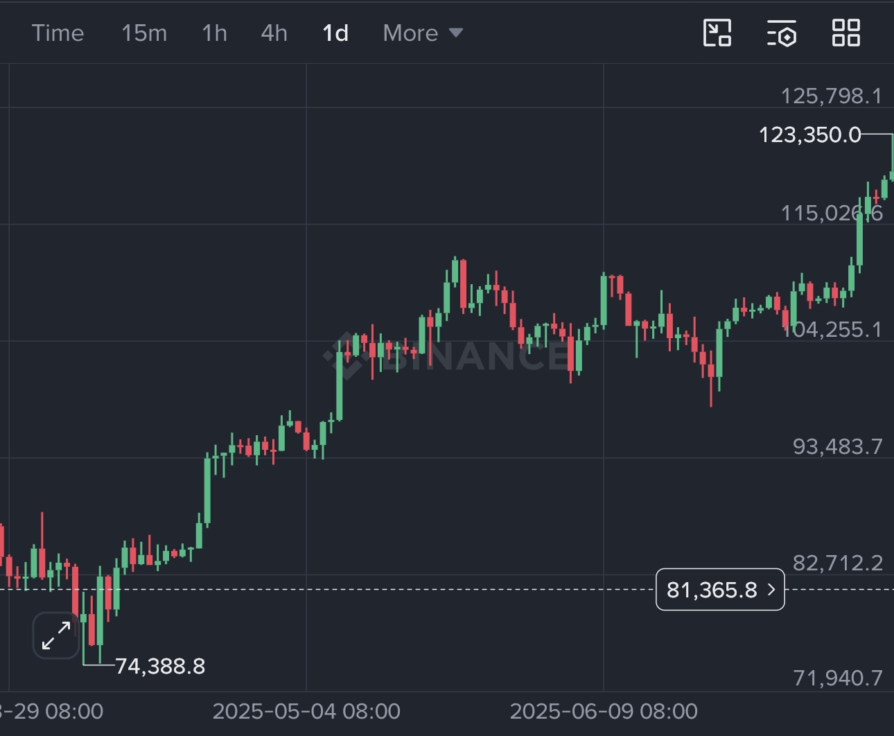
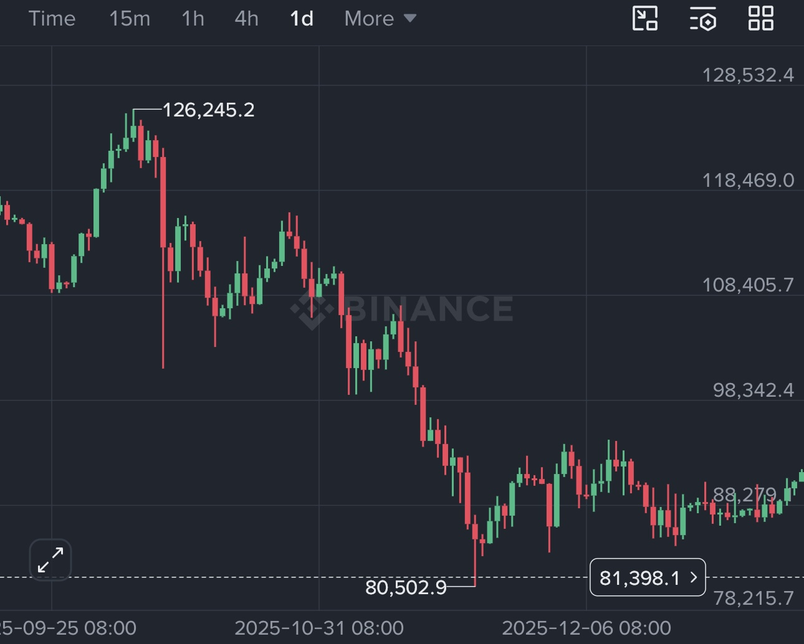
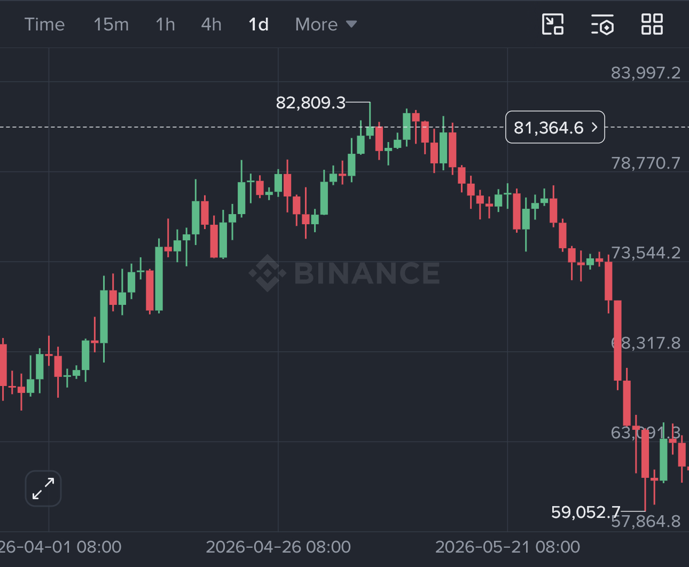
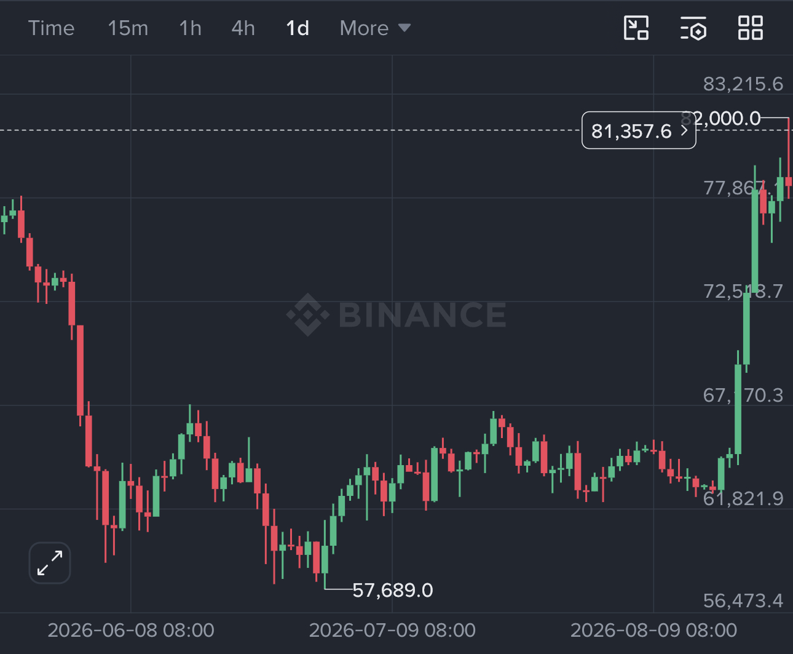
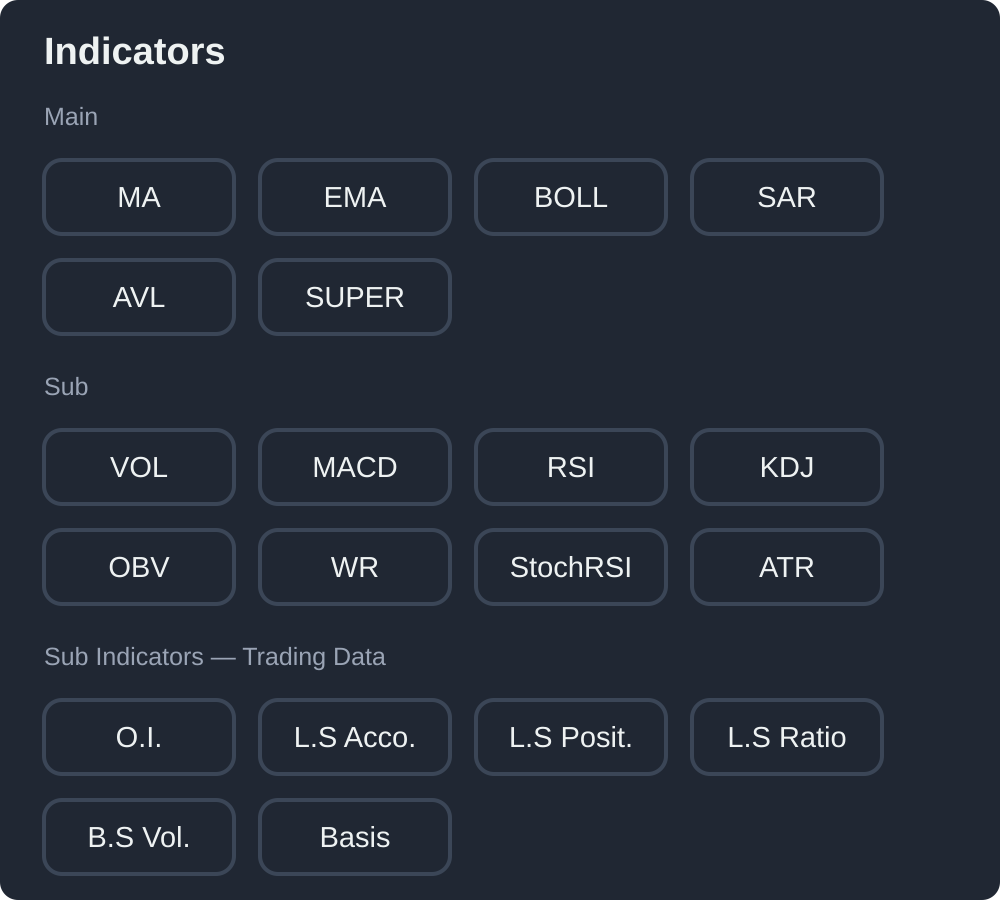
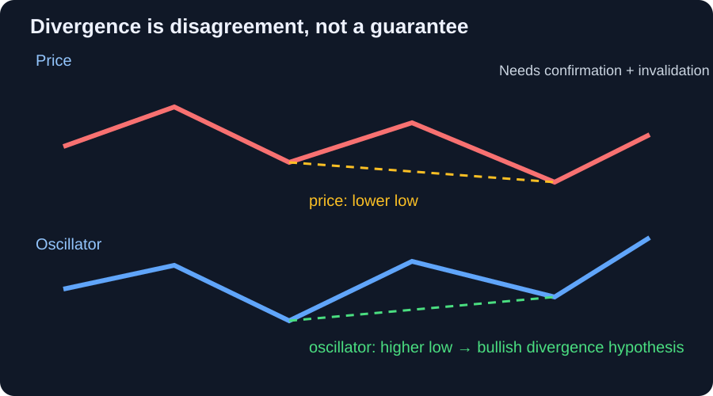
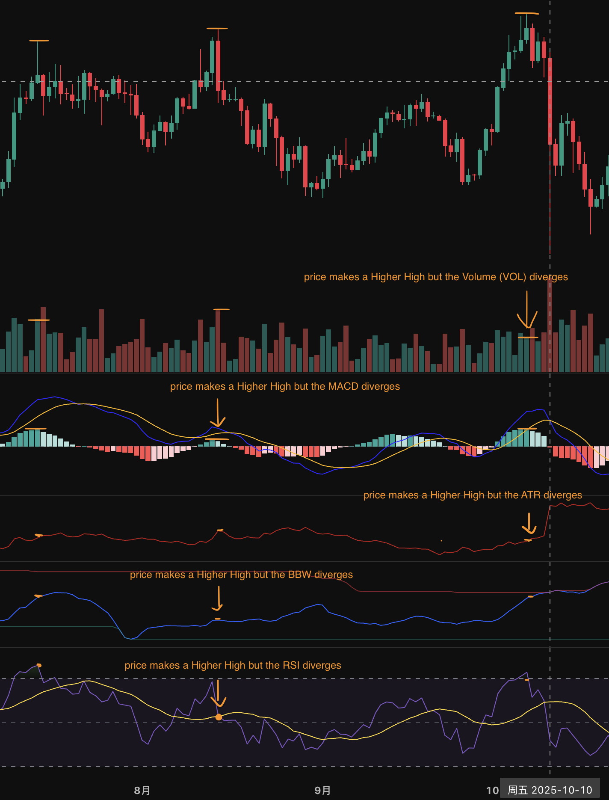

# Chapter 2 — K-line analysis

Chapter 1 introduced crypto as a market of digital assets, contracts, and competing expectations. Before choosing an order, we need a way to describe what the market has actually done. A **K-line is a data summary of market movement**: each candle compresses all matched trades during one interval into an open, high, low, and close. Reading K-lines does not give us secret information or certainty about the next move. It gives us a common language for describing evidence, locating risk, and testing our own ideas.

## 1. K-line foundations

### 1.1 K-line construction and glossary

A candlestick, or K-line, contains four prices. The **open** is the first traded price in the interval; the **close** is the last; the **high** and **low** are the extremes. The thick **body** connects open and close. The thin lines above and below are the **upper wick** and **lower wick** (also called shadows). On most charts a green candle means the close is above the open, while a red candle means the close is below it. The color is a display convention, not a prediction.

A long upper wick shows that buyers reached higher prices but sellers pushed the close back down. A long lower wick shows rejection of lower prices. Neither wick guarantees what happens next. A candle is evidence about one interval, not a complete explanation of the market.

**Small glossary:**

- **K-line / candlestick:** OHLC data for one time interval.
- **Body:** the distance between open and close.
- **Wick / shadow:** the distance from the body to the high or low.
- **Bullish candle:** close above open.
- **Bearish candle:** close below open.
- **Range:** high minus low; a simple measure of that candle’s movement.
- **Close:** the final price only after the interval ends; an open candle can still change.

### 1.2 Timeframes: 1m, 5m, 1h, and weeks

A chart’s **interval** or **timeframe** tells the exchange how much trading time belongs in one candle. On the Binance selector below, choosing 15m means each K-line summarizes 15 minutes; choosing 1h means each K-line summarizes one hour; choosing 1d means each summarizes one day. The chart is not showing more or less truth when you change the setting—it is grouping the same market activity at a different scale.

A 1-minute candle shows a tiny slice of trading noise. A weekly candle shows a broad shift in direction but hides many short-term reversals. Higher timeframes are not automatically more accurate, and lower timeframes are not automatically more precise; they answer different questions and carry different costs.

A practical workflow is **top down**:

1. Use the weekly or daily chart to understand the broad environment and major levels.
2. Use the 4-hour or 1-hour chart to study the current trend or range and form a setup.
3. Use the 15-minute or 5-minute chart to plan execution if your strategy needs that detail.
4. Use the 1-minute chart only when your tested method genuinely depends on very short-term execution.

There is no universally best timeframe. Match it to the job: weekly and daily charts for broad direction and major levels, 4-hour and 1-hour charts for setups, and 15-minute or 5-minute charts for execution. A lower timeframe gives more apparent precision but also more noise, false signals, fees, and decisions. A higher timeframe gives a slower, wider view and may require a wider stop. Many beginners do better by making the higher timeframe decide the context and using a lower timeframe only to improve the entry.

### 1.3 Market structure: HH, HL, LH, LL and key levels

Structure is the sequence of meaningful swing points, not every tiny tick. For a swing high or low, mark the candle's **wick extreme** first: the highest wick is the candidate high, and the lowest wick is the candidate low. This records the furthest price that the market actually traded. Use the **candle close** to confirm a break of that level for BOS or CHoCH; a wick through a level that closes back inside it is not the same as a confirmed structural break. Some traders use candle bodies instead, but the method matters less than choosing one rule, applying it consistently, and stating it clearly.

An uptrend usually prints a **higher high (HH)** and then a **higher low (HL)**. A downtrend prints a **lower high (LH)** and then a **lower low (LL)**. When neither side is consistently winning, price may be in a range.

Mark **support** as a zone where buyers have previously defended price and **resistance** as a zone where sellers have previously appeared. They are areas, not exact lines. A prior high, low, range edge, or high-volume area can become a key level. Volume helps us ask whether a move attracted participation, but volume alone cannot prove who was buying or selling.

These level terms are essential because a structure label has meaning only in relation to a price area:

- **Prior high / previous high:** the most recent meaningful swing high. Traders watch it because a close above it may create a new HH, while rejection there can create a LH.
- **Prior low / previous low:** the most recent meaningful swing low. A close below it may create a new LL; a successful defense can create a HL.
- **Resistance:** a zone where selling previously stopped or slowed an advance. It can become support after a confirmed breakout, but it does not have to.
- **Support:** a zone where buying previously stopped or slowed a decline. It can become resistance after a confirmed breakdown.
- **Range high and range low:** the upper and lower boundaries repeatedly respected while price moves sideways.
- **Breakout and retest:** a close beyond a level followed by a return to test it. A hold from the other side provides more evidence than the first candle alone.

For example, if BTC repeatedly fails near 70,000, that area is resistance. If a daily candle closes above 70,000 and a later pullback holds near it, the old resistance may have become support. The important observation is not the number by itself; it is the reaction, the close, and whether the next swing confirms the idea.

A break of a level matters more when the candle closes beyond it, activity is meaningful, and a later pullback holds the level from the other side. A wick through a level that closes back inside the range is weaker evidence.

### 1.3.1 BOS — Break of Structure

In this bullish example, BTC builds a broad sequence of **HH and HL**. Near the later high, a smaller **LH and LL** appears. That local bearish sequence is a pullback or a temporary correction inside the larger uptrend. It does not invalidate the bullish structure unless price also breaks the key higher low that supported the larger move. The later break to a new high is the meaningful bullish continuation, not every small green candle before it.

In this bearish example, BTC first forms **LH and LL**. It then makes a small **HH and HL**, but the recovery is weak and does not reclaim the important prior swing high. Price subsequently forms another **LL and LH**, showing that the small bullish sequence was a countertrend rally rather than a confirmed trend reversal.

These examples show why HH, HL, LH, and LL are observations rather than automatic signals. A market can contain a small bullish structure inside a larger downtrend, or a small bearish structure inside a larger uptrend. Always define the swing size and timeframe, then ask whether the move broke a meaningful level, closed beyond it, and held during the next pullback. Structure analysis remains useful because it describes who is currently winning at a chosen scale; it becomes misleading when every minor fluctuation is treated as a new trend.

### 1.3.2 CHoCH — Change of Character

A **Change of Character (CHoCH)** is more specific than seeing one LH/LL or HH/HL. It is a possible first change in the behavior of the current trend. In a downtrend, the important test is whether price breaks and closes above the most recent **protected LH**—the lower high that helped produce the latest LL. In an uptrend, the test is whether price breaks and closes below the most recent **protected HL**. A wick or a tiny intraday move is not enough; a pullback that holds the broken level gives stronger confirmation.

The two examples above are therefore **not clean CHoCH examples**. The LH and LL inside the bullish chart show a local pullback that did not break the larger protected HL. The HH and HL inside the bearish chart show a weak countertrend rally that did not break the larger protected LH. They become meaningful only after a later candle breaks the relevant protected swing and the market either follows through or fails.

At the moment a new LH/LL or HH/HL appears, you cannot know whether the next move will continue or reverse. That uncertainty is normal. Structure analysis describes what has already happened and gives you levels to monitor; it does not reveal the next candle in advance. For a CHoCH hypothesis, mark the protected swing before the decision, wait for a confirmed close beyond it, and define what would invalidate the reversal idea. If the level is never broken, the original trend remains the better description.

#### Example: an uptrend changing into a downtrend

This chart begins with a broad HH/HL sequence. Near the top, price stops making clean higher highs, forms a lower high, and then closes below the most recent meaningful higher low. That first confirmed break is the possible **bearish CHoCH**. The later lower highs, lower lows, and sharp sell-off provide follow-through; they are evidence that the change may have developed into a downtrend, not the CHoCH trigger itself. A single wick or the final crash alone would be too late and too ambiguous to identify the first change in character.

This is the **June 2026** BTC example. The interpretation remains a hypothesis: a reclaim of the broken higher-low area would weaken the bearish reading.

### 1.3.3 Range breakout

This chart is a clear range-breakout example. BTC spends many daily candles between roughly **57,000 and 67,000 USDT**, with repeated tests of both the lower and upper boundaries. The move becomes a breakout only when price closes above the upper range rather than briefly wicking through it. The fast move toward **77,000 USDT and higher** is follow-through after the breakout, not the definition of the range itself.

A range breakout is more credible when the close is outside the boundary, the candle has meaningful participation, and a later pullback holds the old resistance as support. If price quickly closes back inside the range, treat it as a failed breakout or liquidity sweep. The range gives a map of the market's accepted prices; it does not tell us in advance which boundary will break.

### 1.3.4 Patterns are descriptions, not predictions

A chart pattern can look obvious only after the next candles have already printed. Before the break, the same candles may support several explanations: a new trend, a range, a false break, or a temporary reaction to news. This is why calling every completed move a “pattern” can create hindsight bias. The label describes what happened; it does not prove that a trader could have known the outcome in advance.

Real markets are also layered. A bullish breakout on a 15-minute chart can be a small rally inside a daily downtrend. A clean-looking range can be interrupted by a liquidation cascade, a policy announcement, or a sudden change in liquidity. Use patterns as conditional maps: state the level, the confirmation you need, the invalidation point, and the risk before acting. If the next candles do not confirm the idea, the correct response is to revise the hypothesis rather than force the pattern to fit.

### 1.3.5 Why study patterns at all?

Patterns are useful as a shared vocabulary and as a way to organize repeated situations. A range, a breakout-and-retest, or a failed break tells you what to watch: the boundary, the close, the pullback, the volume, and the point that proves the idea wrong. That can improve preparation even when the outcome is uncertain.

A pattern becomes a trading method only after it is defined precisely and tested across enough historical examples, fees, slippage, and different market regimes. Without that work, buying because a chart “looks like” a pattern is gambling with a story attached. The goal is not to find a shape that guarantees profit; it is to find a repeatable situation where the possible loss is known and the tested odds are acceptable. If no such evidence exists, standing aside is more rational than forcing a trade.

### 1.3.6 Context before patterns

The same candle pattern means different things in different locations. A long lower wick at established support is different from a long lower wick in the middle of a range. Before naming a pattern, record the trend or range, nearby key levels, volume, volatility, liquidity, and upcoming news. Then write the invalidation level and the condition that would confirm the idea.

### 1.3.7 Bullish and bearish patterns: when is structure valid?

Bullish structure is more credible when price holds a higher low, breaks a prior high, and keeps that level during a pullback. Bearish structure is more credible when price fails at a lower high, breaks a prior low, and cannot reclaim it. Common chart descriptions—breakouts, double tops or bottoms, flags, triangles, engulfing candles, and inside bars—are useful labels for hypotheses, not laws.

A structure is **established** only after the relevant swing is clear and the market confirms it with a close and follow-through. It is **invalidated** when price breaks the level that made the idea meaningful, such as losing the higher low in an uptrend. Define that level before entering; otherwise the pattern can be endlessly reinterpreted after the fact.

#### Bullish engulfing: a two-candle reversal attempt

A **bullish engulfing pattern** is a bearish candle followed by a larger bullish candle whose body covers the previous candle's body. It shows that buyers moved from losing the previous interval to controlling the next one. The pattern is more meaningful when it appears at a well-tested support zone after a decline, closes strongly, and is followed by a higher low or a break of the nearby swing high.

For example, if BTC falls toward a daily support zone, prints a small red candle, and then prints a larger green candle that closes above the red candle's open, the engulfing candle shows a strong response from that area. It does **not** prove that a new bull trend has begun. In the middle of a range, after a large news spike, or directly below major resistance, the same shape can be a temporary bounce. Volume, the next candle, and the higher-timeframe structure still matter.

The pattern can also be drawn with different platform conventions. Some traders require the second candle's body to cover the first body completely; others include the wicks or allow a small gap. State the rule before testing it. A bullish engulfing candle is therefore best treated as a possible entry trigger or confirmation inside a larger plan, with a defined invalidation below the support or swing low—not as a reason to buy every large green candle.

### 1.3.8 False breaks and traps

A market can briefly move beyond support or resistance and then return. Before calling a breakout real, ask: **Did it close beyond the level? Was volume or participation supportive? Did the next pullback hold?** These checks reduce false confidence, but they do not remove uncertainty. A whale can move price temporarily, and news or a liquidation cascade can invalidate a clean-looking setup.

We will never have every message, order, or piece of private information. The goal is not to pretend we can see the whole market. It is to avoid blindly chasing a candle: wait for a defined condition, size the trade so being wrong is survivable, and accept that some traps will only be visible afterward.

### 1.4 Indicators: the colored lines and panels

Indicators are calculations made from price, volume, or derivatives data. They help us organize evidence, but they cannot predict the market by themselves.

The menu groups indicators by purpose. You do not need to add every item to one chart. Start with a small set that answers different questions: trend, momentum, volatility, participation, and—only when using futures—positioning.

A **moving average (MA)** is a line that smooths recent closing prices. **SMA** gives each candle equal weight; **EMA** gives newer candles more weight and reacts faster. In the Binance chart below, **MA(7)** follows the short-term movement, **MA(25)** shows a medium-term view, and **MA(99)** shows a slower, broader view. On a 15-minute chart, they cover about 105 minutes, 6 hours 15 minutes, and 24 hours 45 minutes respectively.

Moving averages can help us see direction, pullback areas, and whether short-term price is stronger or weaker than the broader trend. They lag price and can cross repeatedly in a sideways market, so they are reference lines rather than automatic buy or sell signals. For the detailed explanation of SMA, EMA, MA periods, crossovers, MACD, and related momentum tools, read [Advanced — Moving-average and momentum tools](advanced/moving-average-and-momentum.md).

For beginners, start with a small set that answers different questions. **VOL is important, but it is not the only important tool**: MA/EMA describe trend, RSI or MACD describe momentum, and ATR helps plan risk.

| Indicator (full name) | What question does it answer? | Simple example |
| --- | --- | --- |
| **MA — Moving Average / EMA — Exponential Moving Average** | Is price generally rising, falling, or moving sideways after short-term noise is smoothed? | If the 25-period average rises and price stays above it, the trend looks stronger. EMA reacts faster than a simple moving average. |
| **RSI — Relative Strength Index** | Have recent upward moves been stronger than recent downward moves? | RSI rising from 40 to 60 shows improving momentum. RSI above 70 is not an automatic sell signal. |
| **MACD — Moving Average Convergence/Divergence** | Is momentum speeding up or slowing down? | A breakout with a rising MACD supports the move; a crossover inside a range can fail quickly. |
| **VOL — Volume** | How much was traded during each candle? | A breakout with a large volume bar has more participation than one on very thin volume. |
| **ATR — Average True Range** | How large are recent moves, whether up or down? | When ATR is large, a tight stop may be hit by normal noise, so risk may need to be smaller. |
| **BOLL — Bollinger Bands** | Is volatility becoming quieter or wider around an average? | Narrow bands show a quiet period; expanding bands show larger movement. A band touch is not an automatic reversal. |

These tools answer different questions, but they are all derived from market data and can still be wrong. A practical beginner chart is **price structure + MA/EMA + RSI or MACD + VOL + ATR**. The full indicator reference, including optional and futures-specific tools, is in [Advanced — Combining price, volume, and indicators](advanced/combining-indicators.md).

#### Volume: did the move attract participation?

**Volume** is the amount traded during each candle on the selected venue. Rising volume during a breakout can show that more participants are accepting the new prices. Falling volume while price continues in the same direction can warn that participation is thinning. A sudden volume spike can accompany a breakout, a news reaction, stop orders, or forced liquidations; volume alone cannot tell us which one happened.

**VWAP** is an average traded price weighted by volume. It can provide a reference for whether price is above or below the period’s average execution level. **Volume profile** groups volume by price instead of by time, showing where trading concentrated. Exchange volume is fragmented, so treat all of these as evidence rather than a complete picture.

#### A simple way to combine indicators

Start with price structure: is BTC making HH/HL, LH/LL, or moving in a range? Then use moving averages to describe trend direction, MACD or RSI to describe momentum, and volume to ask whether the move has participation. Use ATR or Bollinger Bands to understand normal movement and set a sensible risk distance. For perpetuals, funding and open interest add information about leverage and crowding.

For example, a breakout above resistance is more convincing when the candle closes beyond the level, the relevant moving averages slope upward, MACD momentum expands, and volume is higher than usual. If price breaks out but volume is weak and MACD is already fading, treat it as a hypothesis that needs confirmation. These tools should create a structured question, not a pile of matching colors. The detailed framework is in [Advanced — Combining price, volume, and indicators](advanced/combining-indicators.md).

### 1.4.1 Divergence: when price and momentum disagree

Divergence means that price and a momentum indicator are telling different stories. A **bullish divergence** occurs when price makes a lower low but an oscillator, such as RSI or MACD, makes a higher low. It says that the latest sell-off has less measured momentum than the previous sell-off. A **bearish divergence** is the opposite: price makes a higher high while the oscillator makes a lower high, suggesting that the latest rise has less momentum.

This annotated BTC chart shows three successive **higher highs**. At the second high, price rises but MACD does not make a matching high: a bearish momentum divergence. At the third high, the chart marks weaker or non-confirming readings in volume, ATR, Bollinger Band Width, and RSI. These panels answer different questions: participation, volatility, volatility range, and momentum. Their disagreement says that the new high is receiving less broad confirmation; it does not prove that the top is already in.

The illustration is a vocabulary aid, not a BTC trading signal. On a real chart, compare like-for-like swing points, use the same timeframe, and wait for price confirmation such as a close back above resistance, a higher low, or a break of a short-term trend line. Divergence can persist while price continues in the same direction, and it can disappear when a strong trend accelerates. It is therefore a warning about momentum, not a promise of reversal or an automatic entry.

For the next real examples, useful screenshots would be: one BTC **RSI bullish divergence**, one BTC **RSI bearish divergence**, one BTC **MACD divergence** with the DIF/DEA panel visible, and—if available—one example where divergence failed and price continued. Please include the timeframe, enough candles to see both swing points, and the price panel together with the indicator; a cropped indicator alone makes the comparison difficult.

**Further reading:** [Binance Academy: Divergence](https://www.binance.com/en/academy/glossary/divergence), [Binance Academy: What Is the RSI Indicator?](https://www.binance.com/en/square/post/43083), [Binance Academy: What Is the MACD Indicator?](https://www.binance.com/en/square/post/43184), [TradingView: RSI divergence indicator](https://www.tradingview.com/support/solutions/43000589127-rsi-divergence-indicator/), and [TradingView: MACD indicator](https://www.tradingview.com/support/solutions/43000502344-moving-average-convergence-divergence-macd-indicator/). These references describe divergence as a warning about weakening or changing momentum and emphasize that it should be combined with other evidence rather than used alone. Binance's MACD guide also discusses regular and hidden divergence; treat those labels as hypotheses that still need price confirmation.

### 1.5 What are we trying to infer?

Learning K-lines is not mainly about gaining the power to predict every next candle. It helps us form testable ideas about trend, range, momentum, liquidity, and invalidation. Those ideas can guide a discretionary plan, become rules for a quantitative tool, or simply tell us when not to trade. The useful output is a decision with a known risk—not a confident story about the future.

## 2. Keep learning and test your own ideas

The first part of this chapter gave us a sequence for reading a chart: describe the candles, choose the timeframe, map the market structure and key levels, then use indicators to examine trend, momentum, participation, and volatility. The next step is not to add more signals. It is to turn that description into a hypothesis with a confirmation condition, an invalidation level, and a known risk. Historical review then tests whether the idea survives different market regimes.

### 2.1 Tools for viewing K-lines

Binance charts are convenient for checking the instrument you may actually trade: its order book, funding, mark price, and execution controls are nearby. TradingView is useful for cleaner multi-chart layouts, drawing tools, alerts, and comparing markets. Whichever tool you use, check the exchange, symbol, contract type, timezone, and whether the candle is closed. A chart from one venue may differ slightly from another because their trades and liquidity differ.

### 2.2 K-lines or news: which matters more?

Neither wins in every situation. K-lines show the market’s response; news may explain why the response is happening or change the range of possible outcomes. A headline can already be priced in, and a technically clean setup can fail when an unexpected announcement changes liquidity. Use news to understand catalysts and risks, and use the chart to see whether traders actually accepted or rejected the information.

### 2.3 Make a hypothesis, then check what happened

Hide the future on a historical chart. Describe the current structure, mark the important level, and write what you think may happen next, including the condition that would prove you wrong. Then reveal the following candles and record the result without changing the original rule. Repeat this across many examples. This turns chart reading from a feeling into a reviewable learning process.

This closes the loop with Chapter 1: knowledge does not remove uncertainty, but it can replace impulse with a process. If an idea cannot be stated clearly, tested fairly, and sized so that a loss is survivable, it is not ready to trade. The advanced chapters then examine MA/MACD and combined indicators in more detail; they extend this workflow rather than replace the basic order of analysis.

## 3. Books and further study

- **Technical Analysis of the Financial Markets — John J. Murphy:** a broad reference for charting, indicators, and market structure.
- **Trading in the Zone — Mark Douglas:** useful for uncertainty, discipline, and emotional control.
- **Japanese Candlestick Charting Techniques — Steve Nison:** a detailed introduction to candlestick terminology and patterns; test every pattern rather than treating it as certain.
- **The Bitcoin Standard — Saifedean Ammous:** Bitcoin’s monetary thesis; read it as one viewpoint and compare it with other sources.
- **Systematic Trading — Robert Carver:** position sizing, risk, and systematic decision-making.

Books provide vocabulary and examples. Your own annotated charts, trade journal, and tested rules provide evidence.
