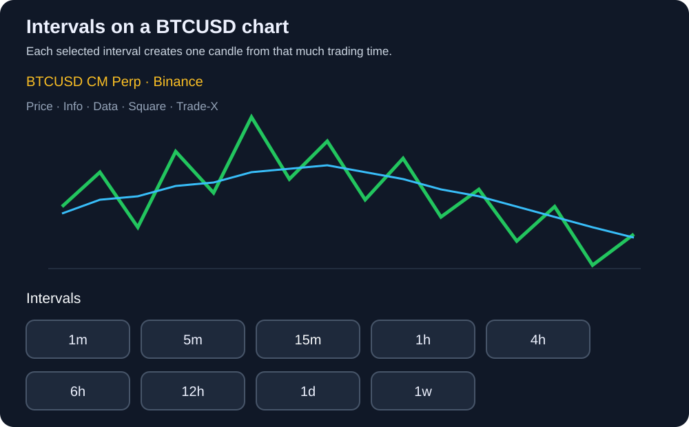
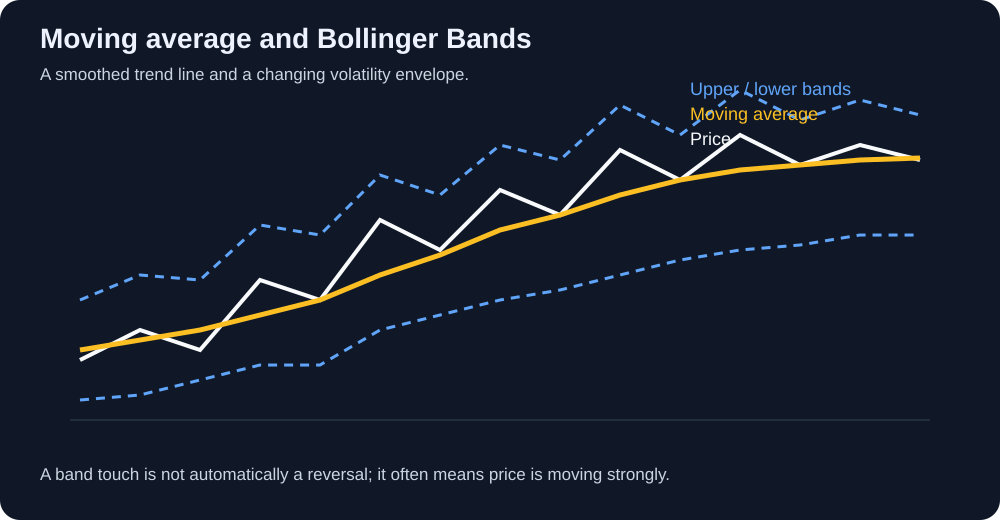
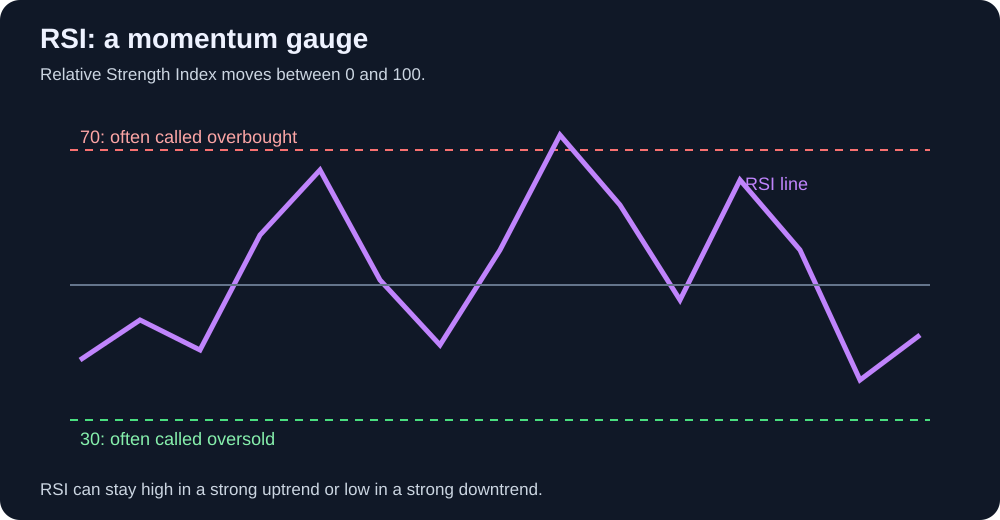

# Chapter 2 — K-line analysis

Chapter 1 introduced crypto as a market of digital assets, contracts, and competing expectations. Before choosing an order, we need a way to describe what the market has actually done. A **K-line is a data summary of market movement**: each candle compresses all matched trades during one interval into an open, high, low, and close. Reading K-lines does not give us secret information or certainty about the next move. It gives us a common language for describing evidence, locating risk, and testing our own ideas.

## 1. K-line foundations

### 1.1 K-line construction and glossary

A candlestick, or K-line, contains four prices. The **open** is the first traded price in the interval; the **close** is the last; the **high** and **low** are the extremes. The thick **body** connects open and close. The thin lines above and below are the **upper wick** and **lower wick** (also called shadows). On most charts a green candle means the close is above the open, while a red candle means the close is below it. The color is a display convention, not a prediction.

A long upper wick shows that buyers reached higher prices but sellers pushed the close back down. A long lower wick shows rejection of lower prices. Neither wick guarantees what happens next. A candle is evidence about one interval, not a complete explanation of the market.

**Small glossary:**

- **K-line / candlestick:** OHLC data for one time interval.
- **Body:** the distance between open and close.
- **Wick / shadow:** the distance from the body to the high or low.
- **Bullish candle:** close above open.
- **Bearish candle:** close below open.
- **Range:** high minus low; a simple measure of that candle’s movement.
- **Close:** the final price only after the interval ends; an open candle can still change.

### 1.2 Market structure: HH, HL, LH, LL and key levels

Structure is the sequence of meaningful swing points, not every tiny tick. An uptrend usually prints a **higher high (HH)** and then a **higher low (HL)**. A downtrend prints a **lower high (LH)** and then a **lower low (LL)**. When neither side is consistently winning, price may be in a range.

Mark **support** as a zone where buyers have previously defended price and **resistance** as a zone where sellers have previously appeared. They are areas, not exact lines. A prior high, low, range edge, or high-volume area can become a key level. Volume helps us ask whether a move attracted participation, but volume alone cannot prove who was buying or selling.

A break of a level matters more when the candle closes beyond it, activity is meaningful, and a later pullback holds the level from the other side. A wick through a level that closes back inside the range is weaker evidence.

### 1.3 Timeframes: 1m, 5m, 1h, and weeks

A chart’s **interval** or **timeframe** tells the exchange how much trading time belongs in one candle. On the Binance selector below, choosing 15m means each K-line summarizes 15 minutes; choosing 1h means each K-line summarizes one hour; choosing 1d means each summarizes one day. The chart is not showing more or less truth when you change the setting—it is grouping the same market activity at a different scale.

A 1-minute candle shows a tiny slice of trading noise. A weekly candle shows a broad shift in direction but hides many short-term reversals. Higher timeframes are not automatically more accurate, and lower timeframes are not automatically more precise; they answer different questions and carry different costs.

A practical workflow is **top down**:

1. Use the weekly or daily chart to understand the broad environment and major levels.
2. Use the 4-hour or 1-hour chart to study the current trend or range and form a setup.
3. Use the 15-minute or 5-minute chart to plan execution if your strategy needs that detail.
4. Use the 1-minute chart only when your tested method genuinely depends on very short-term execution.

There is no universally best timeframe. Match it to the job: weekly and daily charts for broad direction and major levels, 4-hour and 1-hour charts for setups, and 15-minute or 5-minute charts for execution. A lower timeframe gives more apparent precision but also more noise, false signals, fees, and decisions. A higher timeframe gives a slower, wider view and may require a wider stop. Many beginners do better by making the higher timeframe decide the context and using a lower timeframe only to improve the entry.

A lower timeframe gives more entries and more noise, fees, and false signals. A higher timeframe gives fewer decisions and wider stops. Choose the timeframe that fits your holding period, available attention, capital, and trading costs.

### 1.4 Indicators: the colored lines and panels

Indicators transform price, volume, or derivatives data into another view. They are calculators, not independent observers: most use the same candles you already see. Use them to answer a question, not to decorate a chart. The most useful beginner set is explained below.

#### Moving averages (SMA and EMA)

A moving average replaces many closing prices with one smoother reference line. The number of periods tells you how many candles are used. For example, a 20-period average on a 1-hour BTC chart uses the most recent 20 hourly closes, so it summarizes roughly the last 20 hours.

**SMA** means **Simple Moving Average**. It adds the closing prices in the selected period and divides by the number of candles. If the last three BTC closes are 82,000, 83,000, and 84,000 USDT, the 3-period SMA is `(82,000 + 83,000 + 84,000) / 3 = 83,000 USDT`. Every candle has the same weight, so an old close remains just as influential as the newest close until it leaves the window.

**EMA** means **Exponential Moving Average**. It also uses past closing prices, but it gives more weight to recent candles and gradually less weight to older ones. That makes an EMA respond faster when BTC changes direction. The trade-off is that it can react more strongly to short-term noise and produce more false turns. You normally do not calculate an EMA by hand; the charting platform applies the formula using the selected period and the previous EMA value.

Traders use SMA and EMA to smooth noise, describe direction, and identify a moving reference for pullbacks. Price above a rising average can support a bullish context; price below a falling average can support a bearish context. A shorter average reacts faster, while a longer average gives a slower view of the broader trend. Crossovers are delayed signals and can lose repeatedly in a sideways market; they are context, not automatic buy or sell commands.

#### Bollinger Bands

Bollinger Bands place an upper and lower envelope around a moving average. The bands widen when recent movement becomes more volatile and narrow when it becomes quieter. A touch of the upper band does not automatically mean “sell,” and a touch of the lower band does not automatically mean “buy”; strong trends can ride a band. Use the bands to study expansion, contraction, and whether price is unusually far from its recent average.

#### RSI (Relative Strength Index)

RSI is a momentum oscillator scaled from 0 to 100. Many charts mark 70 and 30 as reference levels. A high RSI says recent upward moves have been strong relative to recent downward moves; it does not prove that price must fall. A low RSI says the opposite. RSI is useful for comparing momentum with price, spotting possible divergence, and noticing when a move is extended. In a strong trend, RSI can remain high or low for a long time.

#### MACD (Moving Average Convergence Divergence)

MACD compares a faster moving average with a slower one. The **MACD line**, **signal line**, and **histogram** show whether recent momentum is strengthening or weakening relative to that baseline. A line crossing can be a clue that momentum changed; a histogram growing can show increasing separation. MACD is trend-following and lagging, so crossings arrive late and can whipsaw when BTC moves sideways. Use it with structure rather than as a stand-alone buy or sell command.

#### ATR (Average True Range)

ATR estimates typical price movement over a chosen number of candles. It does not say whether price will rise or fall. A higher ATR means larger normal swings; traders can use it to avoid placing a stop inside ordinary noise and to reduce position size when volatility is high. ATR is especially useful for risk planning, not direction prediction.

#### Volume and volume profile

Volume bars show how much was traded during each candle on that venue. Rising volume can make a breakout more meaningful, while weak volume can warn that a move has little participation. **Volume profile** reorganizes volume by price, showing where trading concentrated. Both are clues, not proof: exchange volume is fragmented, and volume cannot identify every buyer’s intention.

#### VWAP (Volume-Weighted Average Price)

VWAP estimates the average traded price weighted by volume over a chosen session or period. It is often used as a reference for whether price is trading above or below the period’s average execution level. VWAP resets according to the chart or tool’s settings, so confirm the session and calculation before comparing it.

#### Derivatives indicators: open interest, funding, and basis

**Open interest** counts outstanding futures positions; it can show whether leverage is entering or leaving, but it does not reveal direction by itself. **Funding rate** is the periodic transfer between eligible perpetual longs and shorts that helps keep the contract near its reference price; a positive rate is not free yield. **Basis** compares a futures price with spot. These indicators are useful when studying perpetuals, but they are exchange-specific and can change quickly.

Use one trend measure, one volatility measure, and volume before adding more. RSI and MACD are both momentum tools, so using both does not automatically give two independent confirmations. A chart full of signals can still be one uncertain market.

Divergence—price making a lower low while an oscillator makes a higher low, for example—can warn that momentum is changing. It is not a guaranteed reversal and can appear repeatedly during a strong trend.

### 1.5 Context before patterns

The same candle pattern means different things in different locations. A long lower wick at established support is different from a long lower wick in the middle of a range. Before naming a pattern, record the trend or range, nearby key levels, volume, volatility, liquidity, and upcoming news. Then write the invalidation level and the condition that would confirm the idea.

### 1.6 Bullish and bearish patterns: when is structure valid?

Bullish structure is more credible when price holds a higher low, breaks a prior high, and keeps that level during a pullback. Bearish structure is more credible when price fails at a lower high, breaks a prior low, and cannot reclaim it. Common chart descriptions—breakouts, double tops or bottoms, flags, triangles, engulfing candles, and inside bars—are useful labels for hypotheses, not laws.

A structure is **established** only after the relevant swing is clear and the market confirms it with a close and follow-through. It is **invalidated** when price breaks the level that made the idea meaningful, such as losing the higher low in an uptrend. Define that level before entering; otherwise the pattern can be endlessly reinterpreted after the fact.

### 1.7 False breaks and traps

A market can briefly move beyond support or resistance and then return. Before calling a breakout real, ask: **Did it close beyond the level? Was volume or participation supportive? Did the next pullback hold?** These checks reduce false confidence, but they do not remove uncertainty. A whale can move price temporarily, and news or a liquidation cascade can invalidate a clean-looking setup.

We will never have every message, order, or piece of private information. The goal is not to pretend we can see the whole market. It is to avoid blindly chasing a candle: wait for a defined condition, size the trade so being wrong is survivable, and accept that some traps will only be visible afterward.

### 1.8 What are we trying to infer?

Learning K-lines is not mainly about gaining the power to predict every next candle. It helps us form testable ideas about trend, range, momentum, liquidity, and invalidation. Those ideas can guide a discretionary plan, become rules for a quantitative tool, or simply tell us when not to trade. The useful output is a decision with a known risk—not a confident story about the future.

## 2. Keep learning and test your own ideas

### 2.1 Tools for viewing K-lines

Binance charts are convenient for checking the instrument you may actually trade: its order book, funding, mark price, and execution controls are nearby. TradingView is useful for cleaner multi-chart layouts, drawing tools, alerts, and comparing markets. Whichever tool you use, check the exchange, symbol, contract type, timezone, and whether the candle is closed. A chart from one venue may differ slightly from another because their trades and liquidity differ.

### 2.2 K-lines or news: which matters more?

Neither wins in every situation. K-lines show the market’s response; news may explain why the response is happening or change the range of possible outcomes. A headline can already be priced in, and a technically clean setup can fail when an unexpected announcement changes liquidity. Use news to understand catalysts and risks, and use the chart to see whether traders actually accepted or rejected the information.

### 2.3 Make a hypothesis, then check what happened

Hide the future on a historical chart. Describe the current structure, mark the important level, and write what you think may happen next, including the condition that would prove you wrong. Then reveal the following candles and record the result without changing the original rule. Repeat this across many examples. This turns chart reading from a feeling into a reviewable learning process.

## 3. Books and further study

- **Technical Analysis of the Financial Markets — John J. Murphy:** a broad reference for charting, indicators, and market structure.
- **Trading in the Zone — Mark Douglas:** useful for uncertainty, discipline, and emotional control.
- **Japanese Candlestick Charting Techniques — Steve Nison:** a detailed introduction to candlestick terminology and patterns; test every pattern rather than treating it as certain.
- **The Bitcoin Standard — Saifedean Ammous:** Bitcoin’s monetary thesis; read it as one viewpoint and compare it with other sources.
- **Systematic Trading — Robert Carver:** position sizing, risk, and systematic decision-making.

Books provide vocabulary and examples. Your own annotated charts, trade journal, and tested rules provide evidence.
