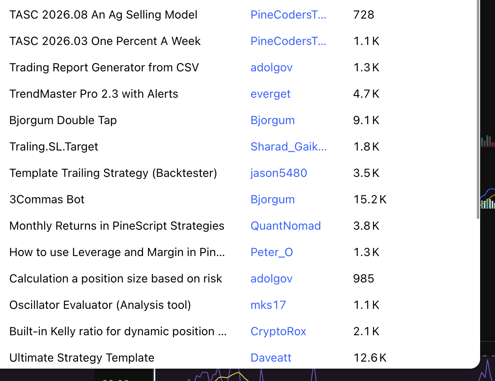

# Chapter 4 — Choose your trading style and learn from strategies

Chapter 3 showed how to turn a chart observation into a trade plan with entry, stop, target, and position size. Before applying that plan, you need to decide what kind of trader you want to be: someone who watches every 15-minute candle, someone who checks the chart once a day, or someone who holds through months of volatility.

This chapter explains the three main trading styles, how to choose one that fits your life, and how to learn from other traders' strategies on TradingView without copying them blindly.

---

## 1. Trading styles: intraday, swing, and position

### 1.1 Intraday trading (scalping and day trading)

**What it is:**

Intraday trading means opening and closing positions within the same day, often within minutes or hours. Scalpers may hold for seconds to minutes; day traders may hold for hours but rarely overnight. The goal is to capture small, frequent moves rather than waiting for large trends.

**Typical timeframes:** 1-minute, 5-minute, 15-minute, 1-hour charts

**What you need:**
- Time to watch the chart during active market hours
- Fast reaction to price changes, news, and order-flow shifts
- Comfort with high trade frequency and frequent small losses
- Understanding of bid-ask spread, slippage, and maker/taker fees

**Profit source:**
- Small price swings during volatility
- Funding-rate windows (for perpetual futures)
- Liquidity provision in range-bound markets
- Breakout momentum that fades quickly

**Costs and risks:**
- **Trading fees accumulate quickly.** A 0.05% taker fee on each side = 0.1% round-trip. If you make 10 trades per day, that is 1% daily in fees alone.
- **Slippage** is more visible on short timeframes because you often use market orders.
- **Emotional fatigue:** watching every candle for hours can lead to overtrading, revenge trades, and decision fatigue.
- **False signals:** lower timeframes contain more noise. A 15-minute breakout may reverse within the next 15 minutes.

**Who should consider it:**
- You have several hours per day to dedicate to active trading
- You can make fast decisions without freezing or second-guessing
- You have tested your strategy thoroughly and know your edge is real after fees
- You are comfortable with a high win rate but small individual profits

**Who should avoid it:**
- You have a full-time job or other commitments
- You find it stressful to make quick decisions under pressure
- You have not yet built a consistently profitable strategy on higher timeframes

### 1.2 Swing trading

**What it is:**

Swing trading captures multi-day moves within a larger trend or range. You hold positions for several days to a few weeks, checking the chart once or twice per day rather than watching every candle. The goal is to enter near support or after a pullback and exit near resistance or when the trend weakens.

**Typical timeframes:** 4-hour, daily charts (with occasional 1-hour checks for entry refinement)

**What you need:**
- Ability to check charts once or twice per day (morning and evening)
- Patience to let trades develop over days
- Comfortable holding through overnight gaps and weekend volatility
- Clear rules for stops and position sizing that allow for wider price swings

**Profit source:**
- Riding 5-15% moves in BTC or larger moves in altcoins
- Entering after pullbacks in a confirmed trend
- Swing highs and lows respected by other participants
- Multi-day momentum after breakouts or news events

**Costs and risks:**
- **Funding fees (for perpetual futures):** if you hold a perp position for 7 days, you pay or receive funding 21 times (every 8 hours). A 0.01% funding rate × 21 = 0.21% total cost or profit.
- **Gap risk:** weekends and major news can cause price to jump, invalidating your stop or triggering it at a worse price.
- **Larger stop distance:** you need wider stops to survive normal noise, which means smaller position sizes for the same risk.
- **Patience required:** a swing trade may take 5-10 days to reach target, during which you do nothing. Beginners often exit too early out of boredom or fear.

**Who should consider it:**
- You have a job or other daytime responsibilities
- You can wait days for a trade to develop without checking constantly
- You have tested a strategy that works on 4-hour or daily charts
- You want to capture trend moves without the stress of intraday volatility

**Who should avoid it:**
- You cannot resist checking your phone every hour
- You panic when a position moves 3% against you overnight
- You prefer instant feedback and cannot wait days for results

**Recommendation for beginners:**

Swing trading is usually the best starting point. It gives you time to think, reduces the impact of fees, and filters out much of the intraday noise. A daily-chart setup that has clear support, resistance, and trend context is easier to trust than a 15-minute pattern that may reverse in the next bar.

### 1.3 Position trading and long-term holding

**What it is:**

Position trading means holding for weeks to months, based on fundamental analysis, long-term trends, or macro cycles. "HODLing" is an extreme version: buying and holding for years, riding through entire bull and bear cycles. The goal is to capture large, sustained moves rather than trading short-term swings.

**Typical timeframes:** weekly and monthly charts, plus fundamental research (on-chain metrics, adoption data, supply schedules, macro environment)

**What you need:**
- Strong conviction in the long-term value or trend
- Ability to ignore 20-40% drawdowns without panic-selling
- Willingness to hold through boring consolidation periods
- Understanding of on-chain data, tokenomics, and macro cycles

**Profit source:**
- Multi-month or multi-year bull runs (e.g., BTC $10k → $60k)
- Compounding during accumulation phases
- Avoiding the whipsaw and fees of frequent trading
- Structural supply changes (halvings, token unlocks, ETF inflows)

**Costs and risks:**
- **Opportunity cost:** your capital is locked while other trades may offer better short-term returns.
- **Drawdowns:** BTC has historically experienced 50-80% corrections. Can you hold through a 60% drop?
- **Regime change:** a macro shift (rising rates, regulation, competing technology) can invalidate a multi-year thesis.
- **Exit discipline:** long-term holders often fail to take profit near cycle tops because "this time is different."

**Who should consider it:**
- You believe in the long-term adoption of crypto
- You have capital you do not need for 1-3 years
- You can psychologically handle seeing your portfolio drop 50% and not sell
- You want exposure without the time commitment of active trading

**Who should avoid it:**
- You need liquidity and cannot lock up capital for months
- You panic-sell during corrections
- You do not understand the fundamental reasons for holding

### 1.4 How to choose your style

Your trading style should match your available time, personality, and capital, not your wish to get rich quickly.

**Ask yourself:**

1. **How much time can I realistically dedicate to trading?**
   - Less than 1 hour per day → swing or position trading
   - 2-4 hours during market hours → swing or selective intraday
   - 6+ hours per day → intraday is possible, but still risky for beginners

2. **How do I handle uncertainty and waiting?**
   - Anxious, need constant feedback → intraday (but high risk of overtrading)
   - Patient, can wait days → swing
   - Very patient, can wait months → position

3. **What is my account size?**
   - Small ($500-$5,000) → swing trading compounds faster than position trading; intraday fees will hurt
   - Medium ($5,000-$50,000) → any style works if properly risk-managed
   - Large ($50,000+) → position trading has lower market impact; intraday may move thin markets against you

4. **Have I tested a profitable strategy on any timeframe?**
   - No → start with swing trading on daily charts; it has the best signal-to-noise ratio for learning
   - Yes, on higher timeframes → continue refining that
   - Yes, on lower timeframes → be honest about whether your edge survives fees and slippage

**Recommended learning path:**

1. Start with **daily-chart swing trading**
2. Build a written playbook and test it in Demo Trading for 20+ trades
3. Once consistently profitable (positive expectancy after fees), consider either:
   - Moving to 4-hour charts if you want slightly more frequency
   - Moving to weekly charts if you want less screen time
   - Staying on daily charts indefinitely (many professionals do this)

Do not attempt intraday trading until you have proven you can make money on daily charts. Intraday is not "easier" or "faster"—it is harder and more expensive.

---

## 2. How to find and evaluate strategies on TradingView

TradingView has a large community library of scripts: indicators, strategies, and tools written in Pine Script. These can be a valuable learning resource if used correctly. The goal is not to copy someone's script and expect it to print money. The goal is to see how experienced traders structure their logic, then adapt useful ideas into your own system.

### 2.1 Accessing the strategy library

1. Open TradingView (free account is enough for browsing)
2. Click the **Indicators** button at the top of a chart
3. Go to the **Community Scripts** tab
4. Filter by:
   - **Strategies** (not just indicators)
   - Most popular, most used, or recently updated
   - Keywords like "trend following," "mean reversion," "risk management"

*Figure 1 — TradingView community scripts library showing popular strategies and tools. Notice the variety: trend-following systems, backtesting templates, position-size calculators, and automation tools.*

The screenshot shows several types of scripts:

- **Trend-following strategies:** TrendMaster Pro, Bjorgum Double Tap
- **Backtesting templates:** Template Trailing Strategy, Monthly Returns calculator
- **Risk management tools:** Position size calculator, Kelly ratio calculator
- **Automation tools:** 3Commas Bot (for exchange integration)
- **Reporting tools:** Trading Report Generator, Oscillator Evaluator

Not all scripts are strategies. Some are utilities (e.g., "Calculation a position size based on risk"). Learn to distinguish between a complete strategy (with entry and exit rules) and a helper tool.

### 2.2 What makes a strategy worth studying?

Before spending time on a script, check these qualities:

**1. Is the code open-source?**

If the script is **protected** or **invite-only**, you cannot read the logic. You are trusting a black box. Open-source scripts let you see every line of Pine code, understand the entry and exit conditions, and learn how the author structured their thinking.

**How to check:** click the script name → look for a "Source Code" or "View Code" button. If it says "Protected" or asks you to subscribe, skip it for learning purposes.

**2. Does it have realistic backtest results?**

Look at the Strategy Tester panel (bottom of TradingView chart when a strategy is applied):

- **Net Profit:** total return, but meaningless without context
- **Max Drawdown:** the largest peak-to-trough loss. If this is 70%, the strategy is a roller coaster.
- **Percent Profitable (Win Rate):** should make sense with the profit factor. A 90% win rate with 1:1 risk-reward is suspicious (likely overfit).
- **Profit Factor:** gross profit ÷ gross loss. Anything above 1.5 is decent; above 2.0 is strong; above 3.0 may be overfit.
- **Sharpe Ratio / Sortino Ratio:** risk-adjusted return. Higher is better. Below 1.0 is weak.

**Red flags:**
- 500% return with 80% max drawdown → you would have panicked and quit halfway
- 95% win rate with tiny profit factor → probably averaging down or not counting all losses
- Perfect equity curve with no losing streaks → overfit or using future data

**3. Does the strategy logic make sense?**

Can you explain the strategy in one sentence?

- Good: "Buy when price closes above the 50-day EMA with rising volume, exit when it closes below the 20-day EMA or hits a 2% stop."
- Bad: "Buy when 7 indicators align, including custom oscillator v3, Fibonacci retracement level 4, and moon phase."

If the author cannot explain it clearly, or if the script uses 15+ indicators, it is probably curve-fit to past data.

**4. Are trading costs included?**

Check the strategy settings:

- **Commission:** should be set to at least 0.05% per side (0.1% round-trip) for spot, or 0.02%/0.05% for futures maker/taker
- **Slippage:** should be enabled, at least 1-2 ticks
- **If these are set to zero, the backtest results are fake.** Real trading has costs.

**How to check:** when viewing a strategy on your chart, open **Strategy Properties** → **Properties** tab → look for Commission and Slippage settings.

### 2.3 How to "digest and absorb" a strategy

Do not copy-paste and run it live. Instead, follow this learning process:

**Step 1: Read the source code**

Open the Pine Script editor and read every line. Identify:

- **Entry condition:** what triggers `strategy.entry()`?
- **Exit condition:** where is the stop-loss? Take-profit? Trailing stop?
- **Position sizing:** is it fixed (e.g., 1 BTC) or dynamic (e.g., risk 2% per trade)?
- **Filters:** are there trend filters, volatility filters, time-of-day filters?

You will learn more from reading 5 scripts deeply than from running 50 scripts blindly.

**Step 2: Change parameters and observe sensitivity**

A robust strategy should work across a reasonable parameter range. Try this:

- Change the moving average period from 20 to 30. Does profit drop to zero?
- Change the stop-loss from 2% to 3%. Does the strategy flip from profitable to unprofitable?
- Change the timeframe from 4-hour to daily. Does it still make sense?

**If small parameter changes destroy the strategy, it is overfit.** A real edge should be somewhat stable across reasonable variations.

**Step 3: Test on different assets and time periods**

Does the strategy work on:
- BTC, ETH, and a major altcoin?
- 2023 data and 2024 data separately?
- Bull markets and bear markets?

If it only works on one coin during one specific period, it is curve-fit to that historical data. Real strategies should have some generalization.

**Step 4: Paper trade it in real-time**

Apply the strategy to a live chart and **manually record every signal** it generates for 2-4 weeks. Compare:

- Does it generate the same signals in real-time as in backtest?
- Are there repainting issues? (indicator changes its past values as new bars arrive)
- Do the fills happen at realistic prices?

Many strategies look great in backtest but fail in real-time because they use future information inadvertently (called "lookahead bias").

**Step 5: Extract core principles, adapt to your system**

Do not copy the entire strategy. Instead, ask:

- What is the one useful idea here?
- Example: "This strategy uses ATR for dynamic stop-loss distance. I can apply that concept to my own trend-following system."
- Example: "This script filters out trades when daily volume is below average. That is a simple but effective way to avoid low-conviction setups."

Build your own strategy by combining principles you understand, not by pasting someone else's code.

### 2.4 Common strategy types in the TradingView library

Based on the screenshot, here are typical categories:

**Trend-following (e.g., TrendMaster Pro, Bjorgum Double Tap)**

- Enter when price confirms a trend (e.g., higher highs/lows, moving average crossover)
- Exit with trailing stop or opposite signal
- Works well in sustained bull/bear moves; loses during choppy ranges

**Mean-reversion**

- Enter when price is "oversold" (RSI < 30, Bollinger Band touch)
- Exit when price returns to average
- Works in ranging markets; dangerous in strong trends

**Breakout strategies**

- Enter when price breaks above resistance or below support with volume confirmation
- Fails often (false breakouts), but big wins when it catches a real move

**Risk management tools (Position size calculator, Kelly ratio)**

- Not strategies, but utilities to calculate how much to risk per trade
- Extremely valuable: most beginners lose because of poor position sizing, not bad signals

**Backtesting templates**

- Pre-built structures you can modify with your own entry/exit logic
- Good for learning Pine Script syntax

### 2.5 Mistakes to avoid

**Mistake 1: Copying a strategy and going live immediately**

Even if a strategy has a great backtest, you do not know if it is overfit until you test it out-of-sample. Always paper trade first.

**Mistake 2: Running 10 strategies at once**

You cannot tell which one is profitable and which is losing. Confusion kills capital. Test one strategy at a time.

**Mistake 3: Abandoning a strategy after one losing week**

All strategies have drawdowns. The question is: "Did the market regime change, or is this normal variance?" If your swing strategy loses during a choppy week, that is expected. Do not immediately switch to a different strategy.

**Mistake 4: Ignoring market regime**

Trend strategies fail in ranges. Mean-reversion strategies fail in trends. No strategy works in all conditions. Part of your job is to recognize the current market type and either pause trading or switch to an appropriate approach.

**Mistake 5: Trusting black-box "signals" services**

If someone sells you signals without explaining the logic, you cannot verify, improve, or adapt it. You are renting their edge (if it exists), not building your own.

---

## 3. Building your own strategy checklist

After studying others' strategies and choosing your trading style, you should be able to write down your own system. Use this checklist:

### 3.1 Core questions

1. **What is my trading style?**
   - Intraday / Swing / Position

2. **What timeframe am I trading?**
   - Primary: (e.g., 4-hour or daily)
   - Confirmation: (e.g., weekly for trend context)

3. **What is my entry condition in one sentence?**
   - Example: "Enter long when price closes above a higher low, the 25 EMA is rising, and volume is above 20-day average."

4. **What is my stop-loss rule?**
   - Fixed percentage (e.g., 2% below entry)
   - Structure-based (below the higher low)
   - ATR-based (1.5× ATR below entry)

5. **What is my take-profit rule?**
   - Fixed target (e.g., 1:2 risk-reward)
   - Trailing stop (e.g., move stop to breakeven after 3% gain, trail by 1 ATR)
   - Opposite signal (e.g., exit when trend breaks)

6. **How do I size my position?**
   - Risk a fixed percentage per trade (e.g., 1-2% of account)
   - Calculate: Position size = (Account × Risk%) / (Entry price − Stop price)

7. **What market conditions make me pause?**
   - Funding rate > 0.05% for 3 consecutive periods (overheated)
   - BTC daily ATR < historical average (low volatility, range-bound)
   - Major news event within 4 hours

8. **How do I know my strategy stopped working?**
   - 5 consecutive losses following the rules → review if market regime changed
   - Drawdown exceeds 10% → pause and analyze
   - Win rate or profit factor drops significantly below backtest → possible overfitting

### 3.2 Validation process

Before risking real money:

1. **Backtest** on TradingView or a spreadsheet (at least 30 trades, including fees)
2. **Paper trade** for 2-4 weeks in real-time
3. **Review**: are results consistent with backtest? Any surprises?
4. **Start small**: use 10-25% of intended position size for the first 10 live trades
5. **Scale up** only after proving consistency

---

## Summary

- **Choose a trading style** that fits your time, personality, and capital. Swing trading is the best starting point for most beginners.
- **Study TradingView strategies** to learn structure and principles, not to copy blindly. Open-source, well-documented, and cost-aware strategies are worth your time.
- **Build your own system** by extracting useful ideas and testing them thoroughly. Write down your rules and follow them.
- **Expect losses and drawdowns**—they are part of trading. The goal is positive expectancy over many trades, not perfection on every trade.

Next, Chapter 5 will guide you through choosing which market, product, and timeframe to apply your strategy to. You now know your style; Chapter 5 will help you pick your battlefield.
