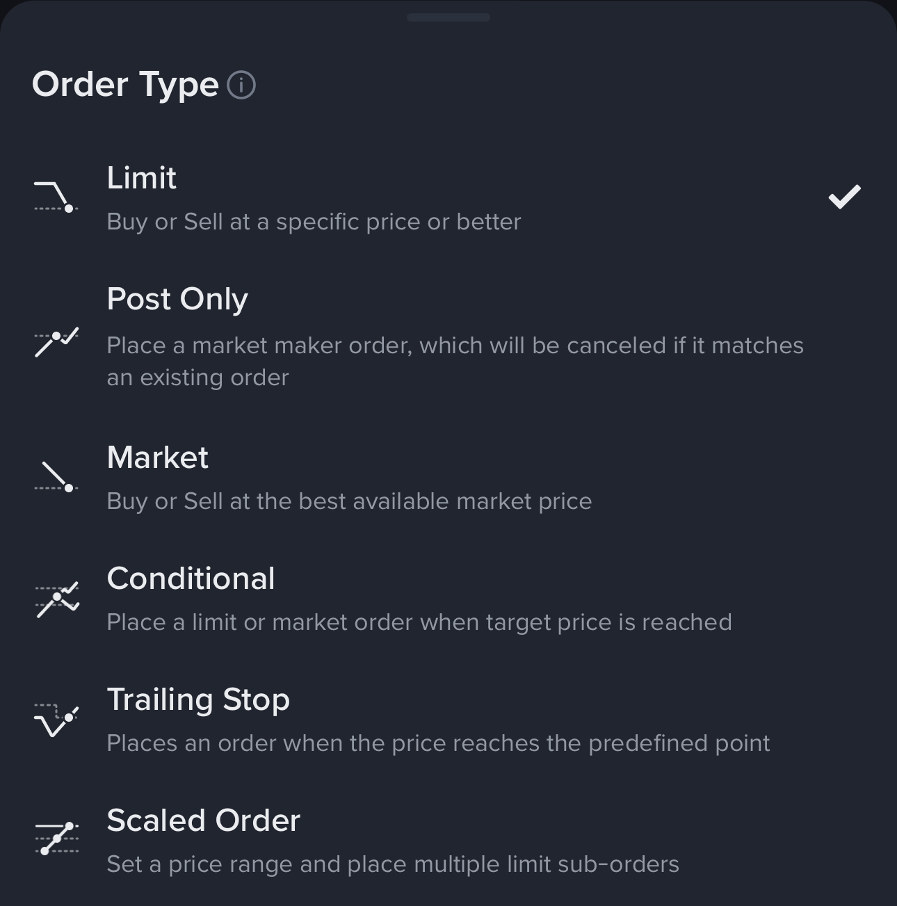

# Chapter 6 — Execution basics

Chapter 5 explained how to choose a market, product, and timeframe. Chapter 3 showed how to plan a trade with entry, stop, target, and position size. This chapter connects planning to action: how to place an order, what each order type does, and how to check whether your execution matched your expectations.

**Before you place an order, understand this:**

The price shown on your chart is a reference, not a promise. Your order is matched against the current bid and ask on the order book. The actual fill price depends on what liquidity is available when your order arrives. A chart showing 83,000 does not guarantee that you can buy or sell at exactly 83,000.

---

## 1. The order book: bids, asks, and spread

When you open an order screen, you see two lists:

- **Bids (buy orders):** traders waiting to buy, listed from highest to lowest price
- **Asks (sell orders):** traders waiting to sell, listed from lowest to highest price

The **best bid** is the highest price someone is willing to pay right now. The **best ask** is the lowest price someone is willing to sell right now. The gap between them is called the **spread**.

**Example:**

```
Best ask: 83,002 USDT (someone wants to sell at this price)
Best bid: 83,000 USDT (someone wants to buy at this price)
Spread: 2 USDT
```

If you place a **market buy order**, you pay the best ask (83,002). If you place a **market sell order**, you receive the best bid (83,000). The spread is an immediate cost before you even consider trading fees.

A narrow spread (1-5 USDT on BTC/USDT) usually means the market is liquid. A wide spread (50+ USDT) means liquidity is thin, and your execution cost will be higher.

---

## 2. Order types: what each one does

Chapter 1 introduced order types in the context of Binance's interface. This section explains how to choose the right one for your situation.



*Figure 1 — Binance order-type menu. The interface lists Limit, Post Only, Market, Conditional, Trailing Stop, and Scaled Order options.*

### 2.1 Market order: execute immediately

**What it does:** Buys or sells at the best available prices right now, consuming liquidity from the order book until your order is filled.

**When to use:**
- You need to exit a position urgently (e.g., stop-loss triggered, news just hit)
- You are entering a breakout and waiting for a limit order would cause you to miss the move
- The spread is tight and you accept the small cost for certainty of execution

**Costs:**
- You pay the **taker fee** (typically 0.05-0.10%)
- You may experience **slippage**: if the order book is thin, your average fill price can be worse than the displayed price
- Example: BTC shows 83,000, but your 10 BTC market buy fills at an average of 83,050 because you consumed several ask layers

**Mistakes to avoid:**
- Using market orders during low liquidity (weekends, thin altcoins) → severe slippage
- Using market orders when the spread is wide → you pay a large immediate cost
- Panic market-selling during a crash → your sell order fills at the worst available bids

### 2.2 Limit order: control your price

**What it does:** You specify the maximum price you will pay (for a buy) or the minimum price you will accept (for a sell). The order rests on the book until someone matches it, or until you cancel it.

**When to use:**
- You want to enter at a specific support level and are willing to wait
- You want to sell at a specific resistance level and are patient
- The market is ranging and you have time to wait for your price

**Costs:**
- If your order rests on the book, you pay the **maker fee** (typically 0.02-0.10%, often lower than taker)
- If your limit order crosses the spread and fills immediately (e.g., you set a buy limit above the current ask), you pay the **taker fee**

**Trade-off:**
- You control price, but you sacrifice execution certainty. If the market never reaches your price, you miss the trade.

**Example:**

BTC is at 83,300. You place a buy limit at 83,000. Two outcomes:

1. Price dips to 83,000 → your order fills, you got your preferred entry
2. Price goes straight to 84,500 → your order never fills, you missed the move

**Mistakes to avoid:**
- Setting a limit too far from current price (e.g., BTC at 83,000, you set a buy limit at 80,000) → you will likely miss the trade
- Forgetting to cancel old limit orders → they may fill days later when you no longer want the position

### 2.3 Post-only order: guarantee maker status

**What it does:** A limit order that will only rest on the book as a maker. If it would fill immediately (cross the spread), the exchange cancels or rejects it instead.

**When to use:**
- You want to ensure you pay the maker fee, not the taker fee
- You are providing liquidity intentionally (e.g., market-making strategy)

**Trade-off:**
- You get the lower maker fee, but you give up execution certainty. If the market moves against you before your order fills, you miss the trade.

**Example:**

BTC best ask is 83,300. You place a post-only buy at 83,310. The exchange rejects it because it would cross the spread. You must adjust to 83,299 or lower to have it rest as a maker bid.

**When beginners should use it:** Rarely. Post-only is an advanced tool. Start with regular limit orders.

### 2.4 Stop-loss order (conditional order)

**What it does:** Triggers an order when price reaches your specified stop level. It becomes a market order (stop-market) or a limit order (stop-limit) after triggering.

**When to use:**
- To protect a position with an automatic exit if the trade goes against you
- To enter a breakout only after price confirms the move

**Two types:**

1. **Stop-market:** triggers → sends market order → fills immediately at best available price
   - **Pro:** guaranteed to execute (if liquidity exists)
   - **Con:** may fill at a worse price than your stop, especially during fast moves

2. **Stop-limit:** triggers → sends limit order at your specified price
   - **Pro:** you control maximum slippage
   - **Con:** if the market gaps through your limit, the order may not fill at all

**Example:**

You are long BTC at 83,500. You set a stop-market at 82,900. Price drops fast to 82,800. Your stop triggers at 82,900, sends a market sell, and fills at 82,750 (slippage of 150 USDT). You are out, but at a worse price than you planned.

**Mistakes to avoid:**
- Setting stops exactly at obvious round numbers (83,000, 82,000) → these are where many other stops sit, causing cascading liquidations and poor fills
- Using stop-limit during high volatility → your limit order may never fill, leaving you unprotected
- Not accounting for slippage when calculating position size → you risk more than intended

### 2.5 Trailing stop: follow the price

**What it does:** A stop order that moves with the market in your favor. If you are long, the stop rises as price rises. If price reverses by your specified callback percentage or amount, the order triggers.

**When to use:**
- You want to let profits run while protecting against reversals
- You have no specific target and want the market to decide when to exit

**Example:**

You buy BTC at 83,000 and set a trailing stop with a 3% callback. Price rises to 86,000. Your stop now sits at 83,420 (3% below 86,000). If price falls to 83,420, your trailing stop triggers and exits.

**Mistakes to avoid:**
- Setting the callback too tight → normal noise triggers the stop
- Setting the callback too wide → you give back too much profit before exiting
- Using trailing stops in choppy, range-bound markets → you get stopped out repeatedly

### 2.6 Summary: which order type to choose

| Situation | Recommended order type | Why |
|-----------|----------------------|-----|
| Need to exit NOW | Market order | Speed > price control |
| Patient entry at support | Limit order | Price control > urgency |
| Want maker fee | Post-only limit | Fee optimization |
| Protect position from loss | Stop-market | Execution certainty |
| Protect position, avoid slippage | Stop-limit | Price control (but may not fill) |
| Let profits run | Trailing stop | Automates profit protection |

**For beginners:** master **limit orders** for entries and **stop-market orders** for protection first. Add trailing stops and post-only later after you are comfortable with the basics.

---

## 3. How to place an order: step-by-step

This section uses Binance as an example, but the principles apply to any exchange.

### 3.1 Before opening the order screen

1. **Write down your plan:** entry price, stop, target, position size, reason for trade
2. **Check the order book:** is the spread tight? Is there enough depth near your entry price?
3. **Check recent volume:** is this a normal session, or is liquidity thin?
4. **Confirm the product:** are you trading Spot BTC/USDT, or BTCUSDT Perp, or something else?

### 3.2 Placing a spot buy order (example: BTC/USDT)

1. Open Binance app or web
2. Navigate to **Spot** trading
3. Select **BTC/USDT** pair
4. Choose **Buy** tab
5. Select order type: **Limit** (for most planned entries)
6. Enter:
   - **Price:** your planned entry (e.g., 82,800 USDT)
   - **Amount:** your position size in BTC (e.g., 0.01 BTC)
   - Or use the **Total** field to specify how much USDT to spend (e.g., 828 USDT)
7. Review:
   - Est. fee
   - Est. total cost
   - Does this match your written plan?
8. Click **Buy BTC**
9. Order is now live on the order book. Check **Open Orders** to confirm.

### 3.3 Setting a stop-loss after entry (Spot example)

Spot does not have a built-in stop-loss during order entry (unlike futures). You must set it separately:

1. Go to **Open Orders** or **Trade** tab
2. Click **Stop-Limit** (some exchanges call this OCO: One-Cancels-Other)
3. Enter:
   - **Stop price:** the trigger level (e.g., 81,900 USDT)
   - **Limit price:** the price you will accept after trigger (e.g., 81,850 USDT, slightly below stop to ensure fill)
   - **Amount:** the BTC quantity to sell (match your position size)
4. Submit
5. Your stop is now live. If price falls to 81,900, it will trigger a limit sell at 81,850.

**Warning:** Stop-limit on Spot can fail to fill during fast moves. For critical protection, consider using a stop-market (if available) or monitor manually.

### 3.4 Placing a futures long order with stop and target

Futures products (USDⓈ-M, COIN-M) allow you to set stop-loss and take-profit in the same order ticket:

1. Navigate to **Futures** → **USDⓈ-M** → **BTCUSDT Perpetual**
2. Select **Leverage** (e.g., 5x) and **Margin Mode** (Isolated or Cross)
3. Choose **Buy/Long** tab
4. Select order type: **Limit**
5. Enter:
   - **Price:** entry price (e.g., 83,000 USDT)
   - **Amount:** position size in BTC (e.g., 0.05 BTC)
   - **TP/SL (Take Profit / Stop Loss):** toggle ON
     - **Take Profit:** target price (e.g., 85,000 USDT)
     - **Stop Loss:** invalidation price (e.g., 81,800 USDT)
6. Review:
   - Est. margin required
   - Est. liquidation price
   - Est. PNL at TP and SL
7. Does this match your risk plan? (Is your loss ≤ 2% of account?)
8. Click **Buy/Long**
9. Order is live. Once filled, your TP and SL are automatically placed.

**Critical check:** verify that your liquidation price is **below your stop-loss**. If your stop is at 81,800 but liquidation is at 82,000, you will be liquidated before your stop can protect you. Reduce leverage or increase margin.

---

## 4. After the order: check your execution

Many beginners place an order and never check what actually happened. This is a mistake. Execution quality is part of your trading edge.

### 4.1 Compare expected vs. actual

**For a limit order that filled:**

- Planned entry: 82,800 USDT
- Actual fill: 82,798 USDT (slightly better)
- Fee: 8.28 USDT (0.1% on 8,280 USDT notional)
- **Result:** As expected. Record this.

**For a market order:**

- Chart showed: 83,300 USDT
- Actual fill: 83,340 USDT (40 USDT slippage)
- Fee: 41.67 USDT (0.05% taker fee on 83,340 notional)
- **Result:** Slippage was 0.048%, acceptable for urgent exit. Record this.

**For a market order during low liquidity:**

- Chart showed: 83,300 USDT
- Actual fill: 83,580 USDT (280 USDT slippage = 0.34%)
- Fee: 41.79 USDT
- **Result:** Slippage was significant. Was the order too large for the order book? Should you have used a limit order? Adjust for next time.

### 4.2 Record in your trading journal

After every trade, log:

- Entry price (planned vs. actual)
- Stop price (planned vs. actual trigger/fill)
- Target price (planned vs. actual)
- Fees paid
- Slippage experienced
- Did execution match expectations?

Over 20+ trades, patterns emerge:

- Are you consistently getting worse fills than planned? → Your limit orders may be too aggressive, or the market is too thin.
- Are your stops consistently filling 1-2% worse than trigger? → You need to account for slippage in position sizing.
- Are you often missing trades because your limit is too far? → Adjust your entry strategy.

---

## 5. Common execution mistakes and how to avoid them

### 5.1 Chasing the market

**Mistake:** BTC is at 83,000. You want to buy but hesitate. Price rises to 83,500. You panic and market-buy. Price immediately reverses to 83,200.

**Why it happened:** FOMO (fear of missing out). You abandoned your plan because of emotion.

**Solution:** If your planned entry was 83,000 and you missed it, do not chase. Wait for the next setup. Missing a trade is cheaper than entering at the wrong price.

### 5.2 Moving your stop-loss

**Mistake:** You set a stop at 82,000. Price approaches 82,100. You move your stop down to 81,500 "to give it more room." Price then falls to 81,200 and you lose twice as much as planned.

**Why it happened:** You could not accept being wrong. Moving the stop is the same as not having a stop.

**Solution:** Set your stop once, based on structure or volatility, and do not touch it unless the trade thesis improves (e.g., price hits breakeven and you move stop to breakeven as planned).

### 5.3 Wrong position size calculation

**Mistake:** You calculate position size in your head. Account is $10,000, risk 2% = $200. Entry 83,000, stop 82,000, difference 1,000. You think "I can buy 0.2 BTC." You buy 0.2 BTC. Price hits stop. You lose $200... wait, you actually lost $200 on 0.2 BTC, which is correct. But you forgot about fees and slippage, so your real loss was $220.

**Why it happened:** You did not account for execution costs.

**Solution:** Use this formula:

```
Position size = (Account × Risk%) / (Entry − Stop + Estimated Slippage + Fees)
```

For futures, also factor in funding fees if holding multi-day.

### 5.4 Forgetting to set a stop

**Mistake:** You enter a trade, planning to "watch it closely" and exit manually if it goes wrong. You get distracted, check your phone 2 hours later, and the position is down 8%.

**Why it happened:** You trusted yourself to be disciplined without a hard rule.

**Solution:** Set your stop immediately after entry. Do not rely on willpower.

### 5.5 Using the wrong product

**Mistake:** You want to buy BTC, so you search "BTC" on Binance. You click the first result: **BTCUSD CM Perp** (COIN-M futures). You place a buy order. Later you realize you opened a leveraged coin-margined perpetual, not spot BTC.

**Why it happened:** You did not verify the product before placing the order.

**Solution:** Always check:
- Is this **Spot**, **USDⓈ-M Futures**, or **COIN-M Futures**?
- What is the exact symbol? (BTCUSDT Spot vs. BTCUSDT Perp vs. BTCUSD CM Perp)
- Is there leverage? Liquidation price? Funding rate?

---

## 6. When to check liquidity before placing an order

For most beginners trading BTC/USDT Spot or BTCUSDT Perp with small size ($100-$1,000 notional), liquidity is not a major concern during active hours. But you should still glance at these before entering:

### 6.1 Spread

- BTC/USDT spread should be $1-10 during normal hours
- If spread is $50+, liquidity is thin → consider waiting or using a limit order

### 6.2 Order book depth

- Open the **Depth** view or **Order Book**
- Check: are there bids and asks stacked within 0.1% of current price?
- If the book looks empty (only a few orders per level), your market order may cause significant slippage

### 6.3 Recent Trades volume

- Is recent volume consistent with the pair's normal activity?
- A sudden drop in volume (e.g., holiday weekend, 3 AM UTC) means thinner liquidity

### 6.4 When liquidity matters most

- **Altcoins:** smaller tokens have wider spreads and less depth
- **Weekends:** BTC liquidity drops on Saturday/Sunday
- **Major news events:** order books can thin out or widen dramatically before/after announcements
- **Liquidation cascades:** during sharp moves, liquidity disappears and slippage spikes

**Rule of thumb:** If you are trading a small position on BTC during active hours, liquidity is fine. If you are trading a large position, an altcoin, or during off-hours, check the order book first.

For a deeper understanding of liquidity, slippage, and market impact, see [Advanced — Liquidity, slippage, and market impact](advanced/liquidity-slippage-market-impact.md).

---

## 7. Paper trading first

Before risking real money, practice execution in Binance Demo Trading or another simulated environment. Focus on:

1. Can you navigate the order screen without mistakes?
2. Can you calculate position size correctly?
3. Can you place a limit entry, set a stop, and let it run without interfering?
4. Can you record the results in a journal?

Do this for at least 20 trades. If you cannot execute your plan consistently in Demo, you will not do it with real money.

---

## Summary

- The chart price is a reference. Your fill depends on the order book.
- **Limit orders** control price but may not fill. **Market orders** guarantee execution but may have slippage.
- **Stop-loss orders** protect your position, but account for slippage when sizing.
- Always check: spread, order book depth, and your planned vs. actual execution.
- Avoid common mistakes: chasing, moving stops, wrong position size, forgetting stops, wrong product.
- **Paper trade first.** Execution is a skill that requires practice.

Next, Chapter 7 introduces trading automation for those ready to move beyond manual execution. Automation does not make a bad strategy good—it only makes a tested strategy more consistent.
